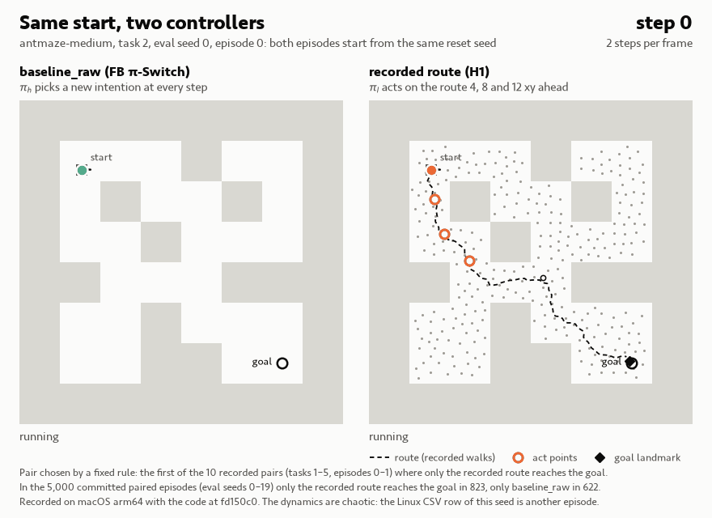
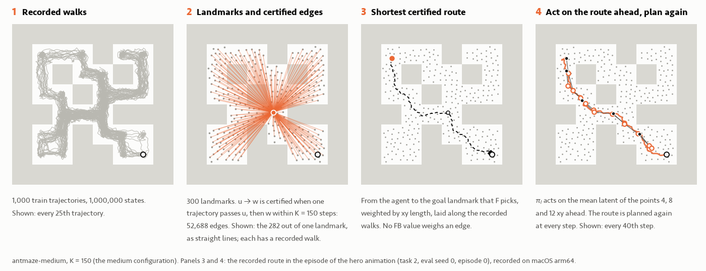
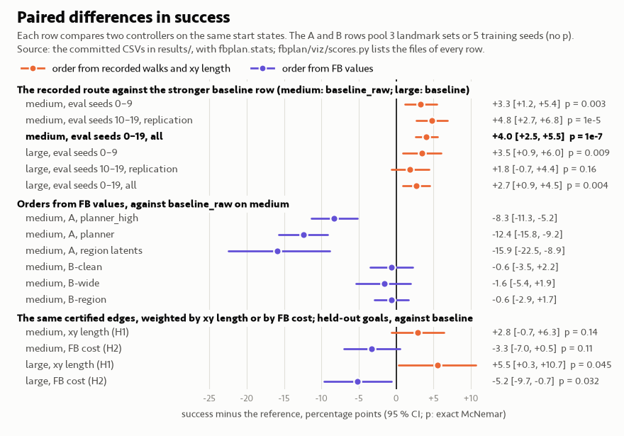

# fbplan

Planning over sequences of intentions with frozen forward-backward (FB) representations,
on OGBench AntMaze. Baseline: FB π-Switch ([paper](https://arxiv.org/abs/2605.13207),
code in `third_party/ssm`).

**Results and analysis: [`REPORT.md`](REPORT.md).** Every number in it names the committed file
that it comes from. Design and notation: `docs/design.md`; theory and the exact tabular study:
`docs/theory.md`; the plan of approach B: `docs/plans/approach-b.md`.

## The recorded route in pictures

<picture>
  <source media="(prefers-color-scheme: dark)" srcset="docs/figures/viz/hero_dark.gif">
  
</picture>

The same start state (antmaze-medium, task 2, eval seed 0, episode 0), two controllers:
`baseline_raw` (left) and the recorded route (right, REPORT §8.7). Dashed: the route over recorded
walks; rings: the points 4, 8 and 12 xy ahead that `π_l` acts on. The pair follows a rule fixed
before the recording: the first of 10 recorded pairs (tasks 1–5, episodes 0–1) where only the
recorded route reaches the goal; in 1 of the 10 only `baseline_raw` does. In the 5,000 committed
paired episodes on medium, only the recorded route reaches the goal in 823 and only
`baseline_raw` in 622 (84.1 % against 80.1 %). The episodes are real rollouts of the committed
code on macOS arm64. The dynamics are chaotic, so the Linux CSV rows of these seeds are other
episodes.

<picture>
  <source media="(prefers-color-scheme: dark)" srcset="docs/figures/viz/explainer_dark.png">
  
</picture>

<picture>
  <source media="(prefers-color-scheme: dark)" srcset="docs/figures/viz/scoreboard_dark.png">
  
</picture>

- `docs/figures/viz/recorded_route.html`: an interactive page that needs no network. It replays
  all 10 pairs, shows the route step by step and lists the files of every comparison. GitHub
  shows its source: download the file and open it in a browser.
- `docs/figures/viz/reel.mp4`: the same story as a vertical video (1080 × 1920, H.264, 53 s, no
  sound), with its cover `reel_cover.png`.

Regenerate all of them (about 3 min on a laptop CPU; needs the medium checkpoint and train
split). `render` alone redraws them from the cache `runs/viz/bundle.json`, without new rollouts:

```bash
uv run --group viz python -m fbplan.viz            # record, then render
uv run --group viz python -m fbplan.viz render
```

## Setup

Prerequisites: git and [uv](https://docs.astral.sh/uv/) (official installer:
`curl -LsSf https://astral.sh/uv/install.sh | sh`, or `pipx install uv`). uv installs Python 3.11
itself. The locked environment (`uv.lock`) needs uv: `pyproject.toml` pins only OGBench,
Gymnasium and MuJoCo 3.1.6, so a plain `pip install` resolves the other packages to other
versions, for example a newer `tfp-nightly` build than the locked `0.26.0.dev20261028`.

```bash
git clone --recurse-submodules https://github.com/scaevolabars/fbplan.git && cd fbplan
uv sync
uv run python -m fbplan.frozen --trained --datasets antmaze-medium-navigate-v0
uv run pytest
```

`fbplan.frozen` downloads the 4 provided frozen checkpoints (73 MB). With `--trained` it also
gets the trained checkpoints that this repository publishes as release assets: the retrained
baseline `π_h` of medium and large, seeds 0–4 (release `baselines-v1`, 32 MB). Both kinds are
checked against pinned sha256 sums. The other trained families (approach B, and the `π_h`
trained with sharper AWR weights or the log-ratio advantage) are not published: the `train`
stage below makes them on a GPU, and without them their evaluations stop with "not published".
With `--datasets` it also gets the medium train and val splits (270 MB) into `~/.ogbench/data`;
other datasets download on first use. Tests never download data: a test that needs a
checkpoint or a dataset skips, and `pytest` lists the skipped tests. CI
(`.github/workflows/ci.yml`) runs `ruff check` and `pytest` on CPU, without data.

On a Linux machine with CUDA, `uv sync` installs the CUDA build of JAX. uv is the primary way to
set up; `devbox.json` only provides the pinned uv (`devbox run setup`, `devbox run test`).

## Methods

| `--method` | What it is | Code |
|---|---|---|
| `baseline` | FB π-Switch: the provided `π_h` picks an intention every step, `π_l` acts | `fbplan/controllers/baseline.py` |
| `baseline_raw` | the same with the raw upstream `z_r` (exact upstream path) | `fbplan/controllers/baseline.py` |
| `nonhier` | `π_l` with the task latent `z_r` only | `fbplan/controllers/baseline.py` |
| `oracle` | privileged: waypoints on the true maze shortest path (diagnostic) | `fbplan/controllers/oracle.py` |
| `planner`, `planner_high` | approach A: landmark graph, SMDP value iteration over FB options | `fbplan/controllers/planner.py` |
| `fbplan.controllers.planner:make_recorded_route` | recorded-route tracking (hypothesis H1): a route over landmark edges that recorded train trajectories certify, to the goal landmark that FB picks; `π_h` or `π_l` acts on the route ahead. The one method that passes the gain rule (REPORT §8.7) | `fbplan/controllers/planner.py`, `fbplan/graph.py` |
| `baseline --checkpoint retrained:<seed>` | the baseline with a `π_h` that we retrained (training variance); `retrained:awr2x:<seed>`: AWR weights twice as sharp; `retrained:logratio:<seed>`: the log-ratio advantage (T2) | `fbplan/train_high.py`, `fbplan/learned/logratio.py` |
| `baseline --checkpoint b:<variant>:<seed>` | approach B: learned multi-switch value `V_H` and a new `π_h`; variants `clean`, `wide`, `region`, `clean-awr2x` | `fbplan/learned/` |
| `ensemble --opt family=<family> seeds=5` | test-time ensemble of the `π_h` of 5 training seeds (T1); `z_input=raw`: through the raw `z_r` path (T4) | `fbplan/controllers/baseline.py` |
| `fbplan.controllers.trap_aware:make_trap_aware` | teleport: a penalty on the trap latent while the time left fits a walk (T3) | `fbplan/controllers/trap_aware.py` |
| `oracle_teleport` | privileged: walks the true route around the teleporters (diagnostic) | `fbplan/controllers/oracle_teleport.py` |

A controller is an alias of `fbplan/controllers/__init__.py` or a `module:attribute` path. The
`method` column of a CSV holds the controller's name: `graph_planner` (`planner`),
`graph_plus_high` (`planner_high`), `baseline_ensemble` and `baseline_ensemble_raw`
(`ensemble`), `recorded_route`, `trap_aware`; the other names equal the alias. Controller options are `--opt key=value`; a dotted key sets a nested field.

## Reproduce

`scripts/reproduce.sh` runs the pipeline from the repository root and prints each command
that it runs:

```bash
scripts/reproduce.sh               # checkpoints, eval, tables, figures (CPU)
scripts/reproduce.sh --smoke       # every stage, training included, CPU only (about 10 min)
scripts/reproduce.sh eval tables   # selected stages
scripts/reproduce.sh train         # train every π_h family (Linux with a GPU)
```

| Stage | What it does | Output |
|---|---|---|
| `checkpoints` | downloads the frozen and the published trained checkpoints (sha256-checked) and the medium datasets | `~/.cache/fbplan/`, `~/.ogbench/data/` |
| `train` | trains the retrained baseline `π_h`, its 2× and log-ratio variants, and approach B (3 critics, 4 policies), 5 seeds each; not in the default | `~/.cache/fbplan/`, `runs/train_*/` |
| `eval` | every run in the table at the top of the script (231 CSVs), the failure classes and the parity check against upstream's evaluation loop | `results/` |
| `tables` | every table of the report: success with 95 % CIs, paired tests against both baseline rows; the held-out seed selection and the Mac-against-Linux check | `runs/reproduce/tables.md`, `results/` |
| `figures` | success per task and time to goal; FB calibration, wormholes and held-out goals; the tabular study and the time limit; the critic check of approach B | `docs/figures/`, `results/figures/` |

**Protocol.** One eval seed is 5 tasks × 50 episodes. The reset seed of an episode comes from
(eval seed, task, episode), so all methods see the same start states and the tables compare
them paired. The main runs use eval seeds 0–4. The hypothesis tests and their reference rows use
eval seeds 0–9, and the recorded route is replicated on the new eval seeds 10–19. A
choice between configs or training seeds uses only the 10 held-out goals of a maze (task ids
101–110, `--heldout`, eval seeds 0–2, 20 episodes per goal), never the eval tasks. A gain
counts only if it holds, paired, against both baseline rows (`baseline` and `baseline_raw`).

| Below `results/` | Contents |
|---|---|
| `<maze>/` | eval seeds 0–4: the reference rows, approach A, one CSV per training seed of each `π_h` family, failure classes in `failures/` |
| `<maze>/planner_ablations/` | approach A ablations (landmark set 0); the recorded route: `h1_heldout/` (selection), `h1_eval/` (eval seeds 0–9) |
| `medium/heldout/`, `medium/heldout_ensemble/`, `teleport/heldout/` | runs on the held-out goals: seed selection, ensembles, the T3 grid |
| `<maze>_10seeds/` | eval seeds 0–9; its eval seeds 0–4 are the records of `<maze>/` |
| `medium_seeds10-19/`, `large_seeds10-19/` | the replication of the recorded route on new eval seeds |
| `macos/` | the same runs on macOS (cross-platform check) |
| `calibration/`, `heldout_goals/`, `figures/`, `platform_check.csv` | FB distance calibration, the held-out goal files, their figures, Mac against Linux |

**Platform.** The canonical evaluation CSVs come from one Linux x86_64 machine (AMD EPYC 7662,
128 cores) on CPU (`JAX_PLATFORMS=cpu`; the script sets it for every stage except training).
`results/macos/` holds 36 of the runs on macOS arm64 as a cross-platform check. The MuJoCo
dynamics of the ant are chaotic: a tiny floating-point difference changes an episode. So on
another platform, or on a GPU (which multiplies float32 in TF32), the same seeds give different
episodes, but success rates that agree within noise: in `results/platform_check.csv` the Linux
minus Mac differences lie between −6.0 and +5.2 pp, and 35 of 36 CIs contain 0. The calibration
and held-out goal files do not depend on MuJoCo.

**Code versions.** The approach A CSVs (`results/*/planner*/l<k>.csv` and the approach A
ablations in `planner_ablations/` except `high_act_ahead8`) come from code commit 84a8127,
those in `results/macos/` from 0de6e0a. Later commits added and removed fields of the planner
config, which the `config_hash` column hashes. A rerun at a later commit repeats the records
with a different `config_hash`. So a replay of a committed approach A run
(`analysis/failures.py` checks the hash), or a table that pools committed and new runs by
`config_hash`, needs commit 84a8127. All other CSVs keep their hash at the current commit.

**Time.** The eval stage writes the committed CSVs in `results/`, so `git diff` shows any
change (the `wall_time_s` column always changes). An evaluation on the 5 eval tasks runs one
process per eval seed and joins them in seed order, as the canonical runs did, and an eval seed
that an earlier run of the same command made is reused. The stage holds about 251k episodes.
The canonical runs took about 9 h on the 128-core machine. On a 12-core laptop with 4 workers,
one 5-seed run on medium (1,250 episodes) takes about 11 min, so the whole stage takes days:
run single lines of the table instead (below). `--workers N` sets the number of evaluation
processes (default 4).

**Smoke check.** `--smoke` uses medium only, the first run of each folder below
`results/medium/`, eval seed 0, two episodes per task, 10 training steps and ensembles of one
member. It writes to `runs/smoke/` and leaves `results/`, `docs/figures/` and the trained models
unchanged; it took 8 min with the datasets already downloaded. After each evaluation it prints
how many episodes equal the committed run and whether the config hashes are equal. On a Mac
the reference is the run in `results/macos/` where one exists, else the Linux run, which gives
other episodes. It also rebuilds the held-out seed selection and the platform check from the
committed CSVs and compares them byte for byte. With devbox: `devbox run reproduce` and
`devbox run smoke`.

**Single runs.** One evaluation (all methods use this loop); `--out runs/...` keeps the
committed CSVs unchanged. The recorded route on medium, eval seeds 0–9:

```bash
uv run python -m fbplan.evaluate --env antmaze-medium-navigate-v0 \
    --method fbplan.controllers.planner:make_recorded_route --opt executor=window max_steps=150 \
    --seeds 0 1 2 3 4 5 6 7 8 9 --episodes 50 --workers 4 --out runs/recorded_route_medium.csv
```

**Training.** The `train` stage has the command of every family. It runs the 5 seeds of a
family in parallel on one GPU (`scripts/gpu/run_seeds.sh`): about 55 min per family of 500k
steps on an RTX 3090. One seed:

```bash
uv run python -m fbplan.train_high --env antmaze-medium-navigate-v0 --seed 0     # baseline π_h
uv run python -m fbplan.learned.train_b value  --env antmaze-medium-navigate-v0 --seed 0
uv run python -m fbplan.learned.train_b policy --env antmaze-medium-navigate-v0 --seed 0 \
    --variant clean                                                              # approach B
```

Checkpoints go to `~/.cache/fbplan/`, training curves to `runs/`. `scripts/gpu/vast.sh` rents a
vast.ai instance, pushes the committed code, runs the jobs and pulls the results (see the
comments at its top). It does not stop the instance by itself: run `vast.sh destroy <id>` when
the jobs end, or the instance bills while idle.

## Layout

| Path | Contents |
|---|---|
| `REPORT.md` | the report: results, analysis, limitations |
| `fbplan/contracts.py` | shared interfaces: `FBModel`, `Controller`, `TaskSpec`, `EpisodeRecord` |
| `fbplan/frozen.py` | frozen and trained checkpoints, environments, datasets |
| `fbplan/controllers/` | complete agents for the eval loop: baselines and ensembles, oracles, approach A, the recorded route, trap-aware control |
| `fbplan/option_model.py`, `graph.py`, `landmarks.py` | FB option model, landmark graphs (approach A, the recorded route) |
| `fbplan/learned/` | approach B, the log-ratio advantage, the device-side batch sampler |
| `fbplan/train_high.py` | retraining of the baseline `π_h` |
| `fbplan/viz/` | the figures, the interactive page and the video of the recorded route (`python -m fbplan.viz`), in `docs/figures/viz/` |
| `fbplan/evaluate.py`, `stats.py`, `maze.py` | evaluation loop, bootstrap CIs and paired tests, maze geometry |
| `fbplan/tabular/` | exact tabular mazes, fake FB model, theory checks |
| `analysis/` | tables, figures, diagnostics |
| `results/` | the CSVs and figures that the report uses (table above) |
| `docs/` | design, theory, the plan of approach B, the figures of the report |
| `scripts/` | `reproduce.sh` (the pipeline), `gpu/` (training on a rented GPU) |
| `third_party/ssm` | upstream FB π-Switch code (git submodule, unchanged) |
