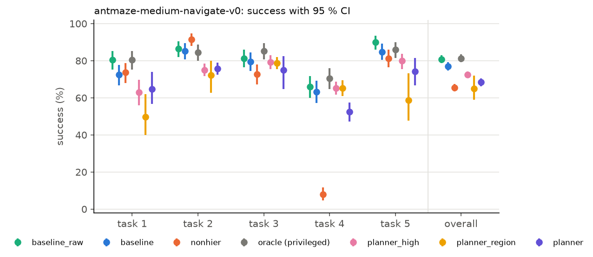
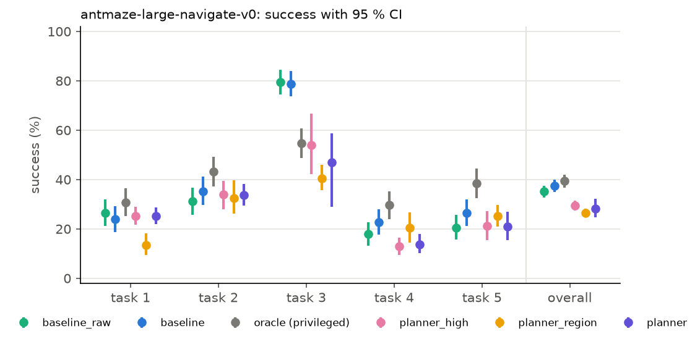
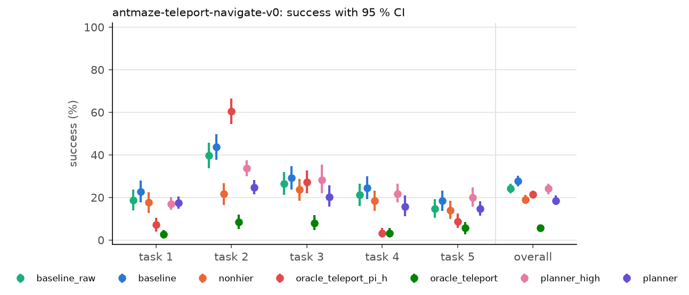
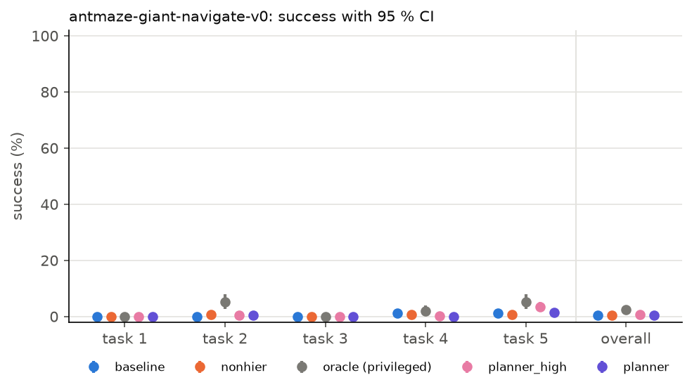
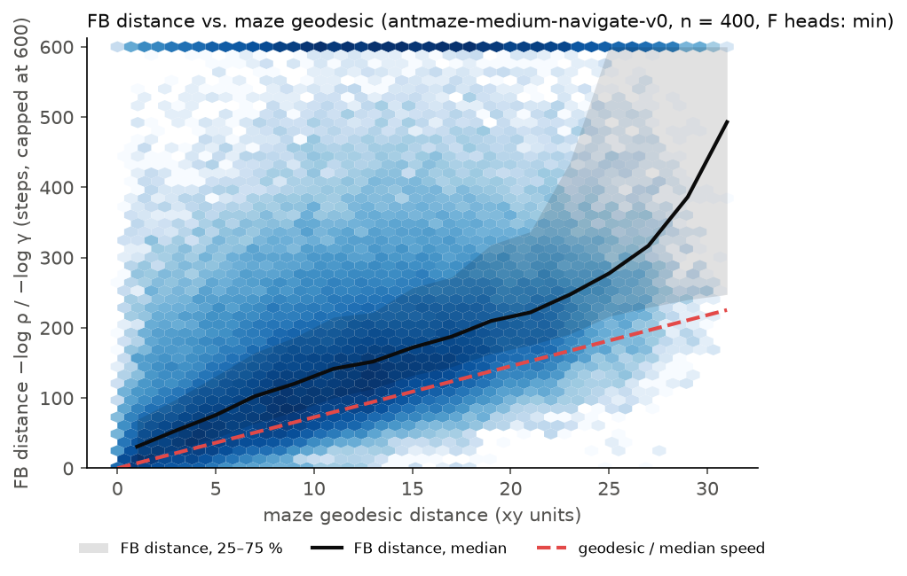
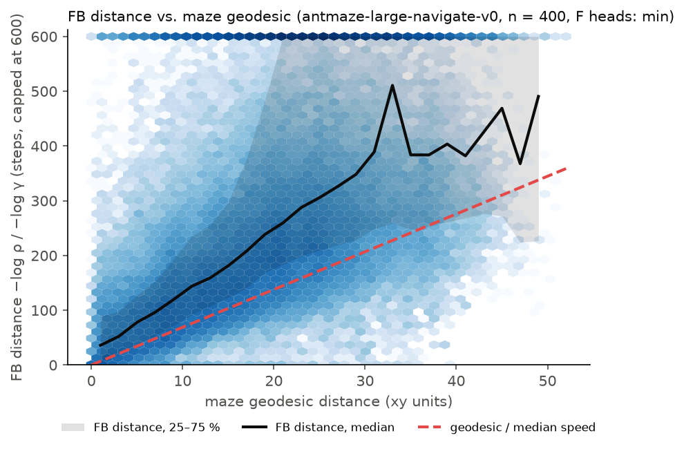
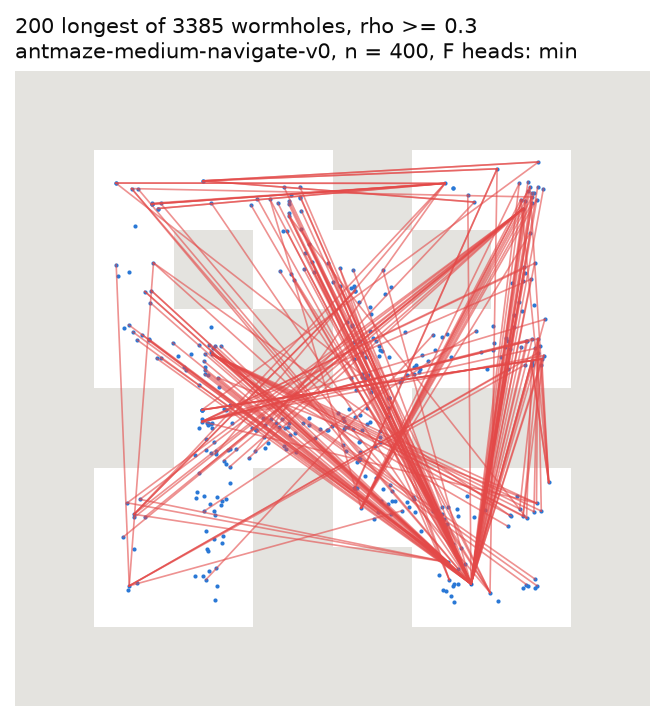
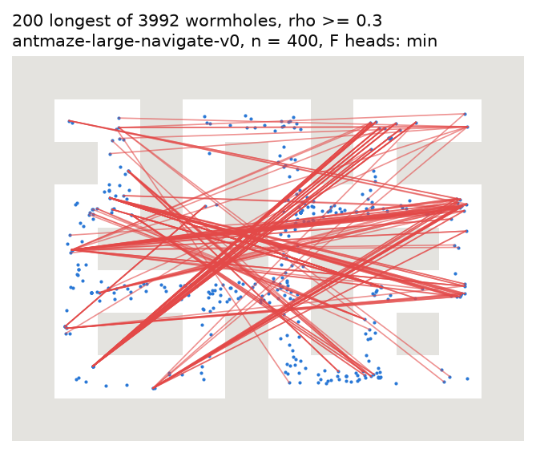
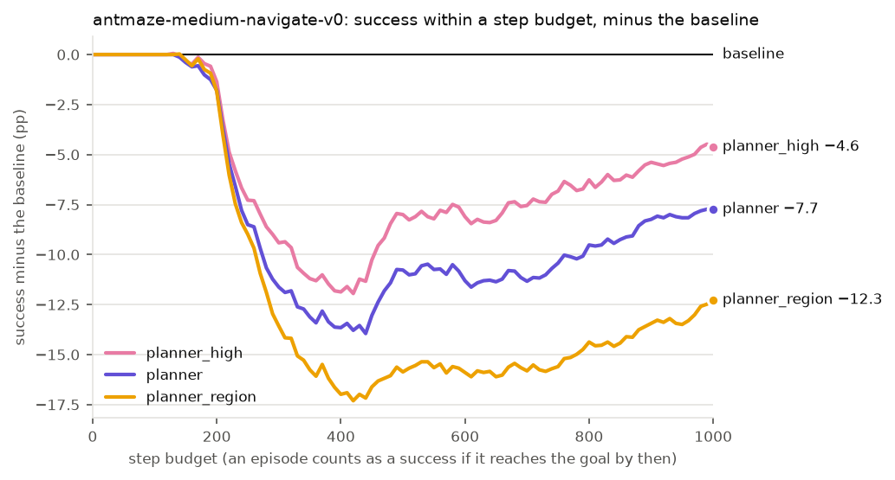
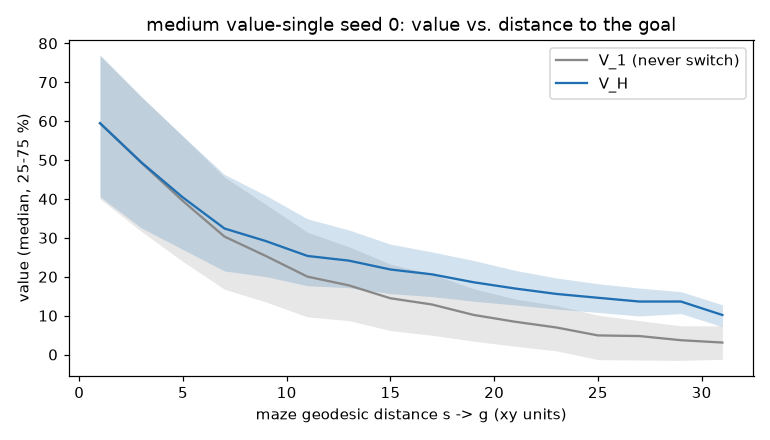

# Report: planning over sequences of intentions with frozen FB representations

Status: draft. Pending: wave 3, the replication of the recorded-route controller on new large
eval seeds and its test on medium (§8.7), and two small items (route plots of A, §8.4; a
wall-crossing count, §8.3). §1 does not yet include T2, the 10-seed rows of the 2× experiment, the
10-seed rows on large and the recorded-route controller (§7.2, §8.5–§8.7); it is rewritten after
wave 3.
Notation: `docs/design.md` §3; names that differ between the report and the code: Appendix. Every
number names the committed file it comes from. pp = percentage points; CI = 95 % confidence
interval.

**Platform.** All evaluation numbers come from one Linux (x86_64) machine, in `results/<env>/`.
The same commands on macOS (arm64) are a reproducibility check, in `results/macos/` (§6).

## 1. Summary

- **Question.** Can a high level that values a sequence of intentions beat the one-switch `π_h`
  of FB π-Switch, with `F`, `B` and `π_l` frozen and offline data only?
- **Theory (§3).** A chain of switches has an exact value: the chain formula and a graph Bellman
  equation, checked to 1e-8 on exact tabular mazes. Chaining can help only where `π_l(·∣s,z_r)`
  or the one-switch value fails at long range. With FB errors it needs `R̂ = 0` for goal reaching
  and guards. Then a guarded chain reaches 0.46 on far pairs of a tabular maze, against 0.26 for
  an idealised `π_h` (§3.1).
- **Central finding: with this frozen `π_l`, no high-level choice of intentions has measurable
  room on medium and large, and on giant and teleport the time limit and `π_l` bound every
  method.** Two baseline rows differ by maze, and the higher one is the bar (§6). Against it, the
  privileged oracle, which routes on the true maze map, gains +1.0 pp [−1.2, +3.2] on medium
  (10 eval seeds) and +1.9 pp [−1.8, +5.6] on large, both not significant (§8.2). On giant it gains +2.0 pp
  [+1.1, +3.0], but every method stays below 3 %. On teleport, a teleport-aware oracle that walks
  the true route scores below the baseline, and the trap caps an agent that maximises a discounted
  value exactly at about 50 % (§7.3).
- **Approach A (graph planner, §4) is below the stronger baseline on every maze:** medium −8.3 to
  −15.9 pp, large −8.0 to −11.1 pp, teleport −3.6 to −9.1 pp (pooled paired differences of the
  A variants, all significant; §7). Its loss is mostly time: A reaches the goal later, and its
  extra failures are episodes still moving at the time limit (§8.4). `R̂ = 0`, the look-ahead and
  the reach radius matter most; no single change of a guard beats the defaults (§4).
- **Approach B (learned multi-switch critic, §5) gives no gain.** With 10 eval seeds, the three B
  families gain +0.5 to +1.5 pp over 5 retrained baselines and score −0.6 to −1.6 pp against
  `baseline_raw`, all not significant (§7.1). In a test fixed in advance, both families were
  retrained with AWR weights twice as sharp, B with one temperature for all seeds: both rise to the
  level of `baseline_raw`, and B is level with the baseline (−0.8 pp [−4.3, +2.5]). So at matched
  sharpness the multi-switch critic adds nothing, and the rise is a `π_h` tuning effect (§8.5).
  One B-clean seed, selected on held-out goals, passes the rule at the edge (+2.2 pp [+0.1, +4.3],
  p = 0.047), but it is one of 10 B tests (Holm-adjusted p 0.47), and at its sharpness the family
  scores −0.6 pp against `baseline_raw`. The learned `V_H` raises long-range values but orders
  states no better than the one-switch value. B's training seeds split, partly by the AWR
  temperature.
- **Hypothesis tests (§8.6), with readings fixed in advance: none gives a gain.** Test-time
  ensembles of 5 `π_h` seeds (T1, T4) are at most +0.5 pp above `baseline_raw` on both input paths.
  The B-region ensemble is ahead of the retrained ensemble in all four ensemble comparisons
  (+0.9 to +4.3 pp, significant in two), but B-region also changes the latent type. A trap penalty
  with a time gate on teleport (T3) loses 9.7 pp: the saved episodes time out. T2 (log-ratio
  advantage) *(pending)*.
- **Evaluation (§6).** 1,250 paired episodes per method and maze; on medium 2,500 for the baseline
  rows, the `π_h` families and the hypothesis tests. With 10 eval seeds the two medium baseline
  rows differ by +2.0 pp (p = 0.07), not by +3.8 pp as with 5. The provided `π_h` behaves as a
  typical seed of 5 retrained ones. Mac and Linux runs agree on success rates within noise.

## 2. Setting

**Task.** OGBench AntMaze navigation: a quadruped ant must reach a goal position in a maze.
The main env is `antmaze-medium-navigate-v0`; large, giant and teleport (stochastic teleporters)
are bonus envs. Each env has 5 evaluation tasks, each a start cell and a goal cell. An episode
lasts at most 1000 steps and succeeds when the ant reaches the goal radius (OGBench's
`info["success"]`).

**Given and frozen.** One FB π-Switch checkpoint per env, training seed 0 (`third_party/ssm`,
arXiv 2605.13207):

| Module | Role | Detail |
|---|---|---|
| `B(s)` | backward representation | `d = 128`; latents are normalized to norm `√d` |
| `F(s,z)` | forward representation | 2 ensemble heads; `F(s,z)ᵀB(s') ≈ M^{π_z}_s(s')` |
| `π_l(a∣s,z)` | low-level policy | acts toward the intention `z` |
| `π_h(z∣s,z_r)` | high-level policy, **the baseline** | picks a new intention at every step |

The discount is γ = 0.99 (giant: 0.995). The task latent `z_r = mean(r·B(s))` over 100k relabeled
validation states is a mean of `B` over the goal ball. Upstream gives this latent to `π_h`
without normalizing it, and a double average in upstream `infer_latent` leaves its norm below
`√d`. Our baseline normalizes it to `√d`, the norm that `π_h` saw in training (§6).

**What the baseline already does.** `π_h` is trained with AWR on the proxy advantage

```
Â(s,w,z) = F(s,z_w)ᵀz + ρ(s,w)·F(w,z)ᵀz − F(s,z)ᵀz,     z_w = B(w)
```

for subgoals `w` on the trajectory of `s` at a geometric offset with mean `1/(1−γ) = 100` steps.
So `π_h` looks **one switch** ahead: "follow `π_{z_w}` until `w`, then follow `π_z` forever".
The proxy drops the term `−ρ(s,w)·F(w,z_w)ᵀz` of the paper's Eq. (5), on purpose (paper Sec. 6).
At test time `π_h` re-selects at every step, so the executed behaviour does chain many switches,
but each choice is valued as if it were the last switch.

**Goal.** A high-level mechanism that values a **sequence** of intentions and beats `π_h` on long
horizons. Constraints: no generative model of states or trajectories; no new environment
interaction for training (offline OGBench data only); `F`, `B` and `π_l` stay frozen.

**Two approaches.**

- **A** (§4), no training: a graph over dataset landmarks whose edges are FB option models; value
  iteration at test time; waypoint execution with `π_l`.
- **B** (§5), offline training: a learned multi-switch value `V_H(s,z)` replaces the one-switch
  value in the AWR advantage of `π_h`; the test-time controller stays the baseline's.

## 3. From one switch to a chain of switches

Derivations, assumptions and the exact checks: `docs/theory.md`. Each property below is checked
to 1e-8 on exact tabular copies of the medium and teleport mazes (`tests/test_tabular_theory.py`).

**Option model.** The option `o_w` is "follow `π_l(·∣s,z_w)` with `z_w = B(w)` fixed until `w` is
hit"; `H` is the hitting time. With `M ≈ FᵀB`:

```
ρ(s,w) = E[γ^H]                  ≈ F(s,z_w)ᵀB(w) / F(w,z_w)ᵀB(w)
R(s,w) = E[Σ_{t<H} γ^t r(s_t)]   ≈ F(s,z_w)ᵀz_r − ρ(s,w)·F(w,z_w)ᵀz_r
```

Both follow from the strong Markov property at `H` (`docs/theory.md` §2). Both are invariant to the
scale of `B(w)`. For `s ≠ w`, `H ≥ 1`, so `ρ(s,w) ≤ γ`.

**One switch** (paper, Theorem 1): `V(s; w → π) = R(s,w) + ρ(s,w)·V^π(w)`.

**A chain.** At `H` the agent is exactly at `w`, so the switch formula applies again at `w`
(Proposition 1, by induction):

```
V(s; w_1,…,w_k → π) = R(s,w_1) + ρ(s,w_1)·V(w_1; w_2,…,w_k → π)
```

**Graph Bellman equation** over a landmark set `L` (Proposition 2), with `V_d(u) = F(u,z_r)ᵀz_r`:

```
V_H(u) = max( V_d(u),  max_{w∈L, w≠u} R(u,w) + ρ(u,w)·V_H(w) )
```

| Property | Consequence for the methods |
|---|---|
| A self-loop (`ρ = 1`, `R = 0`) makes every larger `V_H(u)` a fixed point | exclude `w = u` |
| Without self-loops `ρ ≤ γ`, so the operator is a γ-contraction | clip `ρ̂` to `[0, γ]` for `u ≠ w`; value iteration converges from any start |
| `k` sweeps from `V_d` give the best chain of at most `k` switches | value iteration searches over chains, not over single switches |
| Open-loop chains are optimal among option policies | a route of landmarks is enough |
| If `π_{z_r}` is optimal, `V_H = V*` | **chaining can only help where FB values or `π_l(·∣s,z_r)` are inaccurate** |
| Goal reaching: `R = 0` off the goal | `V_H` is a shortest path with edge cost `−log ρ(u,w)` |
| With exact values, re-planning at every step is never worse than commitment (option interruption, Sutton, Precup and Singh 1999) | commitment is only a defence against noisy values |

**Continuous states.** A single state is hit with probability 0. The option then ends on a ball
around `w`, and the next option starts at the entry point, not at `w`. The chain formula becomes
approximate. Its error grows with the number of hops and with the change of option values inside
the ball (bound in `docs/theory.md` §7). So hops should be few and the reach radius small.

**The dropped term in a chain.** The proxy values the time after `w` twice: in `F(s,z_w)ᵀz` and
again in `ρ·V(w)`. For one switch this is one bias term. In a chain it repeats at every hop, and
two neighbouring landmarks inside a rewarding region form a 2-cycle that the proxy values at
`ρV/(1−ρ)`. On the tabular maze with region rewards and exact FB, the predicted value of the best
chain is wrong by 111.8 with the proxy and by 0.0 with the exact `R`; a single switch with the
proxy is wrong by 10.7 (`docs/figures/theory/study_reward.csv`). So the proxy must not be used in
a graph.

### 3.1 When does chaining help? The tabular study

`fbplan/tabular/` builds a fake FB model on the 104-state medium maze (γ = 0.9) with exact
successor measures and controlled errors: independent noise on `ρ̂` per head, and a controller
`π_l` that is either exact or greedy on the noisy `F(s,z)ᵀz`. The greedy controller is reliable
only at short range, as a learned `π_l` may be. Success means the goal is reached in 100 steps;
all start–goal pairs; 5 noise seeds (`docs/theory.md` §9).

Success on far pairs (11 steps or more), noise std 0.04 on `ρ̂`
(`docs/figures/theory/study_noise.csv`):

| Planner | greedy `π_l` | exact `π_l` |
|---|---|---|
| direct, `π_l(z_r)` | 0.16 | 1.00 |
| idealised one-switch `π_h` | 0.26 | 0.95 |
| single switch, re-planned | 0.24 | 0.91 |
| chained, FB `R̂` | 0.20 | 0.28 |
| chained, `R̂ = 0` | 0.37 | 1.00 |
| chained, `R̂ = 0`, guards (head min, `ρ_min` 0.4, commit) | **0.46** | 1.00 |


Four results set the design of A and B:

1. **Chaining helps when `π_l` fails at long range.** With the greedy controller, the guarded
   chained planner reaches 0.46, against 0.26 for the idealised `π_h` and 0.16 for the direct
   policy. With an exact controller the direct policy is already optimal, and planning on noisy
   values can only lose.
2. **The main failure is a noisy `R̂`, not wormholes.** `R̂` is a difference of two noisy values,
   and for goal reaching the true `R` is about 0. The max over landmarks picks the largest noise
   at every hop. With the exact controller, `R̂ = 0` lifts the chained planner from 0.28 to 1.00.
3. **Guards** (far pairs, noise 0.04, `docs/figures/theory/study_guards.csv`): the min over the 2
   heads helps against independent errors in `R̂` (full `R̂`, exact `π_l`: 0.28 → 0.58).
   Commitment helps in every noisy case (`R̂ = 0`, greedy: 0.37 → 0.50). A hop discount (a factor
   on `ρ̂` per hop) hurts with `R̂ = 0` (0.37 → 0.11–0.13): it pushes the plan to fewer, longer hops
   that the controller cannot complete.
4. **Wormholes come from wall-blind features, not from independent noise.** Independent noise up
   to 0.04 puts no pair above `2γ^d`. A low-rank `B` with a wall-blind (cosine) basis does: 0.41 %
   of pairs at rank 16 and 0.24 % at rank 32 (`docs/figures/theory/study_wormholes.csv`). The two
   heads share such errors, so the head min does not remove them.

**Prediction for AntMaze.** A chained planner can beat `π_h` only if (a) `π_l` or the one-switch
value fails at long range, and (b) FB `ρ̂` is accurate at short range and free of wall-blind
errors. §8 measures both.

## 4. Approach A: landmark graph planner

No training. Code: `fbplan/landmarks.py`, `fbplan/option_model.py`, `fbplan/graph.py`,
`fbplan/controllers/planner.py`.

```
once per env:   training split ─► 300 landmarks ─► edge table ρ̂(u,w) ─► trusted edges
once per task:  z_r ─► V_d(u) = F(u,z_r)ᵀz_r ─► value iteration ─► V_H(u), route from each landmark
during the episode:
                s ─► w* = argmax over trusted edges s→w of ρ̂(s,w)·V_H(w), or the task policy
                commit to w* until reached ─► a = π_l(a | s, B(w*))
```

**Landmarks.** 300 states by farthest-point sampling on xy, from a random pool of 100k training
states. A landmark is a full observation, with the pose and the joint velocities of the ant.
Its latent is `B(w)` of that one state. Option: a region latent, the mean of `B` over the pool
states within 0.5 xy units.

**Edges.** For each landmark pair, `ρ̂(u,w)` per F head, then the min over the 2 heads. Values use
`ρ̂` clipped to `[0, γ]` for `u ≠ w` (contraction, §3). An edge `u → w` is **trusted** when:

- `0.3 ≤ raw ρ̂(u,w) < 1` (at γ = 0.99, `ρ = 0.3` is about 120 steps), and
- the xy distance from `u` to `w` is at most 6 units (1.5 maze cells).

**Values.** Goal reaching uses `R̂ = 0`. Value iteration then solves
`V_H(u) = max(V_d(u), max_w ρ̂(u,w)·V_H(w))` over trusted edges: a shortest path on `−log ρ̂` that
ends with the task policy.

**Execution.** At a re-plan the agent scores the trusted edges from its own state with the same
rules, `Q(s,w) = ρ̂(s,w)·V_H(w)`, and picks `w* = argmax_w Q(s,w)`, or the task policy if
`V_d(s)` is higher. It acts with `π_l(·∣s,B(w*))` and commits to `w*` until it is within 3 xy
units of `w*`, for at most 100 steps. Look-ahead: at each step it moves on to the next stop of the
route when `Q(s,next) ≥ Q(s,w*)` and the edge `s → next` is trusted. Variants: `planner_high`
gives `B(w*)` to `π_h` as its task; `replan_every_step` drops the commitment.

**Each guard and its evidence.**

| Guard | Reason | Evidence |
|---|---|---|
| `R̂ = 0` for goal reaching | `R̂` is a difference of two noisy values, and the max collects its noise | tabular §3.1 (0.28 → 1.00 with exact `π_l`); medium: exact `R̂` −29.3 pp, the paper's proxy −8.2 pp (ablations below) |
| raw `ρ̂ ≥ 1` is untrusted | `ρ ≤ γ < 1` for `u ≠ w` (§3), so `ρ̂ ≥ 1` is an FB error and a free hop | theory; not ablated |
| xy cap of 6 units | wormholes survive any `ρ_min` (§8.3). The maze distance is never shorter than the xy distance, so the cap removes only edges that are long in every metric, and it limits a wormhole hop to 6 units | at `ρ_min` 0.3 it removes 42 % of the wormholes on medium and 64 % on large, all the long ones (§8.3); without it: large −5.1 pp, medium no effect (ablations below) |
| min over the 2 F heads | pessimism against independent errors | tabular §3.1; lowers the AntMaze wormhole count by a fifth to a quarter (§8.3); the mean instead: medium no effect (ablations below) |
| commit until within 3 xy units, with look-ahead | commitment stops dithering between near-equal noisy plans. A rule `ρ̂ ≥ ρ_reached` often does not fire, because FB `ρ̂` near a waypoint stays below about 0.9 | tabular §3.1 (0.37 → 0.50); look-ahead and reach radius matter on medium and large; commitment itself has no effect on medium (ablations below) |
| single-state landmark latents | region latents make `ρ̂` higher and flatter, so it separates near and far landmarks less | 5 eval seeds × 3 landmark sets on medium: region −12.1 pp, single-state −8.6 pp against the baseline (§7.1) |

The xy position is part of the observation, so the cap uses no privileged information. Two FB-only
guards stay as ablations: `two_way`, which uses `min(ρ̂(u,w), ρ̂(w,u))` (maze dynamics are nearly
reversible, FB errors often are not), and a hop discount.

**Ablations on the real model.** One change against the defaults, on landmark set 0, paired with
the default run of the same set on the same 1,250 episodes (`results/<env>/planner_ablations/<name>/l0.csv`
against `results/<env>/planner/l0.csv`; `analysis/tables.py --reference planner/l0`). Differences
in pp with CI:

| Change | medium | large |
|---|---|---|
| defaults (success) | 68.8 % | 32.2 % |
| `R̂` exact instead of 0 | −29.3 [−32.6, −25.9]; task 4 falls to 2.4 % | – |
| `R̂` = the paper's proxy | −8.2 [−11.4, −4.9] | – |
| reach radius 1.5, no look-ahead (the first default) | −17.5 [−21.2, −13.7] | −9.5 [−12.8, −6.2] |
| no look-ahead | −3.4 [−7.0, +0.1] | −10.6 [−13.8, −7.2] |
| no xy cap | +0.7 [−2.7, +4.1] | −5.1 [−8.6, −1.8] |
| mean over the F heads instead of the min | −1.3 [−4.7, +2.2] | – |
| re-plan at every step (no commitment) | +0.9 [−2.7, +4.5] | – |
| route following at a reach (`switch_steps` = ∞) | +1.3 [−2.1, +4.6] | – |
| `two_way` | +3.0 [−0.4, +6.5], p = 0.10 | – |

- **Three guards matter:** `R̂ = 0`, the look-ahead and the reach radius. The exact `R̂` makes
  the planner fail task 4, as the tabular study predicts (§3.1).
- **The xy cap matters on large, not on medium.** This agrees with §8.3: on large the cap
  removes 64 % of the wormholes, on medium 42 %.
- **Four changes have no measurable effect on medium:** the head mean, re-planning at every step,
  route following and `two_way`. So the commitment of the tabular study (0.37 → 0.50) does not
  show on medium, and the head min, which removes few wormholes (§8.3), does not matter either.
- **No change beats the defaults significantly.** Every ablated planner stays significantly below
  both baselines on medium: the best one, `two_way` (71.8 %), scores −5.2 pp [−8.5, −1.8] against
  `baseline` and −9.0 pp [−12.2, −5.8] against `baseline_raw`.

**Tuning.** The guards were chosen on medium, on start states outside the evaluation episodes but
on the same 5 tasks. Large uses the same settings without change.

## 5. Approach B: learned multi-switch value

Code: `fbplan/learned/`. Plan: `docs/plans/approach-b.md`.

**Idea.** The baseline's AWR advantage values a subgoal `w` with a one-switch value: "follow
`π_{z_w}` until `w`, then `π_z` forever". B learns `V_H(s,z)`, the value when the agent may switch
again at `w`, and again after that, and puts it into the same AWR recipe. The actor network, the
data, the spread of the AWR weights and the test-time controller stay as in the baseline. So
"B-clean against the retrained baseline" should measure the effect of the multi-switch value and
nothing else. This held for the network, the data and the optimizer, but not fully for the spread
of the AWR weights (Actor, below; §8.5). B needs no graph and no landmarks at test time, and it is defined for any task latent `z`.

```
offline data ─► (s, w, g, z) batches ─► ρ, R, V_1 from frozen F and B ─► targets y(s,w,z)
stage 1:  V_H(s,z)      ◄── expectile regression on y
stage 2:  π_h(z_w|s,z)  ◄── AWR with weight exp(min(α·[y − V_H(s,z)], 5))
test:     baseline controller: z_w = π_h(s, z_r) at every step, a = π_l(a | s, z_w)
```

**Critic.** Per sample, with the min over the 2 F heads:

```
ρ(s,w)   = min_h F_h(s,z_w)ᵀz_w / F_h(w,z_w)ᵀz_w,     capped at ρ_max = 0.9
V_1(s,z) = min_h F_h(s,z)ᵀz                            value of never switching again
V_H(s,z) = V_1(s,z) + softplus(Δ_θ(s,z))               so V_H ≥ V_1 by construction
y(s,w,z) = R(s,w;z) + ρ(s,w)·[V_1(w,z) + softplus(min_j Δ̄_j(w,z))]
```

`R = 0` for goal latents, as in A, and the exact `R` for Gaussian latents. `Δ_θ` is the upstream
`GCValue` network (3 × 512, LayerNorm, 2 heads), and `Δ̄` is its EMA target (rate 0.005). The loss
is the expectile loss with τ = 0.9 on `y − V_H(s,z)`: an in-sample soft max over the sampled `w`,
as in IQL.

**Sampling** (offline data only). `s` is uniform over the dataset. `w` is on the trajectory of `s`
at a geometric offset with mean 100 steps, as upstream. `g` is a future state of the same
trajectory (70 %) or a random dataset state (30 %). `z` is `B(g)` (50 %) or Gaussian (50 %), as
upstream. All latents are normalized to norm `√d`.

**Actor.** The upstream `GCActor`, trained with AWR toward `normalize(B(w))`, with the advantage
`A = y − V_H(s,z)` and `V_H` frozen. The AWR temperature α makes the spread of `α·A` equal to that
of the upstream run (upstream α = 0.1), so that the weighting is as sharp as in the baseline. Each
seed measured that spread once, on one batch, before training. This calibration turned out to be
noisy: the temperatures of the 5 B-clean seeds range from 0.111 to 0.229 (§8.5).

**Guards against error growth over hops.**

| Guard | Effect |
|---|---|
| `ρ ≤ 0.9` | the hop-level Bellman operator is a 0.9-contraction: a target error ε grows to at most 10ε (a clip at γ would allow 100ε) |
| `w` only from the trajectory of `s` | the data shows every edge `(s,w)`, so no wormhole edge enters the targets |
| samples with raw `ρ̂ ≥ 1` are dropped | as in A: such edges are FB errors |
| min over the F heads, expectile instead of a hard max, clipped double target | pessimism against noise in `ρ̂` and in `V_H` |
| residual form `V_1 + softplus(Δ_θ)` | `V_H` starts at the one-switch value; the gain is learned only where switching helps in the data |

**Variants.** Each changes one thing against the row above it.

| Variant | Subgoal and goal latents | Goals for `π_h` | Measures |
|---|---|---|---|
| retrained baseline | `B(·)` of one state | upstream | reference |
| B-clean | as the baseline | as the baseline | the critic only |
| B-wide | as the baseline | + 30 % random dataset goals | goals across trajectories |
| B-region | mean of `B` over ±5 trajectory steps | as the baseline | the latent type (own `V_H`) |

**Limits by design.** Stitching across trajectories comes only from the generalization of
`V_H(w,z)`, as in IQL and HIQL: no training pair has a `w` from another trajectory. `π_h`
regresses onto `B(w)`, so if good subgoals lie in two directions, the mean lies between them.
A diagnostic controller, B-argmax (A's controller with `V_H` in place of graph value iteration),
would separate the quality of the critic from that of the actor.

**Gate.** B-clean had to gain over the retrained baselines before any further stage. It did not
(§7.1, §8.5), so B stops there: B-argmax, stage B2 (distilling A's routes into `π_h`,
`docs/plans/approach-b.md` §6) and a policy on the expectile 0.7 critic did not run. B-wide and
B-region were trained before the gate; neither gains either (§7.1). One controlled experiment
followed from the seed analysis of §8.5: both families retrained with the AWR weighting twice as
sharp, with the reading fixed before any result (`docs/design.md` §8). At matched sharpness B is
level with the baseline (§8.5, finding 4), so its control (B without the critic) was cancelled.

## 6. Evaluation protocol

**Episodes.** 5 tasks × 50 episodes × 5 eval seeds = 1,250 episodes per method and env. On medium,
the final protocol adds eval seeds 5–9 for both baseline rows, the retrained baselines, the B
families, the oracle and every later candidate: 2,500 episodes per run (`results/medium_10seeds/`;
fixed in `docs/design.md` §8 before those runs). On teleport, both baseline rows and test T3 also
have 10 eval seeds (`results/teleport_10seeds/`); on large, both baseline rows, the oracle and the
recorded-route controller (`results/large_10seeds/`, §7.2). The 95 % CI of one paired difference is about ±3.2 pp with 5
eval seeds and about ±2.2 pp with 10 (§7.1). Episode length 1000, deterministic actions
(temperature 0), success as defined by OGBench at the last step.

**Paired start states.** The reset seed of an episode is
`SeedSequence([eval_seed, task_id, episode])`. OGBench draws the start noise from the global NumPy
RNG, and the goal also depends on the action-space RNG, so the loop seeds all three:
`np.random.seed(s); env.action_space.seed(s); env.reset(seed=s, options={"task_id": t})`.
All methods see the same start and goal states. On one platform an episode replays exactly:
`analysis/failures.py` replays each failure and checks its outcome.

**Methods.**

| Row | What it is |
|---|---|
| baseline | the provided `π_h`, with `z_r` normalized to norm `√d` before `π_h`: the same input path as every other method |
| baseline_raw | the provided `π_h` through upstream `sample_actions`, with the raw `z_r`: a reference row |
| retrained baseline | 5 `π_h` seeds that we trained on the frozen `F`, `B`, `π_l` with the upstream recipe (500k steps), so the CI includes training variance |
| upstream | upstream `evaluate` on the provided checkpoint: raw `z_r` and unseeded resets; used only for the parity check, unpaired |
| non-hier | `π_l(·∣s,z_r)` alone, without a high level |
| oracle (privileged) | `π_l` toward a waypoint 2 cells ahead on the true shortest path, with a region-mean waypoint latent (radius 0.5); a reference, not a bound (§8.2) |
| teleport-aware oracle (privileged, teleport only) | plans on the cell maze with the jumps and walks the shortest route that enters no teleporter; `π_l`, or `π_h` with the waypoint as its task, follows the waypoints (`fbplan/controllers/oracle_teleport.py`) |
| A, B | §4 and §5; approach A over 3 landmark sets (`landmarks.seed` 0, 1, 2), each with all 1,250 episodes |
| recorded route (`recorded_route`) | routes over landmark edges that recorded train trajectories travel; `π_h` acts on the route point 8 xy units ahead as its task (§8.7) |

**Two baseline rows, and the rule for a gain.** `baseline` (normalized `z_r`) is the controlled
reference: it has the same input path as every other method, including B and the retrained
baselines. `baseline_raw` follows upstream. Neither row is the stronger one on every maze
(paired, `analysis/tables.py` on `results/<env>/`):

| Maze | `baseline_raw` − `baseline` | stronger row |
|---|---|---|
| medium, 10 eval seeds | +2.0 [−0.2, +4.2], p = 0.07 | not significant; `baseline_raw` is higher |
| medium, 5 eval seeds | +3.8 [+0.7, +6.8], p = 0.02 | `baseline_raw` |
| large, 10 eval seeds | −2.2 [−4.6, +0.2], p = 0.085 | not significant; `baseline` is higher |
| large, 5 eval seeds | −2.3 [−5.6, +1.0], p = 0.19 | not significant; `baseline` is higher |
| teleport, 10 eval seeds | −2.5 [−4.4, −0.6], p = 0.011 | `baseline` |
| teleport, 5 eval seeds | −3.5 [−6.2, −1.0], p = 0.009 | `baseline` |

On medium the 5-seed gap does not replicate: on eval seeds 5–9 alone it is +0.3 pp [−2.6, +3.4]
(§7.1). Giant has no `baseline_raw` run; its comparisons use `baseline` only. Every other table
shows both rows. A method counts as better than the baseline only if its paired difference is
significant against both rows, so the higher row is the bar.

**Statistics** (`fbplan/stats.py`, `analysis/tables.py`). Overall success is the mean over tasks of
the per-task success, as in OGBench. CIs are percentile intervals from 10,000 bootstrap resamples,
stratified by task. A paired comparison resamples episode pairs within each task and gives an exact
McNemar test on the discordant pairs. The landmark sets of approach A and the retrained baselines
are pooled with a cluster bootstrap over landmark sets or checkpoints and over episodes; their
paired differences are given pooled and per landmark set or checkpoint. A difference whose CI
contains 0 is called not significant.

**Parity with upstream.** Upstream `evaluate` on the provided checkpoint scores 77.9 %
[75.6, 80.2] on medium (`results/medium/upstream.csv`, 1,250 episodes with unseeded resets).
Against our loop (`analysis/tables.py`, unpaired): upstream − `baseline` = +0.9 pp [−2.3, +4.1],
and upstream − `baseline_raw` = −2.9 pp [−6.0, +0.2]. Both CIs contain 0: our loop reproduces the
upstream evaluation within noise.

**Physics.** MuJoCo is pinned to 3.1.6, the version that replays the dataset transitions exactly,
so `π_l` acts in the physics that produced its training data
(`tests/test_frozen.py::test_eval_env_reproduces_the_dataset_dynamics`).

**Platform check.** The same commands ran on macOS (arm64) and on the Linux (x86_64) machine
(`results/platform_check.csv`, made by `analysis/platform_check.py` from `results/` and
`results/macos/`; unpaired). 36 runs exist on both platforms. Linux − Mac lies between −4.6 and
+2.0 pp for the 24 runs of 1,250 episodes, and between −6.0 and +5.2 pp for the 12 oracle-sweep
runs of 250 episodes. The CI contains 0 for 35 of the 36; at 95 %, about 2 exclusions are expected
by chance. The one exclusion is planner set 2 on medium (−4.6 pp). All Mac planner runs used the
planner code before a tie-break fix (commit 06ea0a8), so the planner rows also differ in code. Float results differ between the platforms, so a single episode often
ends otherwise: only 55–75 % of the episodes have the same outcome on both. So the platforms agree
on success rates, not on single episodes, and every paired comparison stays within one platform.

## 7. Results

### 7.1 Medium (required)

Medium has two sets of runs:

- **Final protocol, 10 eval seeds** (2,500 episodes per run, `results/medium_10seeds/`): both
  baseline rows, the oracle, the retrained baselines and the three B families; also the families
  at 2× AWR sharpness (§8.5) and the hypothesis tests T1, T2 and T4 (§8.6). Eval seeds 0–4 are
  the runs in `results/medium/`; eval seeds 5–9 ran on the same code.
- **5 eval seeds** (1,250 episodes per run, `results/medium/`): non-hier and approach A. They are
  paired with the baseline rows on the same 5 eval seeds.

**Final protocol.** Success (%) with 95 % CI (`analysis/tables.py --label-root
results/medium_10seeds --cluster checkpoint_seed`; families of 5 training seeds are pooled with a
cluster bootstrap over the seeds). Bold: the higher baseline row.

| Method | task 1 | task 2 | task 3 | task 4 | task 5 | all |
|---|---|---|---|---|---|---|
| baseline | 74.6 | 87.2 | 80.0 | 65.0 | 85.4 | 78.4 [76.9, 80.0] |
| baseline_raw | 79.8 | 85.8 | 80.2 | 67.8 | 88.8 | **80.5** [78.9, 82.0] |
| oracle (privileged) | 78.0 | 86.6 | 86.0 | 71.6 | 85.4 | 81.5 [80.0, 83.0] |
| retrained baseline (5 seeds) | 79.6 | 82.0 | 77.0 | 65.1 | 88.1 | 78.4 [77.0, 79.7] |
| B-clean (5 seeds) | 82.9 | 85.9 | 77.2 | 65.8 | 87.5 | 79.9 [77.5, 82.2] |
| B-wide (5 seeds) | 81.0 | 82.3 | 79.5 | 65.9 | 85.8 | 78.9 [75.4, 82.0] |
| B-region (5 seeds) | 80.6 | 84.1 | 79.2 | 67.0 | 88.4 | 79.9 [78.2, 81.4] |

Paired differences (pp) with CI and McNemar p, on the same 2,500 start states (`--reference
baseline baseline_raw baseline_retrained`). "Pooled" bootstraps over the training seeds of both
sides and over episodes:

| Method | against baseline | against baseline_raw | against the retrained baselines |
|---|---|---|---|
| baseline_raw | +2.0 [−0.2, +4.2], p = 0.07 | – | |
| oracle (privileged) | +3.1 [+0.9, +5.3], p = 0.007 | +1.0 [−1.2, +3.2], p = 0.37 | |
| retrained, pooled | −0.1 [−2.3, +2.2] | −2.1 [−4.3, +0.1] | – |
| retrained, seeds 0–4 | −1.9 to +1.7, all p ≥ 0.11 | −3.9 to −0.4; seeds 2 and 3 significant (p ≤ 0.003) | – |
| B-clean, pooled | +1.4 [−1.5, +4.3] | −0.6 [−3.5, +2.2] | +1.5 [−1.4, +4.4] |
| B-clean, seeds 0 / 1 / 2 / 3 / 4 | +3.6 / −1.9 / +4.2 / −1.5 / +2.7; seeds 0, 2, 4 significant (p ≤ 0.017) | +1.6 / −4.0 / +2.2 / −3.5 / +0.7; seed 2 significant (p = 0.047), seeds 1 and 3 significantly below (p ≤ 0.003) | |
| B-wide, pooled | +0.5 [−3.4, +4.0] | −1.6 [−5.4, +1.9] | +0.5 [−3.3, +4.0] |
| B-wide, seeds 0 / 1 / 2 / 3 / 4 | +3.8 / −1.3 / +4.2 / −5.7 / +1.4; seeds 0 and 2 significant, seed 3 significantly below | +1.8 / −3.3 / +2.2 / −7.8 / −0.7; seed 2 at the edge (p = 0.05), seeds 1 and 3 significantly below | |
| B-region, pooled | +1.4 [−1.0, +3.7] | −0.6 [−2.9, +1.7] | +1.5 [−0.8, +3.8] |
| B-region, seeds 0 / 1 / 2 / 3 / 4 | +3.5 / +0.7 / +1.8 / −1.2 / +2.4; seeds 0 and 4 significant | +1.5 / −1.4 / −0.2 / −3.3 / +0.3; seed 3 significantly below | |

**The two baseline rows do not differ significantly with 10 eval seeds.** `baseline_raw` is
+2.0 pp higher (p = 0.07). With 5 eval seeds the gap was +3.8 pp [+0.7, +6.8] (p = 0.02). On the
new eval seeds 5–9 alone it is +0.3 pp [−2.6, +3.4] (`analysis/tables.py` on the rows of
`results/medium_10seeds/` with eval seeds 5–9). So most of the 5-seed gap was noise. The rule of
§6 does not change: a gain must be significant against both rows.

**No pooled family gains.** No family of 5 training seeds differs significantly from either
baseline row or from the retrained baselines. B-clean and B-region gain +1.5 pp over the retrained
baselines, the controlled reference of B (same recipe, input path and number of seeds), and B-wide
+0.5 pp; all CIs contain 0. On task 4, where a high level matters most (§8.2), B-clean scores
65.8 % against 65.1 % for the retrained baselines.

**The provided `π_h` is a typical seed of the upstream recipe.** The 5 retrained `π_h` score
76.6–80.1 %, and none differs significantly from the provided one (pooled −0.1 pp). Two of the 5
are significantly below `baseline_raw`. The choice between the provided and the retrained
baseline does not change any conclusion about approach A.

**The training seed matters, for B more than for the baseline.** B-clean seeds 0, 2 and 4 score
81.2–82.7 %, seeds 1 and 3 score 76.5–77.0 %. Each seed of the first group beats each seed of the
second by +4.2 to +6.2 pp (paired, all p ≤ 3e-4; `--reference b_clean/seed1 b_clean/seed3`).
B-wide shows the same pattern, with seeds 1 and 3 lowest (72.7–82.6 %), B-region a smaller spread (77.2–82.0 %). The
retrained baselines spread 76.6–80.1 %. With 10 eval seeds their gaps are also significant: seed 1
beats seeds 2 and 3 by +3.1 and +3.6 pp (p ≤ 0.007; `--reference baseline_retrained/seed2
baseline_retrained/seed3`). §8.5 traces B's split to the AWR temperature.

**Seed selection on held-out goals.** A rule fixed before any held-out result (`docs/design.md`
§8): evaluate every seed on the 10 held-out goals of medium (3 eval seeds × 20 episodes per goal,
600 episodes per seed), select the seed with the highest held-out success, and report it on the
5 eval tasks against the selected retrained baseline and against `baseline_raw`
(`results/medium/heldout/`, `results/medium/heldout_selection.csv`, made by
`analysis/heldout_selection.py` with 5 eval seeds; the 10-seed columns from `analysis/tables.py`
on `results/medium_10seeds/`):

| Family | held-out success, seeds 0–4 (%) | selected | eval tasks, 10 eval seeds | against the selected retrained baseline: 5 / 10 eval seeds | against `baseline_raw`: 5 / 10 eval seeds |
|---|---|---|---|---|---|
| retrained baseline | 87.8, 86.3, 83.7, 87.7, 86.0 | seed 0 | 78.8 % | – | −1.7 [−4.7, +1.4] / −1.7 [−3.9, +0.5] |
| B-clean | 87.0, 86.0, 87.7, 85.3, 82.2 | seed 2 | 82.7 % | +3.8 [+0.9, +6.9] / +3.9 [+1.8, +6.1] | +2.2 [−1.0, +5.1] / **+2.2 [+0.1, +4.3], p = 0.047** |
| B-wide | 86.5, 84.0, 84.8, 82.0, 83.3 | seed 0 | 82.2 % | +1.8 [−1.2, +4.9] / +3.4 [+1.3, +5.6] | +0.2 [−2.9, +3.1] / +1.8 [−0.4, +3.9] |
| B-region | 86.0, 87.8, 86.3, 86.5, 85.7 | seed 1 | 79.1 % | +0.6 [−2.4, +3.7] / +0.3 [−1.9, +2.5] | −1.0 [−4.1, +2.0] / −1.4 [−3.5, +0.8] |

With 5 eval seeds, as the rule was first applied, no selected seed passes `baseline_raw`. **With
the 10 eval seeds of the final protocol, the selected B-clean seed passes the rule of §6, at the
edge:** +2.2 pp [+0.1, +4.3] (p = 0.047) against `baseline_raw` and +4.2 pp [+2.1, +6.4] against
`baseline`. Three limits:

- **Many tests.** Under the final protocol, 12 tests of B ran against `baseline_raw`: 3 pooled
  families, 3 selected seeds, 4 ensembles of T1 and T4 (§8.6), and B-clean at 2× sharpness,
  pooled and selected (§8.5). If B had no effect, 12 independent tests would give at least one
  p ≤ 0.05 with probability 1 − 0.95¹² = 0.46 (the 12 share episodes and seeds, so this is only
  a rough figure). So one p of about 0.05 is what chance alone often gives. The selected seed has
  the smallest p of the 12 (McNemar 0.0466; the next is 0.11, and the 4 pooled CIs contain 0).
  Its Holm-adjusted p over the 12 is 12 × 0.0466 = 0.56, which does not pass. (Over the 8 tests
  that ran first: 8 × 0.0466 = 0.37.)
- **Fresh eval seeds alone do not confirm it.** The seed's result on eval seeds 0–4 was known when
  the 10-seed protocol was fixed. On the new eval seeds 5–9 alone, it scores +2.2 pp [−0.7, +5.3]
  (p = 0.16) against `baseline_raw`: the same size, not significant on its own.
- **It does not carry over to the family.** The selected seed has the second-sharpest AWR
  temperature of B-clean (0.195; §8.5). The experiment at 2× sharpness gives every B seed one
  temperature, 0.210, between those of the two sharpest seeds. With it, B-clean scores 80.1 %,
  −0.4 pp against `baseline_raw` and −0.6 pp against the baseline at the same sharpness, and the
  held-out rule selects another B seed, which is level with `baseline_raw` (+0.6 pp, p = 0.64).
  Seed 2 itself is level with the best baseline seed at 2× (+0.6 pp, p = 0.57; §8.5, finding 4).

So the row is a pass by the rule, but not a gain of chaining: its edge is what sharper AWR
weighting also gives the baseline. The
selection itself is also noisy: the held-out success of one seed has a standard error of about
1.4 points, and retrained seeds 0 and 3 differ by 0.1 point. Pooled over the seeds, B-clean is
level with the retrained baselines on the held-out goals: −0.7 pp [−3.8, +2.4]
(`analysis/tables.py --reference retrained --cluster checkpoint_seed` on
`results/medium/heldout/`).

**Rows with 5 eval seeds.** Success (%) with 95 % CI, 1,250 episodes per row (`results/medium/`;
`analysis/tables.py --label-root results/medium`, with `--cluster config_hash` for approach A).
The baseline rows on the same 5 eval seeds are shown for reference.

| Method | task 1 | task 2 | task 3 | task 4 | task 5 | all |
|---|---|---|---|---|---|---|
| baseline, 5 eval seeds | 72.4 | 85.2 | 79.6 | 63.2 | 84.8 | 77.0 [74.7, 79.3] |
| baseline_raw, 5 eval seeds | 80.4 | 86.4 | 81.2 | 66.0 | 90.0 | 80.8 [78.6, 82.9] |
| non-hier | 73.6 | 91.6 | 72.8 | 8.0 | 81.2 | 65.4 [63.4, 67.5] |
| oracle (privileged), for reference | 80.4 | 84.4 | 85.2 | 70.4 | 86.0 | 81.3 [79.1, 83.4] |
| A: planner | 64.7 | 75.7 | 74.9 | 52.5 | 74.1 | 68.4 [66.2, 70.5] |
| A: planner_high | 62.9 | 75.1 | 79.3 | 65.3 | 79.9 | 72.5 [70.7, 74.3] |
| A: planner, region latents | 49.7 | 72.3 | 78.7 | 65.2 | 58.7 | 64.9 [59.0, 71.9] |

Per-task CIs are about ±5 pp for single runs and up to 25 pp wide for the pooled approach A rows.



Paired differences (pp) with CI and McNemar p, on the same 1,250 start states (`--reference
baseline baseline_raw`). "Pooled" bootstraps over landmark sets and over episodes:

| Method | against baseline | against baseline_raw |
|---|---|---|
| non-hier | −11.6 [−14.7, −8.5], p = 3e-11 | −15.4 [−18.3, −12.4], p = 7e-20 |
| oracle (privileged), for reference | +4.2 [+1.1, +7.5], p = 0.01 | +0.5 [−2.6, +3.5], p = 0.8 |
| planner, pooled | −8.6 [−12.0, −5.3] | −12.4 [−15.8, −9.2] |
| planner, sets 0 / 1 / 2 | −8.2 / −7.1 / −10.6, all p ≤ 4e-5 | −12.0 / −10.9 / −14.3, all p ≤ 2e-10 |
| planner_high, pooled | −4.5 [−7.7, −1.4] | −8.3 [−11.3, −5.2] |
| planner_high, sets 0 / 1 / 2 | −3.2 (p = 0.06) / −5.6 / −4.8 (p ≤ 0.006) | −7.0 / −9.4 / −8.6, all p ≤ 5e-5 |
| region latents, pooled | −12.1 [−18.8, −5.1] | −15.9 [−22.5, −8.9] |
| region latents, sets 0 / 1 / 2 | −18.3 / −4.9 / −13.2, all p ≤ 0.006 | −22.1 / −8.6 / −17.0, all p ≤ 4e-7 |

**Even the privileged oracle does not pass `baseline_raw`:** +1.0 pp [−1.2, +3.2], p = 0.37, with
10 eval seeds (+0.5 pp with 5). §8.2 discusses what this means.

**Approach A is below both baselines on medium.** Every variant on every landmark set is
significantly below `baseline_raw`. Against the normalized baseline, only `planner_high` on set 0
is within noise (−3.2 pp, p = 0.06). §8.4 explains why.

### 7.2 Large

**Final protocol, 10 eval seeds** (2,500 paired episodes per row; `results/large_10seeds/` and
`results/large/planner_ablations/h1_eval/high_k150.csv`; `analysis/tables.py --reference baseline
baseline_raw oracle`). Eval seeds 0–4 of the baseline rows and the oracle are the runs in
`results/large/`; eval seeds 5–9 ran on the same code. Bold: the higher baseline row.

| Method | task 1 | task 2 | task 3 | task 4 | task 5 | all |
|---|---|---|---|---|---|---|
| baseline | 27.0 | 37.6 | 75.0 | 22.6 | 26.2 | **37.7** [35.9, 39.4] |
| baseline_raw | 28.2 | 34.8 | 75.6 | 18.0 | 21.0 | 35.5 [33.8, 37.2] |
| oracle (privileged) | 28.6 | 44.6 | 54.2 | 30.6 | 36.6 | 38.9 [37.0, 40.8] |
| recorded route (`high`, K 150) | 33.4 | 51.0 | 65.2 | 29.4 | 26.8 | 41.2 [39.4, 43.0] |

| Method | against baseline | against baseline_raw | against the oracle |
|---|---|---|---|
| baseline_raw | −2.2 [−4.6, +0.2], p = 0.085 | – | −3.4 [−5.9, −0.9], p = 0.011 |
| oracle (privileged) | +1.2 [−1.3, +3.8], p = 0.37 | +3.4 [+0.8, +5.9], p = 0.011 | – |
| recorded route | **+3.5 [+0.9, +6.0], p = 0.009** | **+5.6 [+3.2, +8.1], p = 2e-5** | +2.2 [−0.4, +4.9], p = 0.10 |

- **The bar on large is the normalized baseline.** The two rows do not differ significantly, and
  `baseline` is higher (+2.2 pp, p = 0.085).
- **The oracle does not pass it:** +1.2 pp [−1.3, +3.8]. It gains 7.0–10.4 pp on tasks 2, 4 and 5,
  but loses 20.8 pp on task 3, where `π_h` succeeds in 75 % of the episodes.
- **The recorded-route controller passes the rule of §6:** +3.5 pp against `baseline` and +5.6 pp
  against `baseline_raw`, both significant. It is the only method of this report that does. It is
  also ahead of the oracle, but not significantly. Its route comes from recorded trajectories,
  not from FB values, and it is one pass among many tests; a replication on new eval seeds runs
  next (§8.7).

**Rows with 5 eval seeds.** Success (%) with 95 % CI, 1,250 episodes per row (`results/large/`,
same commands). The baseline rows and the oracle on the same 5 eval seeds are shown for reference.

| Method | task 1 | task 2 | task 3 | task 4 | task 5 | all |
|---|---|---|---|---|---|---|
| baseline, 5 eval seeds | 24.0 | 35.2 | 78.8 | 22.8 | 26.4 | 37.4 [35.0, 39.9] |
| baseline_raw, 5 eval seeds | 26.4 | 31.2 | 79.6 | 18.0 | 20.4 | 35.1 [32.8, 37.4] |
| oracle (privileged), 5 eval seeds | 30.8 | 43.2 | 54.8 | 29.6 | 38.4 | 39.4 [36.7, 42.0] |
| A: planner | 25.2 | 33.7 | 46.9 | 13.7 | 21.1 | 28.1 [24.7, 32.1] |
| A: planner_high | 25.2 | 34.0 | 54.0 | 12.9 | 21.2 | 29.5 [27.4, 31.4] |
| A: planner, region latents | 13.3 | 32.4 | 40.5 | 20.4 | 25.2 | 26.4 [24.7, 28.2] |
| retrained baseline (5 seeds) | | | | | | *(not evaluated yet)* |



| Method | against baseline | against baseline_raw |
|---|---|---|
| baseline_raw | −2.3 [−5.6, +1.0], p = 0.19 | – |
| oracle (privileged) | +1.9 [−1.8, +5.6], p = 0.34 | +4.2 [+0.7, +7.7], p = 0.025 |
| planner, pooled | −9.3 [−13.8, −4.5] | −7.0 [−11.4, −2.2] |
| planner, sets 0 / 1 / 2 | −5.2 / −12.6 / −10.1, all p ≤ 0.005 | −2.9 (p = 0.12) / −10.3 / −7.8 (p ≤ 8e-6) |
| planner_high, pooled | −8.0 [−11.2, −4.6] | −5.7 [−9.0, −2.4] |
| planner_high, sets 0 / 1 / 2 | −6.6 / −9.6 / −7.8, all p ≤ 3e-4 | −4.2 / −7.3 / −5.4, all p ≤ 0.02 |
| region latents, pooled | −11.1 [−14.2, −7.8] | −8.7 [−11.8, −5.7] |
| region latents, sets 0 / 1 / 2 | −9.7 / −11.7 / −11.8, all p ≤ 8e-8 | −7.4 / −9.4 / −9.5, all p ≤ 4e-5 |

- **With 5 eval seeds the picture is the same:** `baseline` is higher (+2.3 pp, p = 0.19), and the
  oracle gains +1.9 pp [−1.8, +5.6] against it (6.8–12.0 pp on tasks 1, 2, 4 and 5, −24.0 pp on
  task 3).
- **Approach A is below both baselines.** Only the planner on landmark set 0 is within noise of
  `baseline_raw`. On task 3 every waypoint method loses 24–38 pp against the baseline, the oracle
  included, so following waypoints itself costs on that task (not analysed further).
- **Failures on large are mostly slow episodes, not flips** (`results/large/failures/`): of the
  baseline's 782 failures, 217 are flips (28 %) and 563 are still moving at the time limit
  (72 %); of the oracle's 758, 224 (30 %) and 534 (70 %). On medium most failures are flips
  (§8.2). On large the ant runs out of time, so the pace of `π_l` binds, as on giant (§7.3).

### 7.3 Giant and teleport

Two properties of these mazes limit any high-level method before it runs. They come from exact
cell-level computations and from the FB calibration (`docs/theory.md` §11).

**Teleport: a discounted value prefers a gamble.** An agent within 1.5 xy units of an entry jumps
to one of 3 exits, chosen uniformly, and one exit is a closed room (a trap). So a policy that jumps
at least once succeeds with probability at most 2/3, and a policy that jumps again after each bad
exit succeeds at most 1/2 of the time. Every goal can be reached on foot (`docs/theory.md` §11.1,
Proposition 4). FB values, `π_l`, `π_h` and both approaches maximise `E[γ^H]`, but success is
`P(H ≤ 1000)`. On the cell-level teleport maze, with 40 ant steps per cell move
(`docs/figures/theory/time_limit.csv`, `time_limit_thresholds.csv`):

| Task | walk (cells) | success: walk | success: risk-neutral policy, γ = 0.99 | γ at which the risk-neutral policy walks |
|---|---|---|---|---|
| 1 | 23 | 1.00 | 0.48 | 0.99856 |
| 2 | 15 | 1.00 | 0.50 | 0.99770 |
| 3 | 14 | 1.00 | 0.50 | 0.99850 |
| 4 | 25 | 1.00 | 0.50 | 0.99919 |
| 5 | 27 | 0.00 | 0.48 | 0.99933 |


The risk-neutral policy takes the teleporter on all 5 tasks at every pace from 20 to 60 ant steps
per cell. So an agent that maximises `E[γ^H]` at γ = 0.99 exactly scores about 50 % on teleport
at best, whatever its high level. `E[γ^H]` at one γ cannot tell "slow" from "sometimes never".
Approach A's xy cap removes the jump edges, because the exits are far from the entries in xy, so A
plans walks: the cap works against this risk by accident. But `π_l` can still walk into an entry on
its own (`docs/theory.md` §11.3).

**Giant: the time budget and `ρ` at long range.** The shortest walks of the 5 tasks are 30, 26,
30, 26 and 17 cells. In 1000 steps they fit only at 33, 38, 33, 38 and 58 ant steps per cell or
fewer. On the cell-level giant maze, no policy completes 4 of the 5 tasks at 40–55 steps per cell
(`docs/figures/theory/time_limit.csv`). So the pace of `π_l` bounds giant success, not the route.
The FB calibration on giant (γ = 0.995) shows the regime where chaining could help: the median
FB distance grows with the maze distance only up to about 45 xy units and then sits at the cap.
At `ρ_min` 0.3, 4,586 of 43,111 trusted pairs (10.6 %) are wormholes, the longest across 69.2 xy
units of maze distance; the xy cap leaves 801
(`docs/figures/theory/wormholes_antmaze-giant-navigate-v0_min.csv`).


**What these limits imply.** On teleport, a method passes about 50 % only if it does not maximise
`E[γ^H]` exactly. On giant, a high level can supply a direction where the direct value has none,
but it cannot fix the time budget.

**Measured on teleport** (`results/teleport/`, 1,250 episodes per row). Bold: the stronger
baseline row.

| Method | task 1 | task 2 | task 3 | task 4 | task 5 | all |
|---|---|---|---|---|---|---|
| baseline | 22.8 | 43.6 | 29.2 | 24.4 | 18.4 | **27.7** [25.3, 30.2] |
| baseline_raw | 18.8 | 39.6 | 26.4 | 21.2 | 14.8 | 24.2 [21.8, 26.6] |
| non-hier | 17.6 | 21.6 | 23.6 | 18.4 | 14.0 | 19.0 [16.9, 21.2] |
| teleport-aware oracle, `π_l` follows (privileged) | 2.8 | 8.4 | 8.0 | 3.2 | 5.6 | 5.6 [4.3, 6.9] |
| teleport-aware oracle, `π_h` follows (privileged) | 7.2 | 60.4 | 27.2 | 3.2 | 8.8 | 21.4 [19.4, 23.3] |
| A: planner | 17.5 | 24.8 | 20.3 | 15.6 | 14.7 | 18.6 [16.5, 21.0] |
| A: planner_high | 17.1 | 33.6 | 28.1 | 21.7 | 19.9 | 24.1 [21.5, 26.4] |

| Method | against baseline | against baseline_raw |
|---|---|---|
| baseline_raw | −3.5 [−6.2, −1.0], p = 0.009 | – |
| non-hier | −8.6 [−11.2, −6.1], p = 1e-10 | −5.1 [−7.8, −2.5], p = 2e-4 |
| teleport-aware oracle, `π_l` follows | −22.1 [−24.8, −19.4], p = 9e-55 | −18.6 [−21.1, −16.0], p = 7e-42 |
| teleport-aware oracle, `π_h` follows | −6.3 [−9.2, −3.5], p = 5e-5 | −2.8 [−5.6, −0.1], p = 0.06 |
| planner, pooled | −9.1 [−12.2, −6.0] | −5.6 [−8.6, −2.5] |
| planner_high, pooled | −3.6 [−6.7, −0.5] | −0.1 [−3.3, +3.1] |



- **All methods stay far below the about 50 % that an exact maximiser of `E[γ^H]` would reach.**
- **The true walking route does not help.** The teleport-aware oracle plans the shortest walk that
  enters no teleporter. With `π_l` following its waypoints it scores 5.6 %, and with `π_h`
  following them 21.4 %; both are below the baseline. It gains only on task 2: 60.4 % [54.4, 66.4]
  against 43.6 % [37.6, 49.6]. On task 3 it is level with the baseline, and on tasks 1, 4 and 5 it
  scores 3–9 %, although at 40 ant steps per cell the walks of tasks 1 and 4 fit in the time limit.
- **Most failures end in the trap, even on a route that avoids it.** Share of all 1,250 episodes
  (`docs/theory.md` §11.3; a trapped episode ends inside the trap cell, found from the final
  distance to the goal in `results/teleport/*.csv`; the rule finds all 129 trapped episodes of an
  exact replay of one eval seed):

  | Method | success | trap | other failures |
  |---|---|---|---|
  | baseline | 27.7 % | 54.7 % | 17.6 % |
  | baseline_raw | 24.2 % | 57.4 % | 18.4 % |
  | non-hier | 19.0 % | 65.4 % | 15.6 % |
  | A: planner | 18.6 % | 64.2 % | 17.3 % |
  | A: planner_high | 24.1 % | 53.9 % | 22.1 % |
  | teleport-aware oracle, `π_l` follows | 5.6 % | 19.9 % | 74.5 % |
  | teleport-aware oracle, `π_h` follows | 21.4 % | 18.2 % | 60.5 % |

  Every learned agent ends in the trap more often than the 50 % of a policy that jumps until it
  lands on a good exit. The teleport-aware oracle cuts the trap share by about two thirds, but
  not to 0: on tasks 3 and 5, which start one cell below an entry, 37–39 % of its episodes still
  end there. The plan walks down; `π_l` and `π_h` walk up, as the data do (trajectories that leave
  that cell go up 91 times and down 2 times, `docs/theory.md` §11.1). Its other failures are
  timeouts 3–4 cells from the goal on tasks 1, 2, 3 and 5. So the frozen executor limits teleport:
  it follows the expert's route through the entries, and it walks the long safe routes too slowly.
- **Approach A is below the stronger baseline** although its xy cap removes the jump edges, so its
  plans are walks. Yet 64 % of planner episodes end in the trap: `π_l` walks into the entries on
  its own. `planner_high` does not differ from `baseline_raw` (−0.1 pp).
- **Steering away from the trap does not help either.** A penalty on a trap latent learned from
  the data, applied only while a walk fits in the time left (test T3, §8.6), scores 17.9 % on
  10 eval seeds, −9.7 pp against the baseline: it lowers the trap share by 3 points, and the saved
  episodes run out of time.

**Measured on giant** (`results/giant/`, 1,250 episodes per row; no `baseline_raw` run):

| Method | task 1 | task 2 | task 3 | task 4 | task 5 | all | against baseline |
|---|---|---|---|---|---|---|---|
| baseline | 0.0 | 0.0 | 0.0 | 1.2 | 1.2 | 0.5 [0.2, 0.9] | – |
| non-hier | 0.0 | 0.8 | 0.0 | 0.8 | 0.8 | 0.5 [0.2, 0.9] | +0.0 [−0.6, +0.6] |
| oracle (privileged) | 0.0 | 5.2 | 0.0 | 2.0 | 5.2 | 2.5 [1.7, 3.4] | +2.0 [+1.1, +3.0], p = 4e-5 |
| A: planner | 0.0 | 0.5 | 0.0 | 0.0 | 1.5 | 0.4 [0.2, 0.7] | −0.1 [−0.6, +0.4], pooled |
| A: planner_high | 0.0 | 0.4 | 0.0 | 0.1 | 3.5 | 0.8 [0.5, 1.1] | +0.3 [−0.2, +0.9], pooled |



- **Every method stays below 3 %.** The oracle's gain of +2.0 pp is significant, but small.
- **The time budget sets the pattern.** No method succeeds on tasks 1 and 3, the 30-cell walks
  that fit in 1000 steps only at 33 ant steps per cell. Task 5, the 17-cell walk (58 steps per
  cell), gives approach A most of its successes, and it is one of the two best tasks of the oracle.
- **The oracle fails by time, not by route.** Of its 1,219 failures, 77.6 % are still moving at
  the time limit, 21.7 % are flips and 0.7 % are stuck (`results/giant/failures/oracle.csv`). A
  replay of one eval seed of a preliminary Mac run shows its pace: it covers a median of 5–15.5 of
  the 17–30 cells of a task in 1000 steps, 65–200 ant steps per cell against about 40 on medium
  (`docs/theory.md` §11.2). So the pace of `π_l`, not the route, limits giant, as the time budget
  above predicts.

## 8. Analysis

### 8.1 The gap to the paper's numbers

The paper reports 87 ± 6 % on medium and 66 ± 9 % on large (5 training seeds). With the provided
checkpoint we measure 78.4 % [76.9, 80.0] (`baseline`) and 80.5 % [78.9, 82.0] (`baseline_raw`) on
medium, and 37.7 % [35.9, 39.4] and 35.5 % [33.8, 37.2] on large, all with 10 eval seeds
(`results/medium_10seeds/`, `results/large_10seeds/`).
Upstream `evaluate` gives 77.9 % [75.6, 80.2] on medium
(`results/medium/upstream.csv`).

Ruled out:

- **The restore.** The restored parameters equal the checkpoint arrays bit for bit
  (`tests/test_frozen.py::test_restored_parameters_equal_the_checkpoint_arrays`).
- **Our evaluation loop.** It matches upstream `evaluate` within noise (§6, parity).
- **The task latent, for most of the gap.** With the raw `z_r` of upstream, the provided `π_h`
  scores 80.5 % on medium, still about 6 pp below the paper, and on large the raw `z_r` is not
  better.
- **The physics.** The evaluation env replays the dataset transitions exactly (§6).
- **The training seed of `π_h`.** 5 `π_h` that we retrained with the upstream recipe on the same
  frozen modules score 76.6–80.1 % on medium, and none differs significantly from the provided
  `π_h` (§7.1).

Still possible: (1) `F`, `B` and `π_l` of training seed 0 are weaker than the average of the
paper's 5 seeds (the paper's ± 6 and ± 9 show a wide spread between seeds); we cannot test this
without retraining FB, which the task forbids; (2) the paper's evaluation differs from upstream
`main.py`. The gap is larger on large (about 30 pp) than on medium. All our comparisons are paired
on the same frozen modules, so the gap does not bias them.

### 8.2 No measurable room for the privileged oracle

**The oracle is the test.** The privileged oracle routes on the true maze map: `π_l` toward a
waypoint 2 cells ahead on the shortest path, with a region-mean waypoint latent (radius 0.5). If
some choice of intentions could beat the baseline with this `π_l`, a choice with the true route
should come close (`results/<env>/oracle*.csv`, `analysis/tables.py`; 10 eval seeds on medium
and large (`results/medium_10seeds/`, `results/large_10seeds/`), 5 on giant and teleport, paired
with the baseline rows on the same seeds; on teleport the teleport-aware oracle with `π_h` following, the better of its two forms):

| Maze | oracle | against `baseline` | against `baseline_raw` | gain by the rule of §6 |
|---|---|---|---|---|
| medium | 81.5 % | +3.1 [+0.9, +5.3], p = 0.007 | +1.0 [−1.2, +3.2], p = 0.37 | none |
| large | 38.9 % | +1.2 [−1.3, +3.8], p = 0.37 | +3.4 [+0.8, +5.9], p = 0.011 | none |
| giant | 2.5 % | +2.0 [+1.1, +3.0], p = 4e-5 | no run | significant, at 2.5 % success |
| teleport | 21.4 % | −6.3 [−9.2, −3.5], p = 5e-5 | −2.8 [−5.6, −0.1], p = 0.06 | none |

**With this frozen `π_l`, the privileged oracle has no measurable room on medium and large. On
giant and teleport, the time limit and the frozen `π_l` bound every method.** Against the
stronger baseline, the oracle gains +1.0 pp on medium and +1.2 pp on large, both not significant.
On giant it gains a significant +2.0 pp, but every method stays below 3 %: the time budget, not
the choice of intentions, bounds giant. On teleport the walking route that avoids every teleporter
scores below the baseline, and the trap caps an exact maximiser of `E[γ^H]` at about 50 %.

This does not say that chaining cannot help in principle. The tabular study shows that it helps
when `π_l` fails at long range and FB is accurate at short range (§3.1). It says that with the
oracle's executor the frozen `π_l`, not the choice of intentions, limits success: on medium most
failures are flips (below), and on large and giant most failures are episodes still moving at the
time limit (§7.2, §7.3). Approach B gives a second, weaker test of the same room: a learned
multi-switch critic also gains nothing measurable, and at matched AWR sharpness it adds nothing
(§7.1, §8.5).

The oracle is a reference, not a bound. Another waypoint rule changes its success by a large amount
(next paragraph), so a better rule could find room that this one misses. In the sweep below, the
best cell (82.4 %) is within noise of the chosen one (80.4 %) on the same 250 episodes. On large,
a method without the map does find room: the recorded-route controller, which gives `π_h` a
sequence of nearby targets along a route of recorded states, passes the bar (+3.5 pp, p = 0.009)
and is ahead of the oracle (+2.2 pp [−0.4, +4.9], p = 0.10; §8.7). So the oracle's lack of room
holds for the oracle's kind of high level, not for every high level.

**The waypoint latent matters more than the route.** Oracle variants on the 250 episodes of eval
seed 0 (`results/medium/oracle_sweep/*.csv`, `analysis/tables.py`; on these episodes the baseline
scores 72.8 % and `baseline_raw` 79.2 %, `results/medium/baseline*.csv`; CIs about ±5 pp):

| Waypoint latent | 1 cell ahead | 2 cells ahead | 3 cells ahead |
|---|---|---|---|
| `B(w)` of one state | 50.0 | 57.2 | 63.2 |
| mean of `B` within 0.5 xy units | 78.4 | 80.4 | 82.4 |
| mean of `B` within 1.0 xy units | 81.6 | 76.8 | 79.6 |
| mean of `B` within 1.5 xy units | 76.8 | 80.8 | 77.2 |

With the true shortest path, single-state waypoint latents lose 10–23 pp against the baseline;
region-mean latents score 4–10 pp above it, and −2.4 to +3.2 pp against `baseline_raw`. No region setting
stands out from the others. The Mac sweep (`results/macos/medium/oracle_sweep/`) shows the same
pattern. *Hypothesis:* `B(w)` of one state encodes the
full observation of `w`, with the joint angles and the velocities, so `π_l(·∣s,B(w))` tries to
reach that exact pose, which is slower and less stable than passing near `w`. A region mean
averages the pose out and keeps mostly the position. The test-time `z_r` is also a mean over the
goal ball. This matters for approach A, whose default landmark latent is the single state (§4).

**A high level matters on medium mainly for task 4.** Without a high level, `π_l(z_r)` scores
−11.6 pp [−14.7, −8.5] against the baseline (p = 3e-11). Almost all of the loss is on task 4:
8.0 % against 63.2 %. On the other 4 tasks the direct policy is within 7 pp of `π_h`, and above it
on tasks 1 and 2. So the one-switch `π_h` already solves most of what a high level must solve on
medium.

**Failure classes on medium.** `analysis/failures.py` replays each failed episode and classifies
it from the observations: *flipped* (the torso points down for the last 50 steps; the ant cannot
turn back), *stuck* (it stays within 1 xy unit for the last 300 steps), or *other* (still moving at
the time limit). Counts out of 1,250 episodes (`results/medium/failures/<method>.csv`;
descriptive, no CIs):

| Method | failures | flipped | stuck | other | flipped, share of failures |
|---|---|---|---|---|---|
| baseline | 287 | 202 | 6 | 79 | 70 % |
| baseline_raw | 240 | 179 | 1 | 60 | 75 % |
| oracle (privileged) | 234 | 176 | 3 | 55 | 75 % |
| non-hier | 432 | 155 | 52 | 225 | 36 % |

- **Most failures with a high level are flips:** 70–75 % for the baseline, `baseline_raw` and the
  oracle. Once the ant has flipped, no high-level choice can repair the episode.
- **The true route does not lower the flips.** The oracle flips in 176 episodes, `baseline_raw` in
  179 and the baseline in 202. The oracle and `baseline_raw` fail in almost the same way (234 and
  240 failures). The Mac runs showed fewer oracle flips (142 against the baseline's 198,
  `results/macos/medium/failures/`); this difference does not replicate on Linux.
- **Without a high level, task 4 fails by getting lost, not by flipping.** Of the 230 non-hier
  failures on task 4, 135 are *other* and 50 *stuck*; only 45 are flips. This is the long-range
  failure of `π_l(z_r)` that a high level must repair, and `π_h` repairs most of it (§7.1).

### 8.3 FB distance calibration and wormholes

For 400 validation states (159,600 ordered pairs), the FB distance `−log ρ̂ / −log γ` against the
exact maze distance; the min over the 2 heads (`analysis/calibration.py`):

| Medium | Large |
|---|---|
|  |  |

- **`ρ̂` carries distance information at short and medium range.** On medium the median FB
  distance grows with the maze distance over the whole maze.
- **The spread is wide at every distance.** A band of pairs sits at the cap (`ρ̂` near 0) at all
  distances, short ones included: some short edges are missing from the graph.
- **On large, FB loses distance information at long range.** The median stops growing beyond
  about 30 xy units, and the upper quartile reaches the cap from about 20 units. This is the regime
  in which chaining short edges can help, if the short edges are reliable.

**Wormholes.** A wormhole is a trusted pair (`ρ_min ≤ raw ρ̂ < 1`) whose FB distance is shorter
than the time the ant needs to walk the maze distance at its top speed (99th percentile of the
step length in the data). This is not the tabular definition of §3.1 (Appendix). Counts for the
400 states, min over heads (`results/calibration/wormholes_<env>_min.csv`):

| Env | `ρ_min` | raw `ρ̂` ≥ 1 (untrusted) | trusted pairs (raw `ρ̂` in [`ρ_min`, 1)) | wormholes | share of trusted | within the xy cap of 6 |
|---|---|---|---|---|---|---|
| medium | 0.3 | 1,118 | 61,082 | 3,405 | 5.6 % | 1,965 |
| medium | 0.5 | 1,118 | 27,844 | 3,362 | 12.1 % | 1,965 |
| medium | 0.7 | 1,118 | 11,028 | 2,997 | 27.2 % | 1,965 |
| large | 0.3 | 1,170 | 37,189 | 3,992 | 10.7 % | 1,420 |
| large | 0.5 | 1,170 | 16,686 | 3,411 | 20.4 % | 1,420 |
| large | 0.7 | 1,170 | 7,173 | 2,707 | 37.7 % | 1,420 |

| Medium, 200 longest wormholes | Large, 200 longest wormholes |
|---|---|
|  |  |

- **Many wormholes cross the whole maze** (longest: 28.1 xy units of maze distance on medium,
  48.9 on large). A max over routes exploits exactly these pairs.
- **A higher `ρ_min` does not remove them.** From `ρ_min` 0.3 to 0.7 the trusted pairs drop by
  82 % on medium, but the wormholes drop by only 12 % (large: 81 % and 32 %). Their share of the
  trusted pairs grows from 5.6 % to 27.2 % (large: 10.7 % to 37.7 %). The wormholes sit at high
  `ρ̂`. This is why A uses an xy cap instead of a higher `ρ_min` (§4).
- **The xy cap removes the long wormholes, not all of them.** It leaves 1,965 of 3,405 on medium
  and 1,420 of 3,992 on large, all at most 6 xy units long, so a wormhole hop can no longer jump
  across the maze. *(pending: whether the remaining ones cross a wall.)*
- **The head min removes few.** With the mean over heads there are 4,319 (medium) and 5,380
  (large) wormholes at `ρ_min` 0.3 (`results/calibration/wormholes_<env>_mean.csv`). The min
  lowers the count by only a fifth to a quarter, so most of these errors are shared by the heads,
  as with the wall-blind low-rank features of the tabular study (§3.1, result 4), and unlike
  independent noise.
- *Hypothesis:* in the maps, many wormholes meet at a few target states. A target-side error would
  explain this. `ρ̂(s,w)` divides by `F(w,z_w)ᵀB(w)`, so an underestimated denominator inflates
  `ρ̂` from every source at once. If this holds, a guard on the target (distrust landmarks with a
  low `F(w,z_w)ᵀB(w)`) would remove many wormholes with one test per landmark. Not tested yet.

### 8.4 Why approach A is below the baseline on medium

Evidence from the evaluation CSVs: per-task success (§7.1), time to goal and where failures end
(`analysis/report_figures.py` on `results/medium/`), and failure classes (`analysis/failures.py`).
Time-to-goal numbers and failure counts are descriptive, without CIs.

**1. No room on medium.** The one-switch `π_h` already solves the long task 4 (§8.2), and perfect
routing gains only +1.0 pp against the stronger baseline (10 eval seeds; +0.5 pp on the 5 eval
seeds of approach A). The tabular study shows the same pattern:
when the existing policy is already near the best that the controller allows, planning on noisy
values can only lose (§3.1, result 1).

**2. A does not get the routing gain where the oracle gets it, and loses elsewhere.** Against the
normalized baseline, the oracle gains most on tasks 1, 3 and 4 (+8.0, +5.6 and +7.2 pp). On tasks
3 and 4, `planner_high` (79.3 %, 65.3 %) and the region variant (78.7 %, 65.2 %) are only level with
the baseline (79.6 %, 63.2 %); the plain planner is lower (74.9 %, 52.5 %). On task 1 every variant
loses 8–23 pp. On tasks 2 and 5, where the oracle gains −0.8 and +1.2 pp, every variant loses
5–26 pp. So the planner misses the routing gain and pays a cost on tasks that `π_h` already solves.

**3. A reaches the goal later.** Successful episodes take a median of 442 (planner), 420
(`planner_high`) and 461 (region) steps, against 363 for the baseline, 368 for `baseline_raw` and
384 for the oracle, which also follows waypoints:



| Method | success within 400 steps | 600 | 800 | 1000 |
|---|---|---|---|---|
| baseline | 43.3 | 62.5 | 72.9 | 77.0 |
| planner | 29.8 | 49.6 | 61.2 | 68.4 |
| planner_high | 33.8 | 53.1 | 64.7 | 72.5 |
| planner, region latents | 26.1 | 44.9 | 56.1 | 64.9 |

The gap to the baseline is largest at 370–580 steps (−10.6 to −18.0 pp) and shrinks by 33–58 % by
step 1000 (to −4.5 to −12.1 pp). So a large part of the final gap is time: the planner reaches many
goals later, and the 1000-step limit ends some episodes before it arrives. The curves still rise at
1000 steps, so these data cannot say how much of the gap a longer episode would close.

**4. Failures end far from the goal, as the baseline's do.** The median final distance of a failed
episode is 10.2–11.4 xy units (baseline 8.6), and 7.6–9.7 % of A's failures end within 3 units of
the goal (baseline 11.5 %). So circling next to the goal is not a main failure mode on medium.

**5. A's extra failures are slow episodes, not flips.** Failure classes per landmark set, out of
1,250 episodes (`results/medium/failures/planner*_l<k>.csv`):

| Method | failures | flipped | stuck | other (moving at the time limit) |
|---|---|---|---|---|
| baseline | 287 | 202 | 6 | 79 |
| planner, sets 0 / 1 / 2 | 390 / 376 / 419 | 210 / 211 / 209 | 7 / 6 / 2 | 173 / 159 / 208 |
| `planner_high`, sets 0 / 1 / 2 | 327 / 357 / 347 | 173 / 185 / 171 | 4 / 3 / 7 | 150 / 169 / 169 |
| planner, region latents, sets 0 / 1 / 2 | 516 / 348 / 452 | 178 / 157 / 182 | 7 / 7 / 4 | 331 / 184 / 266 |

A flips about as often as the baseline (157–211 episodes against 202), but 2 to 4 times as many of
its episodes are still moving at the time limit (150–331 against 79). On tasks 1 and 5 these
failures are 35–118 (baseline 26) and 21–95 (baseline 17). So A loses time, not balance, which
agrees with point 3.

**6. The plan depends on the landmark set.** The paired difference moves by 3.5 pp (planner), 2.4 pp
(`planner_high`) and 13.4 pp (region) between the 3 landmark sets (§7.1). A graph of 300 sampled
states is itself a random object, and region latents make it more sensitive. On sets 0 and 2 the
region variant scores 40–54 % on tasks 1 and 5 (set 1: 63–74 %; `analysis/tables.py` on
`results/medium/planner_region/`).

**7. Handing the waypoint to `π_h` is the best variant.** `planner_high` gives `B(w*)` to `π_h`
as its task, so `π_h` chooses the intentions toward the waypoint, and it is the closest variant
to the baseline (pooled −4.5 pp [−7.7, −1.4]). With points 3 and 5, this suggests that the
execution of the waypoints is a main cost.

**8. Acting like the oracle on A's own route closes part of the gap, not significantly.** The
act-ahead executor keeps the single-state plan of `planner_high` but gives `π_h` the region latent
(radius 0.5) of the point 8 xy units ahead along the planned route, close to what the oracle gives
`π_l` (`act_ahead_xy = 8`, landmark set 0; `results/medium/planner_ablations/high_act_ahead8/l0.csv`,
paired with `results/medium/planner_high/l0.csv`, whose records it repeats exactly with the
option off):

| Act-ahead (77.0 %) against | difference (pp) |
|---|---|
| `planner_high`, same landmark set (73.8 %) | +3.2 [−0.3, +6.6], p = 0.07 |
| `baseline` | +0.0 [−3.2, +3.4] |
| `baseline_raw` | −3.8 [−6.9, −0.6], p = 0.02 |
| oracle (privileged) | −4.2 [−7.4, −1.0], p = 0.01 |

So acting like the oracle recovers 3.2 of the 7.4 points between `planner_high` and the oracle,
not significantly, and leaves A level with the normalized baseline and below the stronger one.
The rest of the gap lies in the route or in details of the oracle's executor; these runs cannot
split it. On large, the same executor on a route of recorded walks passes the bar (§8.7).
*(pending: route plots.)*

**Region latents: good for acting, bad for planning (hypothesis).** Region-mean waypoint latents
help the oracle by 14–32 pp over single-state ones at the same look-ahead (§8.2), but
they make the planner worse and slower. The oracle takes its route from the true maze and uses the
latent only to act. The planner uses the same latent for `ρ̂`, the planning signal, and for the
action. A region latent makes `ρ̂` higher and flatter between near and far landmarks (§4), so the
route gets worse even if each hop is easier to execute. Test: plan with single-state `ρ̂` and act
with region latents. The act-ahead run of point 8 is this test, with the latent 8 xy units ahead,
as far as the oracle's waypoints: +3.2 pp, not significant. So the hypothesis is weak.

### 8.5 Approach B: why it gives no gain

B gives no gain by the rule of §6, and the controlled test at matched AWR sharpness shows that its
multi-switch critic adds nothing (finding 4). With 10 eval seeds, B-clean and B-region gain
+1.5 pp over the retrained baselines and score −0.6 pp against `baseline_raw`, all CIs containing
0 (§7.1). One B-clean seed, selected on held-out goals, passes the rule at the edge (+2.2 pp
[+0.1, +4.3], p = 0.047; Holm-adjusted p over the B tests 0.56, §7.1); at that seed's sharpness
the family does not (finding 4). Four findings explain the result.

**1. The learned `V_H` lifts long-range values but does not order states better than `V_1`.** The
critic check compares `V_1(s,B(g))` and `V_H(s,B(g))` with the maze distance from `s` to `g`, for
300 × 300 validation pairs and each of the 5 `V_H` seeds, without rollouts
(`fbplan/learned/diagnostics.py`; output in `docs/figures/report/b_critic_check_medium.txt`):



| Critic | median value at 20–24 xy units | rank correlation with distance: all pairs | far half | per goal | goals that `V_H` orders better than `V_1` |
|---|---|---|---|---|---|
| `V_1` (never switch again) | 7.8 | −0.586 | −0.346 | −0.613 | – |
| `V_H`, expectile 0.9 (B-clean) | 16.4 | −0.543 to −0.554 | −0.339 to −0.355 | −0.558 to −0.573 | 12–17 % |
| `V_H`, expectile 0.7 | 10.8 | −0.572 to −0.578 | −0.344 to −0.354 | −0.590 to −0.603 | 16–24 % |

Ranges are over the 5 seeds; medians are from seed 0. A more negative correlation means that the
value orders states better by their distance to the goal.

- **The lift is where chaining should act.** At 0–4 xy units, `V_H` equals `V_1` (median 53.3
  against 53.2). At 20–24 units it doubles (16.4 against 7.8), and 91 % of these pairs gain more
  than 1.
- **The order does not improve.** Over all pairs and per goal, `V_H` correlates less with the
  distance than `V_1` does, in every seed. In the far half, where chaining should help most, the
  two are level. `V_H` orders states better for only 12–17 % of the goals.
- **A lower expectile does not repair it.** Expectile 0.7 shrinks the lift (10.8 at 20–24 units)
  and moves the order toward that of `V_1`. Over all pairs and per goal it still orders worse than
  `V_1` in every seed; in the far half it is level (−0.344 to −0.354 against −0.346). So no policy
  was trained on it (§5, gate).
- **Why this matters for the actor.** AWR weights a subgoal `w` by its target, which contains
  `ρ(s,w)·V_H(w,z)` (§5). If `V_H` orders the states `w` no better than `V_1`, the weights get no
  better signal about which subgoal leads to the goal than the one-switch proxy has, so `π_h`
  cannot become much better.
  *Hypothesis:* the expectile over noisy targets collects their noise (a soft max over `w`), so the
  gain grows with the distance, not with the quality of the route. The smaller lift at expectile
  0.7 agrees with this.

**2. The seeds split partly by their AWR temperature, not by their critic.** The 5 B-clean seeds form
two groups, 81.2–82.7 % and 76.5–77.0 %, which differ significantly (§7.1). The retrained
baselines spread less (76.6–80.1 %). One seed alone can show a significant gain over the
normalized baseline (seed 2: +4.2 pp, p = 1e-4) or a significant loss against `baseline_raw`
(seed 1: −4.0 pp, p = 5e-4). Per seed (success with 10 eval seeds from
`results/medium_10seeds/b_<variant>/`; calibration from the training flags
`approach_b/medium/<variant>/seed<k>/flags.json`, key `approach_b.calibration`):

| Seed | 0 | 1 | 2 | 3 | 4 |
|---|---|---|---|---|---|
| B-clean: success on the eval tasks (%) | 82.1 | 76.5 | 82.7 | 77.0 | 81.2 |
| B-clean: task 4 (%) | 68.0 | 60.8 | 69.8 | 63.6 | 67.0 |
| B-clean: AWR temperature α | 0.229 | 0.131 | 0.195 | 0.111 | 0.144 |
| spread of the upstream advantage in the calibration (all three families) | 36.6 | 20.5 | 30.6 | 17.4 | 22.5 |
| B-clean: spread of B's advantage in the calibration | 16.0 | 15.7 | 15.7 | 15.7 | 15.7 |
| B-clean: `V_H` rank correlation, all pairs (`V_1`: −0.586) | −0.545 | −0.554 | −0.548 | −0.543 | −0.546 |
| B-wide: success (%) / α | 82.2 / 0.244 | 77.2 / 0.141 | 82.6 / 0.210 | 72.7 / 0.118 | 79.8 / 0.153 |
| B-region: success (%) / α | 82.0 / 0.211 | 79.1 / 0.121 | 80.2 / 0.177 | 77.2 / 0.102 | 80.8 / 0.131 |

- **Not the critic.** The 5 critics order states almost alike, and the weakest policy (seed 1)
  has the critic with the best order.
- **The temperature.** α was set so that the spread of `α·A` equals 0.1 times the spread of the
  upstream advantage on one batch (§5). B's own spread is stable (15.7–16.0), but the upstream
  spread varies twofold (17.4–36.6), so α varies twofold. The two weak seeds have the two lowest
  temperatures, and both score 3–9 pp lower on task 4, the longest task. Success follows α with
  rank correlation +0.8 (n = 5, so suggestive, not significant). In B-wide and B-region it is
  +0.9. These two families are not independent evidence: their calibrations measured the same
  upstream spread per seed, so their temperatures follow the same pattern. Within these runs the
  training seed also sets the initialization and the batches, so it confounds the temperature
  with them. The experiment at 2× sharpness removes this confound with one temperature for all
  seeds: seed 3 then rises from 77.0 to 81.0 %, but seed 1 stays low (finding 4). So the
  temperature explains part of the split, not all of it.
- *Hypothesis* (e-learner, `docs/status/e-learner.md`): the upstream advantage divides by
  `F(w,z_w)ᵀB(w)`, which can be near 0, so its spread on one batch is heavy-tailed, and each seed's
  α came from one noisy draw of it.
- **Consequence.** "Only the critic changes" (§5) held for the network, the data and the
  optimizer, but not for the sharpness of the AWR weights, which differed twofold between the
  seeds. So B-clean's +1.5 pp is within the noise that the temperature adds. Finding 4 shows that
  a sharper weighting alone lifts the baseline as much as B.

**3. With this `π_l`, the bar leaves almost no room.** With the true route, the privileged oracle
gains +1.0 pp [−1.2, +3.2] against `baseline_raw` (10 eval seeds, §8.2). B must pass the same bar, and it starts
below it: on B's input path (normalized `z_r`), the retrained baselines score −2.1 pp
[−4.3, +0.1] against `baseline_raw` (10 eval seeds). A learned critic knows less about the maze than the true
route, so a gain past the bar was unlikely even with a critic that orders states well. The oracle
is a reference, not a bound (§8.2), so this is an argument, not a proof. With 10 eval seeds,
pooled B-clean's CI against `baseline_raw`, [−3.5, +2.2], does not exclude a small gain, but it
does not show one.

**4. At matched AWR sharpness, the multi-switch critic adds nothing.** The test was fixed before
any result (`docs/design.md` §8). Both families were retrained on medium with AWR weights twice as
sharp as upstream, 5 seeds each: the baseline `π_h` with `high_alpha = 0.2`, and B-clean with one
temperature for all seeds, calibrated from a stable estimate (200 batches) to the same spread of
`α·A`: α = 0.210 (`docs/status/e-learner.md`). Only the temperature differs from B-clean. The
reading was fixed in advance:

| Outcome | Reading |
|---|---|
| B at 2× beats the baseline at 2× and `baseline_raw` | chaining adds value at matched sharpness |
| both rise together | the gain is a `π_h` tuning effect, reported as such and not as a gain of chaining |
| neither | B stays negative |

Success (%) with 95 % CI and paired differences (pp), 10 eval seeds, 2,500 episodes per run
(`results/medium_10seeds/baseline_retrained_awr2x/`, `results/medium_10seeds/b_clean_awr2x/`;
`analysis/tables.py --label-root results/medium_10seeds --cluster checkpoint_seed --reference
baseline_retrained_awr2x baseline_raw baseline_retrained b_clean`). Eval seeds 0–4 are the runs
in `results/medium/`, which gave the same reading.

| Family (5 training seeds) | AWR temperature | success | task 4 | against the baseline at 2× | against `baseline_raw` |
|---|---|---|---|---|---|
| retrained baseline | upstream, 0.1 | 78.4 [77.0, 79.7] | 65.1 | −2.2 [−4.4, −0.0] | −2.1 [−4.3, +0.1] |
| B-clean | per seed, 0.111–0.229 | 79.9 [77.5, 82.2] | 65.8 | −0.7 [−3.7, +2.1] | −0.6 [−3.5, +2.2] |
| baseline at 2× | `high_alpha` = 0.2 | 80.6 [79.1, 81.9] | 60.6 | – | +0.1 [−2.0, +2.3] |
| B-clean at 2× | one for all seeds, 0.210 | 80.1 [77.2, 82.0] | 57.8 | −0.6 [−3.8, +2.3] | −0.4 [−3.6, +2.3] |

- **By the fixed reading, B gives no gain of chaining.** B at 2× is level with the baseline at
  2× (−0.6 pp) and with `baseline_raw` (−0.4 pp). Both families at 2× reach the level of
  `baseline_raw` (80.6 % and 80.1 % against 80.5 %): the reading calls this a `π_h` tuning effect.
  The baseline gains +2.2 pp [+0.0, +4.3] over the retrained baselines, at the edge of
  significance. B gains +0.2 pp [−3.6, +3.6] over B-clean, which already had its best seeds near
  this sharpness. So B-clean's +1.5 pp over the retrained baselines is what sharper weighting
  alone gives the baseline.
- **The pass of the selected seed does not carry over to the family.** The shared temperature,
  0.210, lies between those of the two sharpest B-clean seeds (seed 2, the selected one: 0.195;
  seed 0: 0.229). With it, the family scores 80.1 %, −0.4 pp against `baseline_raw`. The held-out
  rule selects B-clean-at-2× seed 3: +0.6 pp [−1.6, +2.7] (p = 0.64) against `baseline_raw` and
  +0.5 pp [−1.6, +2.6] (p = 0.66) against the selected baseline at 2×, seed 4
  (`results/medium/heldout_selection_awr2x.csv`; 10-seed values from `analysis/tables.py`).
  The selected B-clean seed 2 is a good seed at both temperatures (82.7 % and 82.5 %). It is
  level with the best baseline seed at 2× (seed 3: +0.6 pp, p = 0.57), but +2.2 pp [+0.1, +4.2]
  (p = 0.043) above the selected one, seed 4, which is the second weakest of the five on the
  eval tasks. So its edge is a property of one training seed, which sharper weighting also gives
  the baseline, not of the B family.
- **The seed split does not disappear with one temperature.** Seeds 0–4 at 2×: baseline 81.0,
  77.9, 81.6, 82.0, 80.5 %; B 80.8, 74.7, 82.5, 81.0, 81.2 %. B-clean seed 3, which had the lowest
  temperature before (0.111), rises from 77.0 to 81.0 %. Seed 1 stays low in both families: it is
  below each other seed by 6.1–7.8 pp in B (p ≤ 3e-8) and by 2.6–4.1 pp in the baseline
  (p ≤ 0.018; `--reference b_clean_awr2x/seed1 baseline_retrained_awr2x/seed1` without
  `--cluster`), and it fails task 4 (34.8 % and 48.0 %). So the temperature explains part of the
  split of finding 2, not all of it: the training seed matters in both families.
- **The rise is on tasks 1, 2, 3 and 5.** At 2× both families gain there and lose on task 4
  (60.6 % and 57.8 %, against 65.1 % and 65.8 %), mostly through seed 1. *Hypothesis:* sharper
  weights fit the final approach to the goal better, where most of the AWR weight lies (offline
  check in `docs/hypotheses/h-learn.md` §0), and make the long task 4 more fragile.
- **The control with `V_H = V_1` was cancelled.** It was to attribute a B gain to the critic or
  to the temperature; there was no B gain to attribute.

**Conclusion: approach B gives no gain.** Pooled over training seeds, no B family beats
`baseline_raw`. At matched AWR sharpness, B-clean is level with the baseline. Its one passing
seed does not carry over to the family at that seed's sharpness. Its critic does not order states
better than `V_1`. What B's best seeds showed is a `π_h` tuning effect of the AWR temperature,
which the baseline gets as well. One point stays open: the B-region ensemble is ahead of the
retrained ensemble in all four ensemble comparisons (§8.6), but not significantly when pooled over
training seeds, never against `baseline_raw`, and B-region also changes the latent type. No run
separates its critic from its latents.

### 8.6 Hypothesis tests with readings fixed in advance

After the results above, a search for the hypotheses most likely to give a gain looked through
three lenses: execution and the low-level policy, the training of `π_h`, and the latents
(`docs/hypotheses/h-exec.md`, `h-learn.md`, `h-repr.md`; each ranks 5–8 hypotheses by expected
value and lists the rejected ones). Their offline checks use scripts that are not in the
repository, so the report quotes them as the files state them:

- **Execution.** On medium, no test-time change of `z` that was tried (smoothing, holding, a
  safety term) lowers the flips; they occur at the rate of the training data. On teleport, a trap
  latent from the offline data halves the trap share, but the saved episodes then time out.
- **Training of `π_h`.** The upstream AWR puts 56 % of the goal-latent weight on samples already
  within the success radius. B's `R = 0` removes the term that carries the long-range progress
  signal of the upstream advantage. B's per-seed temperatures were not matched in effective
  sharpness.
- **Latents.** The direction of `z_r` is stable and robust; its norm acts as a look-ahead knob,
  and the training norm is already the best on held-out goals.

Every probability of a gain that the files estimate is 0.20 or less. The tests below were fixed,
with their readings, before any of their results (`docs/design.md` §8). All run on 10 eval
seeds, paired against both baseline rows on the same seeds (the 2× experiment first ran on 5).
The rule of §6 decides. Choices are made on held-out goals, never on the eval tasks. A fourth
search, through the papers of the assignment, led to the one method that passes (§8.7).

| Test | What changes | Reading fixed in advance | Result |
|---|---|---|---|
| T1, test-time ensemble | `z = normalize(mean_k normalize(π_h^k(s, z_r)))` over the 5 seeds of a family (retrained, B-clean, B-region); no training | a pass is test-time aggregation of `π_h` seeds; it is a gain of chaining only if the B ensemble also beats the retrained ensemble | **no gain**: best +0.5 pp against `baseline_raw` (B-region); the chaining condition holds for B-region (+3.0 pp) |
| T2, log-ratio advantage | the baseline `π_h` retrained (5 seeds) with a log-ratio proxy advantage, whose scale does not shrink with the goal distance | a pass is a `π_h` training improvement, not a gain of chaining | **fails**: 76.1 %, −4.4 pp against `baseline_raw`, −2.3 pp against the retrained baselines |
| T3, time-aware trap avoidance (teleport) | a penalty on the trap latent in the intention, only where a walk still fits in the time left; weight and radius chosen on teleport held-out goals | a pass is a gain of a sequence-aware high level over the one-switch baseline on teleport | **fails**: 17.9 %, −9.7 pp against the baseline, −7.2 pp against `baseline_raw` |
| T4, raw input path | the T1 ensembles with the raw `z_r` at the input of each `π_h`, as `baseline_raw` | a gain if a B ensemble beats both baseline rows; chaining if it also beats the retrained ensemble on the same path; all rows reported | **no gain**: best +0.2 pp against `baseline_raw` (B-region); no B ensemble beats the retrained ensemble on this path |
| 2× sharpness | both families retrained with AWR weights twice as sharp as upstream; B with one temperature for all seeds, 0.210 | B beats both → chaining at matched sharpness; both rise → a `π_h` tuning effect; neither → B stays negative | **no gain of chaining**: both families reach `baseline_raw`'s level, B at 2× −0.6 pp against the baseline at 2× (§8.5, finding 4) |
| control of 2× | B-clean at the same 2× temperature with `V_H = V_1` | B at 2× ≈ control → the critic adds nothing | cancelled: no B gain to attribute |

**T1 and T4: no ensemble gains.** Each ensemble is one controller, evaluated on the 2,500 episodes
of the final protocol (`results/medium_10seeds/ensemble_*.csv` for T1,
`results/medium_10seeds/ensemble_raw_*.csv` for T4; `analysis/tables.py --reference baseline
baseline_raw ensemble_retrained ensemble_raw_retrained`):

| Ensemble of 5 seeds | input path | success | against baseline | against `baseline_raw` | against the retrained ensemble, same path |
|---|---|---|---|---|---|
| retrained | normalized (T1) | 77.9 [76.3, 79.5] | −0.5 [−2.8, +1.7] | −2.6 [−4.8, −0.4], p = 0.023 | – |
| B-clean | normalized (T1) | 80.0 [78.4, 81.6] | +1.6 [−0.6, +3.7] | −0.5 [−2.6, +1.7] | +2.1 [−0.1, +4.3], p = 0.071 |
| B-region | normalized (T1) | 81.0 [79.4, 82.5] | +2.5 [+0.4, +4.6], p = 0.024 | +0.5 [−1.7, +2.6] | +3.0 [+0.9, +5.3], p = 0.007 |
| retrained | raw (T4) | 79.8 [78.2, 81.3] | +1.4 [−0.8, +3.6] | −0.7 [−2.8, +1.4] | – |
| B-clean | raw (T4) | 78.6 [77.0, 80.2] | +0.2 [−2.0, +2.4] | −1.8 [−4.0, +0.3], p = 0.11 | −1.2 [−3.4, +1.1] |
| B-region | raw (T4) | 80.7 [79.1, 82.2] | +2.2 [+0.0, +4.4], p = 0.051 | +0.2 [−2.0, +2.4] | +0.9 [−1.2, +3.0], p = 0.44 |

- **By the fixed readings, no ensemble gains.** None is significantly above `baseline_raw` on
  either input path.
- **The chaining condition holds on the normalized path only.** Through the raw path the
  retrained ensemble scores 79.8 % instead of 77.9 %, and B-region's margin falls to +0.9 pp
  (p = 0.44). So most of T1's +3.0 pp comes from a weak retrained ensemble on the normalized path.
- **Held-out goals, a check without selection** (`results/medium/heldout_ensemble/`, the 10
  held-out goals of medium, 600 episodes per run; no baseline rows ran there): T1 retrained 85.2 %,
  B-clean 86.7 %, B-region 87.3 %; T4 84.2 %, 85.3 %, 88.5 %. B-region against the retrained
  ensemble: +2.2 pp [−1.5, +6.0] (p = 0.31) on the normalized path and +4.3 pp [+0.7, +8.2]
  (p = 0.034) on the raw path.
- **So the B-region ensemble is ahead of the retrained ensemble in all four comparisons** (+3.0,
  +0.9, +2.2 and +4.3 pp), significantly in two. Three limits: an ensemble is one controller, so
  its CI covers the episodes, not the choice of the 5 training seeds (pooled over training seeds,
  B-region − retrained = +1.5 pp [−0.8, +3.8], §7.1); no ensemble differs significantly from its
  own seeds; and B-region changes the critic and the latent type (region-mean targets, §5), so the
  comparison does not isolate the critic. A retrained baseline with region-mean targets
  (hypothesis H1 of `docs/hypotheses/h-repr.md`) would separate the two; it did not run.

**T2: the log-ratio advantage fails.** Five baseline `π_h` seeds were retrained with the upstream
recipe, but with a log-ratio proxy advantage (`--advantage logratio --goal-alpha 2.45`,
`docs/status/e-learner.md`; evaluated as `--checkpoint retrained:logratio:<k>`). On the final
protocol (`results/medium_10seeds/baseline_retrained_logratio/`; held-out selection in
`results/medium/heldout_selection.csv`):

| Row | success | against baseline | against `baseline_raw` | against the retrained baselines |
|---|---|---|---|---|
| log-ratio baseline, pooled (5 seeds) | 76.1 [73.7, 77.8] | −2.4 [−5.2, +0.1] | −4.4 [−7.2, −1.9] | −2.3 [−5.2, +0.2] |
| held-out-selected seed 0 | 77.5 [75.9, 79.1] | −0.9 [−3.2, +1.4] | −3.0 [−5.2, −0.8], p = 0.009 | −1.3 [−3.5, +1.0], against the selected retrained seed |

- **By the fixed reading, T2 does not pass.** It is significantly below `baseline_raw` and not
  above the retrained baselines: the log-ratio advantage trains a weaker `π_h` than the upstream
  advantage.
- **The loss is largest on task 4:** 58.5 % against 65.1 % for the retrained baselines. The seeds
  score 77.5, 77.5, 76.4, 77.2 and 71.7 %; the weakest, seed 4, scores 45.4 % on task 4.

**T3: trap avoidance fails on teleport** (`results/teleport/heldout/`, `results/teleport_10seeds/`;
`docs/theory.md` §11.4). The rule fixed before the runs selects the gated candidate with the
highest success on the 10 teleport held-out goals (600 episodes per row): weight 0.5, trap radius
1.5, at 46.5 %. Every candidate was below the baseline there (48.2 %). On the eval tasks, 10 eval
seeds, 2,500 episodes per row (trap shares by the rule of §7.3, `docs/theory.md` §11.4):

| Method | success | against baseline | against `baseline_raw` | trap | other failures |
|---|---|---|---|---|---|
| baseline | 27.6 [25.9, 29.3] | – | +2.5 [+0.6, +4.4], p = 0.011 | 54.8 % | 17.6 % |
| baseline_raw | 25.1 [23.5, 26.8] | −2.5 [−4.4, −0.6] | – | 56.5 % | 18.4 % |
| trap-aware intention (T3) | 17.9 [16.4, 19.4] | −9.7 [−11.6, −7.7], p = 3e-21 | −7.2 [−9.2, −5.2], p = 8e-13 | 51.8 % | 30.2 % |

- **The penalty moves episodes from the trap to the time limit.** The trap share falls by 3
  points, the other failures rise from 17.6 to 30.2 %, and successes are slower (median 574 steps
  against 502). An episode that does not jump must walk, and the safe walks do not fit in the
  time limit at the pace of `π_l` (§7.3).
- **It also costs where there is nothing to avoid.** On the 4 held-out goals where at most 10 % of
  the baseline's episodes end in the trap, weight 0.5 loses 7.1 pp (`docs/theory.md` §11.4).
- So on teleport a high level that steers away from the trap does not help with this `π_l`.

### 8.7 Recorded-route tracking: the one method that passes (large)

One method passes the rule of §6: a controller that tracks a route of recorded states on large.
It came from a fourth search for hypotheses, through the papers of the assignment
(`docs/hypotheses/h-papers.md`, hypothesis H1; code `fbplan.controllers.planner:make_recorded_route`,
`docs/status/c-planner.md`). It is one pass among many tests. A replication on new eval seeds and
a test on medium run next, and they decide how strong the claim is.

**Method.** Three points describe it:

- **The route comes from recorded trajectories, not from FB values.** The landmarks are 300 train
  states, by farthest-point sampling on xy, as in approach A. An edge `u → w` exists when one
  train trajectory passes within 0.5 xy units of `u` and later within 0.5 of `w`, at most `K`
  steps later. Its weight is its xy length. The first hop from the agent's state follows the same
  rule from the train states within 0.5 xy units of it. The route is the shortest path to the goal
  landmark, planned again at every step.
- **FB gives only the goal landmark and the executor.** The goal landmark is the landmark with the
  largest `min_h F_h(w,z_r)ᵀz_r`. On the 10 large held-out goals it lies 0.82 xy units from the
  goal at the median and 3.25 at most (a privileged check, not used for any choice).
- **`π_h` executes a sequence of nearby targets.** The selected executor gives `π_h` the
  region-mean latent (radius 0.5) of the route point 8 xy units ahead as its task, in place of
  `z_r`. When that point would lie past the goal landmark, `π_h` gets `z_r`. So `π_h` picks its
  intentions toward a near target, and the target moves along the route.

Why it was tested: approach A loses mostly time, and on A's own route an oracle-like executor
recovered only 3.2 of the 7.4 points between `planner_high` and the oracle on medium (point 8 of
§8.4). That act-ahead executor is the selected executor here: `π_h` on the route point 8 xy units
ahead. Only the route differs (FB `ρ̂` there, recorded walks here), but the two ran on different
mazes, so they are not compared. A's FB edges have wormholes (§8.3). A recorded walk cannot be a
wormhole. With xy weights, routes over recorded edges are 0–2 % longer than the maze shortest path
between the same end landmarks, at the median, on medium and large (offline check M2 of
`h-papers.md`, by a script outside the repository). `F`, `B`, `π_l` and `π_h` stay frozen. The
controller uses the train observations, their order in time and the xy position in the observation
(approach A also uses xy, for its edge cap), and no map.

**Protocol, fixed in advance** (`docs/design.md` §8, entries "Gate G0" and "H1 on large"):

1. **Gate G0.** On large, the 10-seed oracle is +1.2 pp [−1.3, +3.8] above the bar (`baseline`,
   37.7 %; §7.2). By the fixed table, this middle band sends route methods to a held-out check
   first. On medium the oracle's +1.0 pp fell in the lowest band, so route methods were first
   dropped there.
2. **Held-out check.** 6 configurations, on the 10 large held-out goals only (600 paired episodes
   per row, with the oracle and `baseline` on the same episodes): executor `point` (`π_l` on the
   route point 8 xy units ahead), `window` (`π_l` on the mean of the unit latents of the points
   4, 8 and 12 xy units ahead) or `high` (`π_h`, as above), each with `K` = 60 or 150. Select the
   highest success; ties go to the simpler configuration. The method is falsified if the selected
   one is more than 2 pp below the oracle or not above `baseline`.
3. **Final run.** The selected configuration on the 5 large eval tasks, 10 eval seeds, paired
   against both baseline rows. The rule of §6 decides.

Held-out check, success (%) (`results/large/planner_ablations/h1_heldout/`; `analysis/tables.py
--reference baseline oracle`; on the same episodes `baseline` scores 53.3 % and the oracle 53.0 %):

| Executor | `K` = 60 | `K` = 150 |
|---|---|---|
| `point`: `π_l` on the point 8 xy units ahead | 52.0 | 57.0 |
| `window`: `π_l` on the points 4, 8, 12 xy units ahead | 57.7 | 56.8 |
| `high`: `π_h` with the point 8 xy units ahead as its task | 57.0 | **58.8** (selected) |

- **Not falsified.** The selected configuration, `high` with `K` 150, is +5.5 pp [+0.3, +10.7]
  (p = 0.045) above `baseline` and +5.8 pp [+0.7, +11.0] above the oracle on these episodes.
- **The held-out gain does not rest on one configuration.** Five of the six are 3.5–5.5 pp above
  `baseline` (each not significant alone); only `point` with `K` 60 is below it (−1.3 pp). The
  `π_l` executors are close to the `π_h` one, so the held-out goals do not separate the executors.

**Final run: a pass by the rule of §6** (§7.2; `results/large/planner_ablations/h1_eval/high_k150.csv`).
The recorded route scores 41.2 % [39.4, 43.0] on 2,500 paired episodes, against 37.7 % for
`baseline` (+3.5 pp [+0.9, +6.0], p = 0.009) and 35.5 % for `baseline_raw` (+5.6 pp [+3.2, +8.1],
p = 2e-5).

- **Per task** (paired McNemar p against `baseline`): it gains on tasks 1, 2 and 4 (+6.4, +13.4 and
  +6.8 pp; p = 0.035, 4e-5 and 0.016), is level on task 5 (+0.6 pp) and loses on task 3 (−9.8 pp,
  p = 0.001). On task 3 every waypoint method loses (§7.2); the recorded route loses less than the
  oracle (−20.8 pp).
- **Both halves of the eval seeds agree:** +3.2 pp on eval seeds 0–4 (p = 0.09) and +3.8 pp on
  eval seeds 5–9 (p = 0.049).
- **It is not faster.** Successful episodes take 642 steps at the median, against 617 for
  `baseline` and 635 for the oracle. The extra successes are long episodes.
- **Against the privileged oracle** it is +2.2 pp [−0.4, +4.9], p = 0.10: ahead, but not
  significantly. Why a route of recorded states does as well as the true route is not measured.
  *Hypothesis:* recorded walks follow the paths on which `π_l` was trained, while the oracle's
  waypoints follow the centres of the maze cells.

**What the pass means.**

- **It is a gain of a sequence of intentions, but not of FB chaining.** A high level that gives
  `π_h` a sequence of nearby targets along a recorded route beats the one-switch `π_h` on large.
  No FB value enters the route. The FB arm of the same controller (FB `ρ̂` as the weight of the
  recorded edges, hypothesis H2 of `h-papers.md`) did not run.
- **It qualifies the central finding.** The oracle has no measurable room (§8.2), but the oracle
  is a reference, not a bound: on large a method without the map passes the bar and is ahead of
  the oracle.
- **It is one pass among many tests.** About 20 candidate tests ran under the rule of §6 on
  10 eval seeds: 12 of B (§7.1), the 2 retrained ensembles (T1, T4), the baseline at 2× pooled and
  selected, T2 pooled and selected, T3, and this one. This one has the smallest p against its bar
  (0.0087). If no method had an effect, at least one of 20 independent tests would give a p this
  small with probability 1 − (1 − 0.0087)²⁰ = 0.16, and the Holm-adjusted p over the 20 is at
  most 20 × 0.0087 = 0.17. So the pass alone is not a confirmed gain. Unlike the B seed of §7.1,
  its configuration was chosen on held-out goals before any eval-task result, and five of its six
  held-out configurations were above `baseline`.

**Wave 3, fixed before any of its results** (`docs/design.md` §8, "H1 result and wave 3"):

| Step | What runs | Reading | Result |
|---|---|---|---|
| (R) replication | the same code and configuration (`high`, `K` 150) on large eval seeds 10–19 (new episodes), with both baseline rows, on one platform | confirmed if it beats both rows there, paired, p < 0.05; the report shows eval seeds 0–9, 10–19 and 0–19 | *(pending)* |
| (M) medium | the same grid and tie rule on the medium held-out goals; the falsification rule against the medium oracle and `baseline`; then the selected configuration on medium eval seeds 0–9 | the rule of §6 decides | *(pending)* |

Gate G0 had dropped route methods on medium because the oracle had no room there. The recorded
route is ahead of the oracle on large, so the oracle does not bound it, and (M) tests it on medium
too.

**Limits.** One maze so far, with one landmark set (seed 0) and one FB model. It loses 9.8 pp on
task 3. The goal landmark depends on FB: on the large held-out goals it lies within 3.25 xy units
of the goal, but a worse goal landmark would send the route to the wrong place.

## 9. What worked and what did not

| Item | Outcome | Evidence |
|---|---|---|
| Chain formula, graph Bellman equation, contraction, option interruption | hold exactly on tabular mazes | `tests/test_tabular_theory.py`, to 1e-8 |
| `R̂ = 0` and guards in the tabular study | chaining beats the idealised `π_h` when `π_l` fails at long range (0.46 against 0.26) | §3.1 |
| Room for the privileged oracle with this `π_l` | **none measurable** on medium and large: the oracle gains +1.0 pp and +1.2 pp against the stronger baseline (10 eval seeds), both not significant; on giant +2.0 pp at 2.5 % success; on teleport the walking route scores below the baseline. The oracle is not a bound: the recorded route is ahead of it on large | §8.2, §8.7 |
| Paired evaluation | paired tests resolve differences of about 3 pp with 5 eval seeds and about 2 pp with 10; parity with upstream holds; Mac and Linux agree on success rates | §6, §7.1 |
| Two baseline rows | neither is the stronger one on every maze (medium: raw +2.0 pp with 10 eval seeds, p = 0.07, after +3.8 pp with 5; large: normalized +2.2 pp, p = 0.085; teleport: normalized +2.5 pp; all with 10 eval seeds) | §6 |
| Retrained baselines | the provided `π_h` is a typical seed (retrained 76.6–80.1 %, pooled −0.1 pp against it, 10 eval seeds) | §7.1, §8.1 |
| Approach A | **did not work**: below the stronger baseline on medium (−8.3 to −15.9 pp), large (−8.0 to −11.1 pp) and teleport (−3.6 to −9.1 pp) | §7 |
| A's loss on medium | mostly time: later arrival, and slow episodes instead of flips | §8.4 |
| Region landmark latents | **did not work** for the planner (worst variant, most sensitive to the landmark set), although region waypoint latents help the oracle | §7.1, §8.2, §8.4 |
| `planner_high` (waypoint as the task of `π_h`) | the best A variant; equal to `baseline_raw` on teleport, below the stronger baseline elsewhere | §7 |
| Giant and teleport | teleport: an exact maximiser of `E[γ^H]` takes the teleporter and succeeds about half the time, and every method stays far below that, the teleport-aware oracle included (21.4 %), and 54–65 % of the learned agents' episodes end in the trap; giant: the walks fit in 1000 steps only at a fast pace, and every method stays below 3 % | §7.3 |
| Each guard of A on the real model | `R̂ = 0`, the look-ahead and the reach radius matter; the xy cap matters on large only; the head min, commitment, route following and `two_way` show no effect on medium; no single change beats the defaults | §4 |
| Acting like the oracle on A's route (act-ahead) | +3.2 pp over `planner_high` (not significant); level with `baseline`, below `baseline_raw` and the oracle | §8.4 |
| Approach B (B-clean, B-wide, B-region) | **did not work**: pooled +0.5 to +1.5 pp over the retrained baselines and −0.6 to −1.6 pp against `baseline_raw` (10 eval seeds, all CIs contain 0); the held-out-selected B-clean seed passes the rule at the edge (+2.2 pp, p = 0.047), but it is one of 12 B tests (Holm-adjusted p 0.56), and at its sharpness the family does not | §7.1, §8.5 |
| AWR sharpness at 2× (matched for both families) | both families reach the level of `baseline_raw` (80.6 % and 80.1 %, 10 eval seeds); B is level with the baseline (−0.6 pp): a `π_h` tuning effect, and the multi-switch critic adds nothing | §8.5 |
| B's critic `V_H` | lifts long-range values (median 16.4 against 7.8 at 20–24 xy units) but orders states no better than `V_1`, at expectile 0.9 or 0.7 | §8.5 |
| B's training seeds | split into two significantly different groups (B-clean 81.2–82.7 % and 76.5–77.0 %), not by the critic; the AWR temperature explains part of it: with one temperature, seed 3 recovers, but seed 1 stays low in B and in the baseline | §7.1, §8.5 |
| Test-time ensembles of 5 `π_h` seeds (T1, T4) | **no gain**: at most +0.5 pp against `baseline_raw` on either input path; the B-region ensemble is ahead of the retrained ensemble in all four comparisons (+0.9 to +4.3 pp, significant in two), but B-region also changes the latent type | §8.6 |
| Trap avoidance with a time gate on teleport (T3) | **did not work**: −9.7 pp against the baseline; the trap share falls by 3 points and the saved episodes time out | §7.3, §8.6 |
| Log-ratio advantage for the baseline `π_h` (T2) | **did not work**: 76.1 %, −4.4 pp against `baseline_raw` (significant) and −2.3 pp against the retrained baselines | §8.6 |
| Recorded-route tracking (routes over edges that recorded trajectories travel; `π_h` on the route point 8 xy units ahead) | **passes the rule on large**: 41.2 %, +3.5 pp against `baseline` (p = 0.009) and +5.6 pp against `baseline_raw`; ahead of the oracle (+2.2 pp, not significant). The route does not use FB values. One pass among about 20 tests (Holm-adjusted p ≤ 0.17); the replication on new eval seeds and the test on medium are pending | §7.2, §8.7 |

## 10. Limitations and next steps

Limitations:

- **One FB model per env.** `F`, `B` and `π_l` come from training seed 0. The retrained `π_h`
  seeds add `π_h` training variance (76.6–80.1 % on medium), not the variance of the frozen
  modules. The central finding holds for this `π_l` only.
- **The oracle is a reference, not a bound** (§8.2). A better waypoint rule could find room that
  this oracle misses; on large the recorded route does (§8.7).
- **The one pass is not yet replicated.** The recorded route passed once, on large, with one
  landmark set, among about 20 tests (Holm-adjusted p ≤ 0.17). The replication on large eval
  seeds 10–19 and the test on medium decide how strong the claim is (§8.7).
- **Flips** are 70–75 % of the failures with a high level on medium. Even the true route does not
  lower their count below `baseline_raw`'s, and no high level can repair a flipped episode (§8.2).
- **Tuning on the evaluation tasks.** A's guards were tuned on the 5 medium tasks with other start
  states (§4). This favours A on medium, so it does not explain A's loss.
- **3 landmark sets** estimate the landmark variance of A only roughly (§8.4, point 6).
- **5 training seeds per family.** B's seeds split into two groups, and at 2× sharpness one
  training seed is weak in both families (§8.5), so 5 seeds estimate the training variance only
  roughly. B was tested on medium only.
- **B-clean did not change only the critic.** Its AWR temperature, calibrated per seed from one
  batch, varied twofold between the seeds (§8.5). The experiment at 2× sharpness fixed this with
  one temperature for all seeds, and there B is level with the baseline.
- **B's critic was varied only offline.** The expectile (0.9, 0.7) was compared with the critic
  check; the `ρ` cap (0.9) was not varied in a policy run.
- **Giant has no `baseline_raw` run**, so its comparisons use the normalized baseline only.
- **Some rows have 5 eval seeds only.** Non-hier and approach A have no run on eval seeds 5–9, on
  medium or large. On medium their comparisons stay on eval seeds 0–4, where the two baseline rows
  differ more (+3.8 pp) than on all 10 (+2.0 pp).

Next steps that the evidence suggests:

- Replicate the recorded route (wave 3, §8.7), then run its FB arm: FB `ρ̂` as the weight of the
  recorded edges (hypothesis H2 of `docs/hypotheses/h-papers.md`). Recorded edges cannot be
  wormholes, so this tests whether FB values add to a route once the data guard its edges.
- With this `π_l`, the oracle's route gains nothing measurable (§8.2), but a route of recorded
  walks that `π_h` executes gains on large (§8.7). *Hypothesis:* the states that the route passes
  and the executor matter more than the value used to plan. A waypoint-reaching `π_l`, faster and
  less prone to flips, would change the frozen setting, so it is a separate study.
- For a learned critic: check the order of states against the maze distance before any policy
  run, as the gate of §5 did for expectile 0.7, and report the training-seed spread of the policy.
  A critic that orders far states better than `V_1` is the first requirement (§8.5). Fix the AWR
  temperature from a stable estimate, not from one batch per seed, and compare at matched
  sharpness: here sharper weighting alone lifted the baseline as much as B.
- A target-side wormhole guard (§8.3, hypothesis).
- On teleport, an objective closer to `P(H ≤ T)` than `E[γ^H]` at one γ, such as FB at several γ
  (§7.3, `docs/theory.md` §11.1). A trap penalty in the intention with an FB time gate did not
  work (T3, §8.6): with this `π_l`, the safe walks do not fit in the time limit.
- Separating the planning latent from the acting latent gave +3.2 pp, not significant (act-ahead,
  §8.4), so it has a low priority.
- A retrained baseline with region-mean intention targets, to tell whether B-region's edge over
  the retrained ensemble comes from its critic or from its latent type (§8.6).

## 11. Reproduction

Commands for every table and figure: `README.md`, section "Reproduce". Figures that only the report
uses:

- time to goal and the tables of §8.4: `uv run python analysis/report_figures.py`;
- success per task (§7): `uv run python analysis/plots.py results/<env>/*.csv
  results/<env>/planner*/*.csv --label-root results/<env> --cluster config_hash --out-dir
  docs/figures/report`, for medium, large, giant and teleport;
- the A ablations (§4) and act-ahead (§8.4): `uv run python analysis/tables.py
  results/<env>/planner/l0.csv results/<env>/planner_high/l0.csv
  results/<env>/planner_ablations/*/l0.csv results/<env>/baseline*.csv results/<env>/oracle.csv
  --label-root results/<env> --reference planner/l0 planner_high/l0 baseline baseline_raw oracle`;
- the held-out seed selection (§7.1): `uv run python analysis/heldout_selection.py` (writes
  `results/medium/heldout_selection.csv`);
- the Mac-vs-Linux check (§6): `uv run python analysis/platform_check.py` (writes
  `results/platform_check.csv`);
- the final protocol on medium (§7.1), T1, T2 and T4 (§8.6): `uv run python analysis/tables.py
  results/medium_10seeds/*.csv results/medium_10seeds/*/*.csv --label-root results/medium_10seeds
  --cluster checkpoint_seed --reference baseline baseline_raw baseline_retrained
  ensemble_retrained ensemble_raw_retrained`; without `--cluster`, the same files with `--reference b_clean/seed1
  b_clean/seed3 baseline_retrained/seed2 baseline_retrained/seed3` (seed gaps) and with
  `--reference baseline_retrained/seed0` (held-out-selected seeds); each ensemble against its own
  seeds with `--reference <family> --cluster checkpoint_seed` on that family and the ensemble;
- the 2× experiment (§8.5): `uv run python analysis/tables.py results/medium_10seeds/baseline*.csv
  results/medium_10seeds/baseline_retrained*/*.csv results/medium_10seeds/b_clean*/*.csv
  --label-root results/medium_10seeds --cluster checkpoint_seed --reference
  baseline_retrained_awr2x baseline_raw baseline_retrained b_clean`, and without `--cluster` with
  `--reference b_clean_awr2x/seed1 baseline_retrained_awr2x/seed1 baseline_retrained_awr2x/seed3
  baseline_retrained_awr2x/seed4`; its held-out selection: `results/medium/heldout_selection.csv`
  and `heldout_selection_awr2x.csv` (`analysis/heldout_selection.py`);
- the ensembles on the held-out goals (§8.6): `uv run python analysis/tables.py
  results/medium/heldout_ensemble/*.csv --label-root results/medium/heldout_ensemble --reference
  t1_retrained t4_retrained`;
- T3 (§8.6): `uv run python analysis/tables.py results/teleport/heldout/*.csv
  results/teleport/heldout/trap_aware/*.csv --label-root results/teleport/heldout --reference
  baseline` (selection), and `uv run python analysis/tables.py results/teleport_10seeds/*.csv
  --label-root results/teleport_10seeds --reference baseline baseline_raw` (final run);
- the final protocol on large and the recorded route (§7.2, §8.7): `uv run python
  analysis/tables.py results/large_10seeds/*.csv
  results/large/planner_ablations/h1_eval/high_k150.csv --reference baseline baseline_raw
  oracle`; its held-out check: `uv run python analysis/tables.py
  results/large/planner_ablations/h1_heldout/*.csv --label-root
  results/large/planner_ablations/h1_heldout --reference baseline oracle`; the evaluation commands
  are in `docs/status/c-planner.md`, section "H1 on large";
- eval seeds 5–9 alone (§6, §7.1, §8.7) and one task alone (§8.7): keep the rows with
  `eval_seed >= 5` (or one `task_id`) of every CSV in a folder with the same layout, and run the
  same `tables.py` command on it;
- the critic check of B (§8.5): the two `fbplan.learned.diagnostics` commands at the top of
  `docs/figures/report/b_critic_check_medium.txt`; it needs the trained `V_H` folders
  `approach_b/medium/value-single*/`.

## Appendix: notation and names in the code

Symbols and parameters whose names differ between the report, approach A, approach B and the
tabular code:

| Report | Meaning | Approach A | Approach B | Tabular code |
|---|---|---|---|---|
| raw `ρ̂(s,w)`; `ρ̂` clipped | FB estimate of `E[γ^H]`; values use the clipped one | `OptionTable.rho_raw`; `.rho`, clipped to `[0, γ]` | `OptionTerms.rho_raw`; `.rho`, capped at 0.9 | `rho_hat` |
| raw `ρ̂ < 1` (trust bound, A) | an edge with raw `ρ̂ ≥ 1` is untrusted | `PlannerConfig.rho_max = 1.0` | samples with raw `ρ̂ ≥ 1` are dropped (`OptionTerms.valid`) | – |
| `ρ ≤ 0.9` (value cap, B) | cap on `ρ` in the targets: a 0.9-contraction | – | `OptionConfig.rho_cap = 0.9` (CLI `--rho-cap`) | – |
| `ρ_min` | lower trust bound | `PlannerConfig.rho_min = 0.3` | – | `PlannerConfig.rho_min` (0.4 in the guarded planner) |
| exact `R` | `F(s,z_w)ᵀz_r − ρ·F(w,z_w)ᵀz_r` | `edge_reward="exact"` | `edge_reward="exact"`; also Gaussian latents under the default `"goal_zero"` | `reward="full"` ("R=full"); `high_advantage="full"` |
| the proxy | `R` without `−ρ·F(w,z_w)ᵀz_r`, as upstream `π_h` | `edge_reward="paper"` | `edge_reward="paper"` | `reward="proxy"`; `high_advantage="proxy"` |
| `R̂ = 0` | goal reaching: shortest path on `−log ρ̂` | `edge_reward="zero"` (default) | `edge_reward="goal_zero"` (default): 0 for goal latents | `reward="zero"` ("R=zero", "chained R=0") |
| `V_d(u) = F(u,z_r)ᵀz_r` | direct value: switch to the task policy now | `direct`, `OptionModel.direct_value` | `V_1(s,z)`, `direct_value`, for any latent `z` | `v_direct`, `v_d`; `v_final` is the value of the last policy of a chain |
| `V_H(u)`, §3–4 | graph value over landmarks, for one task `z_r` | `graph.value_iteration` → `GraphSolution.values` | – | `v_graph`, `graph_value_iteration` |
| `V_H(s,z)`, §5 | learned multi-switch value, any state and latent | – | `ValueState.value` = `V_1` + min over heads of `ValueState.gain` | – |
| `Δ_θ`, `Δ̄` | residual network of `V_H` and its EMA target | – | `delta_network`, raw output `delta`; `ValueState.gain` returns softplus(delta) per head | – |
| wormhole, §8.3 | trusted pair, raw `ρ̂ < 1`, FB distance shorter than the walk at top speed | `analysis/calibration.py:wormhole_mask` | – | – |
| wormhole, §3.1 | `ρ̂ > 2γ^d`, `d` = shortest path in steps (the true `ρ ≤ γ^d`) | – | – | `fbplan/tabular/study.py:wormhole_mask` |

The two wormhole definitions both flag a `ρ̂` that the maze does not allow, but their counts are
not comparable.

Methods: name in the report, `--method` of `fbplan.evaluate`, and the `method` column of the CSV
(the `Controller.name`):

| Report | `--method` and options | CSV `method` | Results (`<env>`: medium, large, giant, teleport, where run; Mac copies below `results/macos/`) |
|---|---|---|---|
| baseline | `baseline` | `baseline` | `results/<env>/baseline.csv`; 10 eval seeds: `results/{medium,large}_10seeds/baseline.csv` |
| baseline_raw | `baseline_raw` | `baseline_raw` | `results/<env>/baseline_raw.csv`; 10 eval seeds: `results/{medium,large}_10seeds/baseline_raw.csv` |
| non-hier | `nonhier` | `nonhier` | `results/<env>/nonhier.csv` |
| oracle | `oracle` | `oracle` | `results/<env>/oracle.csv`; 10 eval seeds: `results/{medium,large}_10seeds/oracle.csv` |
| teleport-aware oracle, `π_l` / `π_h` follows | `fbplan.controllers.oracle_teleport:make_teleport_oracle` (`--opt follow=pi_h` for `π_h`) | `oracle_teleport` (two `config_hash` values) | `results/teleport/oracle_teleport{,_pi_h}.csv` |
| planner | `planner --opt landmarks.seed=k` | `graph_planner` | `results/<env>/planner/l<k>.csv` |
| planner_high | `planner_high --opt landmarks.seed=k` | `graph_plus_high` | `results/<env>/planner_high/l<k>.csv` |
| planner, region latents | `planner --opt landmarks.latent=region landmarks.seed=k` | `graph_planner` (another `config_hash`) | `results/<env>/planner_region/l<k>.csv` |
| retrained baseline | `baseline --checkpoint retrained:<seed>` | `baseline`, `checkpoint_kind` = `retrained` | `results/<env>/baseline_retrained/seed<k>.csv`; 10 eval seeds `results/medium_10seeds/baseline_retrained/`; held-out goals `results/medium/heldout/retrained/` |
| A ablations, act-ahead | `planner` or `planner_high --opt landmarks.seed=0 <option>` | `graph_planner`, `graph_plus_high` (another `config_hash`) | `results/<env>/planner_ablations/<name>/l0.csv` |
| B-clean, B-wide, B-region | `baseline --checkpoint b:<variant>:<seed>` (variant `clean`, `wide`, `region`) | `baseline`, `checkpoint_kind` = `b`, `checkpoint_variant` = the variant | `results/medium/b_<variant>/seed<k>.csv`; 10 eval seeds `results/medium_10seeds/b_<variant>/`; held-out goals `results/medium/heldout/b_<variant>/` |
| baseline at 2×, B-clean at 2× | `baseline --checkpoint retrained:awr2x:<seed>`, `baseline --checkpoint b:clean-awr2x:<seed>` | `baseline`, `checkpoint_variant` = `awr2x` or `clean-awr2x` | `results/medium/baseline_retrained_awr2x/`, `results/medium/b_clean_awr2x/`; 10 eval seeds `results/medium_10seeds/{baseline_retrained,b_clean}_awr2x/`; held-out goals `results/medium/heldout/{retrained,b_clean}_awr2x/` |
| T1 ensemble of 5 seeds | `ensemble --opt family=<retrained, b:clean or b:region> seeds=5` | `baseline_ensemble` | `results/medium_10seeds/ensemble_<retrained, b_clean or b_region>.csv`; held-out goals `results/medium/heldout_ensemble/t1_*.csv` |
| T4 ensemble, raw input path | the same with `z_input=raw` | `baseline_ensemble_raw` | `results/medium_10seeds/ensemble_raw_<family>.csv`; held-out goals `results/medium/heldout_ensemble/t4_*.csv` |
| T3 trap-aware intention (teleport) | `fbplan.controllers.trap_aware:make_trap_aware --opt weight=0.5 trap_radius=1.5` | `trap_aware` | `results/teleport_10seeds/trap_aware.csv`; held-out grid `results/teleport/heldout/trap_aware/` |
| T2 log-ratio baseline | `baseline --checkpoint retrained:logratio:<seed>` | `baseline`, `checkpoint_variant` = `logratio` | `results/medium/baseline_retrained_logratio/`; 10 eval seeds `results/medium_10seeds/baseline_retrained_logratio/`; held-out goals `results/medium/heldout/retrained_logratio/` |
| recorded route (large) | `fbplan.controllers.planner:make_recorded_route --opt executor=high max_steps=150` (`max_steps` is `K`) | `recorded_route` | `results/large/planner_ablations/h1_eval/high_k150.csv`; held-out grid `results/large/planner_ablations/h1_heldout/` |
