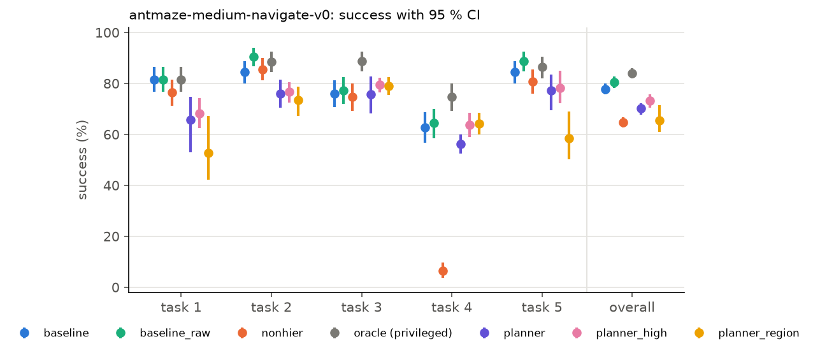

# Report: planning over sequences of intentions with frozen FB representations

Status: draft. Sections 2–6, the medium results of approach A and the retrained baselines are
complete. Sections and table
rows marked *(pending)* wait for final runs. Notation: `docs/design.md` §3; names that differ
between the report and the code: Appendix. Every number names the committed file it comes from.
pp = percentage points; CI = 95 % confidence interval.

## 1. Summary *(pending)*

Written last: success on `antmaze-medium-navigate-v0` of each method against the baseline, with
the paired difference and its CI; then large, giant and teleport; then the main reason for each
result.

## 2. Setting

**Task.** OGBench AntMaze navigation: a quadruped ant must reach a goal position in a maze.
The main env is `antmaze-medium-navigate-v0`; large, giant and teleport (stochastic teleporters)
are bonus envs. Each env has 5 evaluation tasks, each a start cell and a goal cell. An episode
lasts at most 1000 steps and succeeds when the ant reaches the goal radius (OGBench's
`info["success"]`).

**Given and frozen.** One FB π-Switch checkpoint per env, training seed 0 (`third_party/ssm`,
arXiv 2605.13207):

| Module | Role | Detail |
|---|---|---|
| `B(s)` | backward representation | `d = 128`; latents are normalized to norm `√d` |
| `F(s,z)` | forward representation | 2 ensemble heads; `F(s,z)ᵀB(s') ≈ M^{π_z}_s(s')` |
| `π_l(a∣s,z)` | low-level policy | acts toward the intention `z` |
| `π_h(z∣s,z_r)` | high-level policy, **the baseline** | picks a new intention at every step |

The discount is γ = 0.99 (giant: 0.995). The task latent `z_r = mean(r·B(s))` over 100k relabeled
validation states is a mean of `B` over the goal ball. Upstream gives this latent to `π_h`
without normalizing it, and a double average in upstream `infer_latent` leaves its norm below
`√d`. Our baseline normalizes it to `√d`, the norm that `π_h` saw in training (§6).

**What the baseline already does.** `π_h` is trained with AWR on the proxy advantage

```
Â(s,w,z) = F(s,z_w)ᵀz + ρ(s,w)·F(w,z)ᵀz − F(s,z)ᵀz,     z_w = B(w)
```

for subgoals `w` on the trajectory of `s` at a geometric offset with mean `1/(1−γ) = 100` steps.
So `π_h` looks **one switch** ahead: "follow `π_{z_w}` until `w`, then follow `π_z` forever".
The proxy drops the term `−ρ(s,w)·F(w,z_w)ᵀz` of the paper's Eq. (5), on purpose (paper Sec. 6).
At test time `π_h` re-selects at every step, so the executed behaviour does chain many switches,
but each choice is valued as if it were the last switch.

**Goal.** A high-level mechanism that values a **sequence** of intentions and beats `π_h` on long
horizons. Constraints: no generative model of states or trajectories; no new environment
interaction for training (offline OGBench data only); `F`, `B` and `π_l` stay frozen.

**Two approaches.**

- **A** (§4), no training: a graph over dataset landmarks whose edges are FB option models; value
  iteration at test time; waypoint execution with `π_l`.
- **B** (§5), offline training: a learned multi-switch value `V_H(s,z)` replaces the one-switch
  value in the AWR advantage of `π_h`; the test-time controller stays the baseline's.

## 3. From one switch to a chain of switches

Derivations, assumptions and the exact checks: `docs/theory.md`. Each property below is checked
to 1e-8 on exact tabular copies of the medium and teleport mazes (`tests/test_tabular_theory.py`).

**Option model.** The option `o_w` is "follow `π_l(·∣s,z_w)` with `z_w = B(w)` fixed until `w` is
hit"; `H` is the hitting time. With `M ≈ FᵀB`:

```
ρ(s,w) = E[γ^H]                  ≈ F(s,z_w)ᵀB(w) / F(w,z_w)ᵀB(w)
R(s,w) = E[Σ_{t<H} γ^t r(s_t)]   ≈ F(s,z_w)ᵀz_r − ρ(s,w)·F(w,z_w)ᵀz_r
```

Both follow from the strong Markov property at `H` (`docs/theory.md` §2). Both are invariant to the
scale of `B(w)`. For `s ≠ w`, `H ≥ 1`, so `ρ(s,w) ≤ γ`.

**One switch** (paper, Theorem 1): `V(s; w → π) = R(s,w) + ρ(s,w)·V^π(w)`.

**A chain.** At `H` the agent is exactly at `w`, so the switch formula applies again at `w`
(Proposition 1, by induction):

```
V(s; w_1,…,w_k → π) = R(s,w_1) + ρ(s,w_1)·V(w_1; w_2,…,w_k → π)
```

**Graph Bellman equation** over a landmark set `L` (Proposition 2), with `V_d(u) = F(u,z_r)ᵀz_r`:

```
V_H(u) = max( V_d(u),  max_{w∈L, w≠u} R(u,w) + ρ(u,w)·V_H(w) )
```

| Property | Consequence for the methods |
|---|---|
| A self-loop (`ρ = 1`, `R = 0`) makes every larger `V_H(u)` a fixed point | exclude `w = u` |
| Without self-loops `ρ ≤ γ`, so the operator is a γ-contraction | clip `ρ̂` to `[0, γ]` for `u ≠ w`; value iteration converges from any start |
| `k` sweeps from `V_d` give the best chain of at most `k` switches | value iteration searches over chains, not over single switches |
| Open-loop chains are optimal among option policies | a route of landmarks is enough |
| If `π_{z_r}` is optimal, `V_H = V*` | **chaining can only help where FB values or `π_l(·∣s,z_r)` are inaccurate** |
| Goal reaching: `R = 0` off the goal | `V_H` is a shortest path with edge cost `−log ρ(u,w)` |
| With exact values, re-planning at every step is never worse than commitment (option interruption, Sutton, Precup and Singh 1999) | commitment is only a defence against noisy values |

**Continuous states.** A single state is hit with probability 0. The option then ends on a ball
around `w`, and the next option starts at the entry point, not at `w`. The chain formula becomes
approximate. Its error grows with the number of hops and with the change of option values inside
the ball (bound in `docs/theory.md` §7). So hops should be few and the reach radius small.

**The dropped term in a chain.** The proxy values the time after `w` twice: in `F(s,z_w)ᵀz` and
again in `ρ·V(w)`. For one switch this is one bias term. In a chain it repeats at every hop, and
two neighbouring landmarks inside a rewarding region form a 2-cycle that the proxy values at
`ρV/(1−ρ)`. On the tabular maze with region rewards and exact FB, the predicted value of the best
chain is wrong by 111.8 with the proxy and by 0.0 with the exact `R`; a single switch with the
proxy is wrong by 10.7 (`docs/figures/theory/study_reward.csv`). So the proxy must not be used in
a graph.

### 3.1 When does chaining help? The tabular study

`fbplan/tabular/` builds a fake FB model on the 104-state medium maze (γ = 0.9) with exact
successor measures and controlled errors: independent noise on `ρ̂` per head, and a controller
`π_l` that is either exact or greedy on the noisy `F(s,z)ᵀz`. The greedy controller is reliable
only at short range, as a learned `π_l` may be. Success means the goal is reached in 100 steps;
all start–goal pairs; 5 noise seeds (`docs/theory.md` §9).

Success on far pairs (11 steps or more), noise std 0.04 on `ρ̂`
(`docs/figures/theory/study_noise.csv`):

| Planner | greedy `π_l` | exact `π_l` |
|---|---|---|
| direct, `π_l(z_r)` | 0.16 | 1.00 |
| idealised one-switch `π_h` | 0.26 | 0.95 |
| single switch, re-planned | 0.24 | 0.91 |
| chained, FB `R̂` | 0.20 | 0.28 |
| chained, `R̂ = 0` | 0.37 | 1.00 |
| chained, `R̂ = 0`, guards (head min, `ρ_min` 0.4, commit) | **0.46** | 1.00 |


Four results set the design of A and B:

1. **Chaining helps when `π_l` fails at long range.** With the greedy controller, the guarded
   chained planner reaches 0.46, against 0.26 for the idealised `π_h` and 0.16 for the direct
   policy. With an exact controller the direct policy is already optimal, and planning on noisy
   values can only lose.
2. **The main failure is a noisy `R̂`, not wormholes.** `R̂` is a difference of two noisy values,
   and for goal reaching the true `R` is about 0. The max over landmarks picks the largest noise
   at every hop. With the exact controller, `R̂ = 0` lifts the chained planner from 0.28 to 1.00.
3. **Guards** (far pairs, noise 0.04, `docs/figures/theory/study_guards.csv`): the min over the 2
   heads helps against independent errors in `R̂` (full `R̂`, exact `π_l`: 0.28 → 0.58).
   Commitment helps in every noisy case (`R̂ = 0`, greedy: 0.37 → 0.50). A hop discount (a factor
   on `ρ̂` per hop) hurts with `R̂ = 0` (0.37 → 0.11–0.13): it pushes the plan to fewer, longer hops
   that the controller cannot complete.
4. **Wormholes come from wall-blind features, not from independent noise.** Independent noise up
   to 0.04 puts no pair above `2γ^d`. A low-rank `B` with a wall-blind (cosine) basis does: 0.41 %
   of pairs at rank 16 and 0.24 % at rank 32 (`docs/figures/theory/study_wormholes.csv`). The two
   heads share such errors, so the head min does not remove them.

**Prediction for AntMaze.** A chained planner can beat `π_h` only if (a) `π_l` or the one-switch
value fails at long range, and (b) FB `ρ̂` is accurate at short range and free of wall-blind
errors. §8 measures both.

## 4. Approach A: landmark graph planner

No training. Code: `fbplan/landmarks.py`, `fbplan/option_model.py`, `fbplan/graph.py`,
`fbplan/controllers/planner.py`.

```
once per env:   training split ─► 300 landmarks ─► edge table ρ̂(u,w) ─► trusted edges
once per task:  z_r ─► V_d(u) = F(u,z_r)ᵀz_r ─► value iteration ─► V_H(u), route from each landmark
during the episode:
                s ─► w* = argmax over trusted edges s→w of ρ̂(s,w)·V_H(w), or the task policy
                commit to w* until reached ─► a = π_l(a | s, B(w*))
```

**Landmarks.** 300 states by farthest-point sampling on xy, from a random pool of 100k training
states. A landmark is a full observation, with the pose and the joint velocities of the ant.
Its latent is `B(w)` of that one state. Option: a region latent, the mean of `B` over the pool
states within 0.5 xy units.

**Edges.** For each landmark pair, `ρ̂(u,w)` per F head, then the min over the 2 heads. Values use
`ρ̂` clipped to `[0, γ]` for `u ≠ w` (contraction, §3). An edge `u → w` is **trusted** when:

- `0.3 ≤ raw ρ̂(u,w) < 1` (at γ = 0.99, `ρ = 0.3` is about 120 steps), and
- the xy distance from `u` to `w` is at most 6 units (1.5 maze cells).

**Values.** Goal reaching uses `R̂ = 0`. Value iteration then solves
`V_H(u) = max(V_d(u), max_w ρ̂(u,w)·V_H(w))` over trusted edges: a shortest path on `−log ρ̂` that
ends with the task policy.

**Execution.** At a re-plan the agent scores the trusted edges from its own state with the same
rules, `Q(s,w) = ρ̂(s,w)·V_H(w)`, and picks `w* = argmax_w Q(s,w)`, or the task policy if
`V_d(s)` is higher. It acts with `π_l(·∣s,B(w*))` and commits to `w*` until it is within 3 xy
units of `w*`, for at most 100 steps. Look-ahead: at each step it moves on to the next stop of the
route when `Q(s,next) ≥ Q(s,w*)` and the edge `s → next` is trusted. Variants: `planner_high`
gives `B(w*)` to `π_h` as its task; `replan_every_step` drops the commitment.

**Each guard and its evidence.**

| Guard | Reason | Evidence |
|---|---|---|
| `R̂ = 0` for goal reaching | `R̂` is a difference of two noisy values, and the max collects its noise | tabular §3.1 (0.28 → 1.00 with exact `π_l`); medium ablation *(pending)* |
| raw `ρ̂ ≥ 1` is untrusted | `ρ ≤ γ < 1` for `u ≠ w` (§3), so `ρ̂ ≥ 1` is an FB error and a free hop | theory; medium ablation *(pending)* |
| xy cap of 6 units | wormholes survive any `ρ_min` (§8.3). The maze distance is never shorter than the xy distance, so the cap removes only edges that are long in every metric, and it limits a wormhole hop to 6 units | at `ρ_min` 0.3 it removes 42 % of the wormholes on medium and 64 % on large, all the long ones (§8.3); medium ablation *(pending)* |
| min over the 2 F heads | pessimism against independent errors | tabular §3.1; lowers the AntMaze wormhole count by a fifth to a quarter (§8.3) |
| commit until within 3 xy units, with look-ahead | commitment stops dithering between near-equal noisy plans. A rule `ρ̂ ≥ ρ_reached` often does not fire, because FB `ρ̂` near a waypoint stays below about 0.9 | tabular §3.1 (0.37 → 0.50); medium ablation *(pending)* |
| single-state landmark latents | region latents make `ρ̂` higher and flatter, so it separates near and far landmarks less | 5 eval seeds × 3 landmark sets: region −12.3 pp, single-state −7.7 pp against the baseline (§7.1) |

The xy position is part of the observation, so the cap uses no privileged information. Two FB-only
guards stay as ablations: `two_way`, which uses `min(ρ̂(u,w), ρ̂(w,u))` (maze dynamics are nearly
reversible, FB errors often are not), and a hop discount.

**Tuning.** The guards were chosen on medium, on start states outside the evaluation episodes but
on the same 5 tasks. Large uses the same settings without change.

## 5. Approach B: learned multi-switch value

Code: `fbplan/learned/`. Plan: `docs/plans/approach-b.md`.

**Idea.** The baseline's AWR advantage values a subgoal `w` with a one-switch value: "follow
`π_{z_w}` until `w`, then `π_z` forever". B learns `V_H(s,z)`, the value when the agent may switch
again at `w`, and again after that, and puts it into the same AWR recipe. The actor network, the
data, the spread of the AWR weights and the test-time controller stay as in the baseline. So
"B-clean against the retrained baseline" measures the effect of the multi-switch value and nothing
else. B needs no graph and no landmarks at test time, and it is defined for any task latent `z`.

```
offline data ─► (s, w, g, z) batches ─► ρ, R, V_1 from frozen F and B ─► targets y(s,w,z)
stage 1:  V_H(s,z)      ◄── expectile regression on y
stage 2:  π_h(z_w|s,z)  ◄── AWR with weight exp(min(α·[y − V_H(s,z)], 5))
test:     baseline controller: z_w = π_h(s, z_r) at every step, a = π_l(a | s, z_w)
```

**Critic.** Per sample, with the min over the 2 F heads:

```
ρ(s,w)   = min_h F_h(s,z_w)ᵀz_w / F_h(w,z_w)ᵀz_w,     capped at ρ_max = 0.9
V_1(s,z) = min_h F_h(s,z)ᵀz                            value of never switching again
V_H(s,z) = V_1(s,z) + softplus(Δ_θ(s,z))               so V_H ≥ V_1 by construction
y(s,w,z) = R(s,w;z) + ρ(s,w)·[V_1(w,z) + softplus(min_j Δ̄_j(w,z))]
```

`R = 0` for goal latents, as in A, and the exact `R` for Gaussian latents. `Δ_θ` is the upstream
`GCValue` network (3 × 512, LayerNorm, 2 heads), and `Δ̄` is its EMA target (rate 0.005). The loss
is the expectile loss with τ = 0.9 on `y − V_H(s,z)`: an in-sample soft max over the sampled `w`,
as in IQL.

**Sampling** (offline data only). `s` is uniform over the dataset. `w` is on the trajectory of `s`
at a geometric offset with mean 100 steps, as upstream. `g` is a future state of the same
trajectory (70 %) or a random dataset state (30 %). `z` is `B(g)` (50 %) or Gaussian (50 %), as
upstream. All latents are normalized to norm `√d`.

**Actor.** The upstream `GCActor`, trained with AWR toward `normalize(B(w))`, with the advantage
`A = y − V_H(s,z)` and `V_H` frozen. The AWR temperature α makes the spread of `α·A` equal to that
of the upstream run (upstream α = 0.1), so the weighting is as sharp as in the baseline.

**Guards against error growth over hops.**

| Guard | Effect |
|---|---|
| `ρ ≤ 0.9` | the hop-level Bellman operator is a 0.9-contraction: a target error ε grows to at most 10ε (a clip at γ would allow 100ε) |
| `w` only from the trajectory of `s` | the data shows every edge `(s,w)`, so no wormhole edge enters the targets |
| samples with raw `ρ̂ ≥ 1` are dropped | as in A: such edges are FB errors |
| min over the F heads, expectile instead of a hard max, clipped double target | pessimism against noise in `ρ̂` and in `V_H` |
| residual form `V_1 + softplus(Δ_θ)` | `V_H` starts at the one-switch value; the gain is learned only where switching helps in the data |

**Variants.** Each changes one thing against the row above it.

| Variant | Subgoal and goal latents | Goals for `π_h` | Measures |
|---|---|---|---|
| retrained baseline | `B(·)` of one state | upstream | reference |
| B-clean | as the baseline | as the baseline | the critic only |
| B-wide | as the baseline | + 30 % random dataset goals | goals across trajectories |
| B-region | mean of `B` over ±5 trajectory steps | as the baseline | the latent type (own `V_H`) |

**Limits by design.** Stitching across trajectories comes only from the generalization of
`V_H(w,z)`, as in IQL and HIQL: no training pair has a `w` from another trajectory. `π_h`
regresses onto `B(w)`, so if good subgoals lie in two directions, the mean lies between them.
A diagnostic controller, B-argmax (A's controller with `V_H` in place of graph value iteration),
separates the quality of the critic from that of the actor.

## 6. Evaluation protocol

**Episodes.** 5 tasks × 50 episodes × 5 eval seeds = 1,250 episodes per method and env. Episode
length 1000, deterministic actions (temperature 0), success as defined by OGBench at the last step.

**Paired start states.** The reset seed of an episode is
`SeedSequence([eval_seed, task_id, episode])`. OGBench draws the start noise from the global NumPy
RNG, and the goal also depends on the action-space RNG, so the loop seeds all three:
`np.random.seed(s); env.action_space.seed(s); env.reset(seed=s, options={"task_id": t})`.
All methods see the same 1,250 start and goal states. An episode replays exactly:
`analysis/failures.py` replays each failure and checks its outcome.

**Methods.**

| Row | What it is |
|---|---|
| baseline | the provided `π_h`, with `z_r` normalized to norm `√d` before `π_h`: the same input path as every other method |
| baseline_raw | the provided `π_h` through upstream `sample_actions`, with the raw `z_r`: a reference row |
| retrained baseline | 5 `π_h` seeds that we trained on the frozen `F`, `B`, `π_l` with the upstream recipe (500k steps), so the CI includes training variance |
| upstream | upstream `evaluate` on the provided checkpoint: raw `z_r` and unseeded resets; used only for the parity check, unpaired |
| non-hier | `π_l(·∣s,z_r)` alone, without a high level |
| oracle (privileged) | `π_l` toward a waypoint 2 cells ahead on the true shortest path, with a region-mean waypoint latent (radius 0.5); a reference, not a bound (§8.2) |
| A, B | §4 and §5; approach A over 3 landmark sets (`landmarks.seed` 0, 1, 2), each with all 1,250 episodes |

**Rule for a gain.** A method counts as better than the baseline only if its paired difference is
significant against both `baseline` and `baseline_raw`.

**Statistics** (`fbplan/stats.py`, `analysis/tables.py`). Overall success is the mean over tasks of
the per-task success, as in OGBench. CIs are percentile intervals from 10,000 bootstrap resamples,
stratified by task. A paired comparison resamples episode pairs within each task and gives an exact
McNemar test on the discordant pairs. The retrained baselines and the landmark sets of approach A
are pooled with a cluster bootstrap over checkpoints or landmark sets; their paired differences are
given per checkpoint or landmark set. A difference whose CI contains 0 is called not significant.

**Parity with upstream.** Our loop with the provided `π_h`, against upstream `evaluate`:
−2.2 pp, CI [−5.3, +1.0], unpaired, 2,500 episodes (`results/medium/baseline.csv`,
`results/medium/upstream.csv`). The CI contains 0: our loop reproduces the upstream evaluation
within noise.

**Physics.** MuJoCo is pinned to 3.1.6, the version that replays the dataset transitions exactly,
so `π_l` acts in the physics that produced its training data
(`tests/test_frozen.py::test_eval_env_reproduces_the_dataset_dynamics`).

## 7. Results *(partly pending)*

### 7.1 Medium (required)

Success (%) with 95 % CI, 1,250 episodes per row; the approach A rows pool 3 landmark sets and the
retrained baseline pools 5 training seeds, each with a cluster bootstrap (`results/medium/*.csv`,
`results/medium/planner*/l{0,1,2}.csv`, `results/medium/baseline_retrained/seed{0..4}.csv`;
`analysis/tables.py --label-root results/medium`, `--cluster config_hash` or
`--cluster checkpoint_seed`):

| Method | task 1 | task 2 | task 3 | task 4 | task 5 | all |
|---|---|---|---|---|---|---|
| baseline | 81.6 | 84.4 | 76.0 | 62.8 | 84.4 | **77.8** [75.6, 80.1] |
| baseline_raw | 81.6 | 90.4 | 77.2 | 64.4 | 88.8 | 80.5 [78.3, 82.6] |
| non-hier | 76.4 | 85.6 | 74.8 | 6.4 | 80.8 | 64.8 [62.7, 66.8] |
| oracle (privileged) | 81.6 | 88.4 | 88.8 | 74.8 | 86.4 | 84.0 [82.0, 86.0] |
| A: planner | 65.7 | 75.9 | 75.6 | 56.1 | 77.2 | 70.1 [67.8, 72.3] |
| A: planner_high | 68.1 | 76.7 | 79.5 | 63.6 | 78.3 | 73.2 [70.4, 75.6] |
| A: planner, region latents | 52.7 | 73.5 | 79.1 | 64.3 | 58.4 | 65.6 [61.0, 71.5] |
| retrained baseline (5 seeds) | 78.2 | 83.4 | 78.0 | 64.4 | 87.6 | 78.3 [76.9, 79.8] |
| B-clean | | | | | | *(pending)* |
| B-wide | | | | | | *(pending)* |
| B-region | | | | | | *(pending)* |

Per-task CIs are about ±5 pp for single runs and up to 25 pp wide for the pooled approach A
rows. The pooled retrained row has only 5 clusters, so its CI is a rough one.



Paired differences (pp) with CI and McNemar p, on the same 1,250 start states. Approach A has one
row per landmark set; "mean" is the mean over the 3 sets (`analysis/tables.py`, with
`--reference baseline` and `--reference baseline_raw`):

| Method | against baseline | against baseline_raw |
|---|---|---|
| baseline_raw | +2.6 [−0.5, +5.8], p = 0.11 | – |
| retrained, seed 0 | −0.0 [−3.1, +3.1], p = 1 | −2.6 [−5.8, +0.5], p = 0.11 |
| retrained, seed 1 | +2.7 [−0.3, +5.7], p = 0.09 | +0.1 [−3.0, +3.1], p = 1 |
| retrained, seed 2 | −1.0 [−4.2, +2.3], p = 0.59 | −3.6 [−6.7, −0.5], p = 0.03 |
| retrained, seed 3 | −0.2 [−3.3, +3.0], p = 0.96 | −2.8 [−6.0, +0.5], p = 0.09 |
| retrained, seed 4 | +0.8 [−2.2, +3.9], p = 0.65 | −1.8 [−4.8, +1.1], p = 0.26 |
| retrained, mean | +0.5 | −2.2 |
| non-hier | −13.0 [−16.2, −10.0], p = 3e-14 | −15.7 [−18.6, −12.7], p = 9e-21 |
| oracle (privileged) | +6.2 [+3.1, +9.2], p = 1e-4 | +3.5 [+0.5, +6.5], p = 0.02 |
| planner, set 0 | −6.5 [−9.8, −3.2], p = 2e-4 | −9.1 [−12.2, −5.8], p = 4e-8 |
| planner, set 1 | −9.9 [−13.4, −6.5], p = 7e-8 | −12.6 [−15.7, −9.4], p = 2e-13 |
| planner, set 2 | −6.8 [−10.2, −3.4], p = 1e-4 | −9.4 [−12.7, −6.2], p = 4e-8 |
| planner, mean | −7.7 | −10.4 |
| planner_high, set 0 | −3.3 [−6.6, +0.1], p = 0.06 | −5.9 [−9.2, −2.6], p = 5e-4 |
| planner_high, set 1 | −3.0 [−6.2, +0.2], p = 0.08 | −5.7 [−8.8, −2.6], p = 5e-4 |
| planner_high, set 2 | −7.5 [−10.8, −4.2], p = 2e-5 | −10.2 [−13.4, −6.8], p = 7e-9 |
| planner_high, mean | −4.6 | −7.3 |
| planner region, set 0 | −16.6 [−20.1, −13.1], p = 5e-19 | −19.3 [−22.6, −15.9], p = 7e-25 |
| planner region, set 1 | −6.0 [−9.3, −2.6], p = 5e-4 | −8.6 [−11.8, −5.4], p = 3e-7 |
| planner region, set 2 | −14.2 [−17.7, −10.6], p = 6e-14 | −16.8 [−20.1, −13.5], p = 5e-21 |
| planner region, mean | −12.3 | −14.9 |
| B rows | *(pending)* | *(pending)* |

**The provided `π_h` is a typical seed of the upstream recipe.** The 5 retrained `π_h` score
76.9–80.6 % (`analysis/tables.py` on `results/medium/baseline_retrained/`); none differs
significantly from the provided one (mean +0.5 pp). So the choice between the provided and the
retrained baseline does not change any conclusion about approach A.

**Approach A is below the baseline on medium.** All 3 variants lose on all 3 landmark sets. Only
`planner_high` on sets 0 and 1 is not significantly below the baseline (CI contains 0); against
`baseline_raw` every variant and every set is significantly below. §8.4 explains why.

### 7.2 Large *(pending)*

### 7.3 Giant and teleport *(pending)*

## 8. Analysis

### 8.1 The gap to the paper's numbers

The paper reports 87 ± 6 % on medium (5 training seeds). With the provided checkpoint we measure
77.8 % [75.6, 80.1] (baseline), 80.5 % [78.3, 82.6] (`baseline_raw`) and 80.0 % [77.8, 82.2]
(upstream `evaluate`) (`results/medium/{baseline,baseline_raw,upstream}.csv`).

Ruled out:

- **The restore.** The restored parameters equal the checkpoint arrays bit for bit
  (`tests/test_frozen.py::test_restored_parameters_equal_the_checkpoint_arrays`).
- **Our evaluation loop.** It matches upstream `evaluate` within noise (§6, parity).
- **The task latent.** The raw `z_r` of upstream does not differ significantly from the normalized
  one: `baseline_raw` − baseline = +2.6 pp [−0.5, +5.8], p = 0.11, paired.
- **The physics.** The evaluation env replays the dataset transitions exactly (§6).

- **The training seed of `π_h`.** 5 `π_h` that we retrained with the upstream recipe on the same
  frozen modules score 76.9–80.6 %, and none differs significantly from the provided `π_h` (§7.1).

Still possible: (1) `F`, `B` and `π_l` of training seed 0 are weaker than the average of the
paper's 5 seeds (the paper's ± 6 shows a wide spread between seeds); we cannot test this without
retraining FB, which the task forbids; (2) the paper's evaluation differs from upstream `main.py`.
All our comparisons are paired on the same frozen modules, so the gap does not bias them.
Large *(pending)*.

### 8.2 Headroom on medium

**A high level matters on medium mainly for task 4.** Without a high level, `π_l(z_r)` scores
−13.0 pp [−16.2, −10.0] against the baseline (p = 3e-14). Almost all of the loss is on task 4:
6.4 % against 62.8 %. On the other 4 tasks the direct policy is within 6 pp of `π_h`. So the
one-switch `π_h` already solves most of what a high level must solve on medium.

**Perfect routing gives +3.5 to +6.2 pp.** The privileged oracle routes on the true maze map and
scores 84.0 % [82.0, 86.0]: +6.2 pp [+3.1, +9.2] over the baseline (p = 1e-4) and +3.5 pp
[+0.5, +6.5] over `baseline_raw` (p = 0.02). Its gain is on tasks 3 and 4 (+12.8 and +12.0 pp
over the baseline). This estimates what a high-level method can gain with this `π_l` on medium.
It is a reference, not a bound: another waypoint rule changes it by a large amount (next
paragraph).

**The waypoint latent matters more than the route.** Oracle variants on the same 250 episodes of
eval seed 0 (`results/medium/oracle_sweep/*.csv`; the baseline scores 76.4 % on these episodes,
`results/medium/baseline.csv`; CIs about ±5 pp):

| Waypoint latent | 1 cell ahead | 2 cells ahead | 3 cells ahead |
|---|---|---|---|
| `B(w)` of one state | 44.8 | 56.4 | 65.2 |
| mean of `B` within 0.5 xy units | 80.8 | 86.4 | 78.0 |
| mean of `B` within 1.0 xy units | 87.2 | 76.0 | 74.8 |
| mean of `B` within 1.5 xy units | 80.8 | 80.0 | 80.0 |

With the true shortest path, single-state waypoint latents lose 11–32 pp against `π_h`;
region-mean latents are level with it or above it. *Hypothesis:* `B(w)` of one state encodes the
full observation of `w`, with the joint angles and the velocities, so `π_l(·∣s,B(w))` tries to
reach that exact pose, which is slower and less stable than passing near `w`. A region mean
averages the pose out and keeps mostly the position. The test-time `z_r` is also a mean over the
goal ball. This matters for approach A, whose default landmark latent is the single state (§4).

**Failure classes.** `analysis/failures.py` replays each failed episode and classifies it from the
observations: *flipped* (the torso points down for the last 50 steps; the ant cannot turn back),
*stuck* (it stays within 1 xy unit for the last 300 steps), or *other* (still moving at the time
limit). Counts out of 1,250 episodes (`results/medium/failures/<method>.csv`; descriptive, no CIs):

| Method | failures | flipped | stuck | other | flipped, share of failures |
|---|---|---|---|---|---|
| baseline | 277 | 198 | 7 | 72 | 71 % |
| baseline_raw | 244 | 175 | 4 | 65 | 72 % |
| oracle (privileged) | 200 | 142 | 2 | 56 | 71 % |
| non-hier | 440 | 177 | 50 | 213 | 40 % |

- **Most failures with a high level are flips.** About 71 % for the baseline, `baseline_raw` and
  the oracle. Once the ant has flipped, no high-level choice can repair the episode.
- **The flip count still depends on the high level.** The oracle flips in 142 episodes against the
  baseline's 198. The drop is on tasks 3 and 4 (50 → 26 and 72 → 56), where the oracle gains. So
  flips are not a fixed floor, and a better route also lowers them. *Hypothesis:* a shorter route
  leaves less time to flip; a success ends the episode early.
- **Without a high level, task 4 fails by getting lost, not by flipping.** Of the 234 non-hier
  failures on task 4, 140 are *other* and 47 *stuck*; only 47 are flips. This is the long-range
  failure of `π_l(z_r)` that a high level must repair, and `π_h` repairs most of it (§7.1).

### 8.3 FB distance calibration and wormholes

For 400 validation states (159,600 ordered pairs), the FB distance `−log ρ̂ / −log γ` against the
exact maze distance; the min over the 2 heads (`analysis/calibration.py`):

| Medium | Large |
|---|---|
|  |  |

- **`ρ̂` carries distance information at short and medium range.** On medium the median FB
  distance grows with the maze distance over the whole maze.
- **The spread is wide at every distance.** A band of pairs sits at the cap (`ρ̂` near 0) at all
  distances, short ones included: some short edges are missing from the graph.
- **On large, FB loses distance information at long range.** The median stops growing beyond
  about 30 xy units, and the upper quartile reaches the cap from about 20 units. This is the regime
  in which chaining short edges can help, if the short edges are reliable.

**Wormholes.** A wormhole is a trusted pair (`ρ_min ≤ raw ρ̂ < 1`) whose FB distance is shorter
than the time the ant needs to walk the maze distance at its top speed (99th percentile of the
step length in the data). This is not the tabular definition of §3.1 (Appendix). Counts for the
400 states, min over heads (`results/calibration/wormholes_<env>_min.csv`):

| Env | `ρ_min` | trusted pairs | of which raw `ρ̂ ≥ 1` | wormholes (raw `ρ̂ < 1`) | share of trusted | within the xy cap of 6 |
|---|---|---|---|---|---|---|
| medium | 0.3 | 62,200 | 1,118 | 3,385 | 5.4 % | 1,965 |
| medium | 0.5 | 28,962 | 1,118 | 3,353 | 11.6 % | 1,965 |
| medium | 0.7 | 12,146 | 1,118 | 2,997 | 24.7 % | 1,965 |
| large | 0.3 | 38,359 | 1,170 | 3,992 | 10.4 % | 1,420 |
| large | 0.5 | 17,856 | 1,170 | 3,411 | 19.1 % | 1,420 |
| large | 0.7 | 8,343 | 1,170 | 2,707 | 32.4 % | 1,420 |

| Medium, 200 longest wormholes | Large, 200 longest wormholes |
|---|---|
|  |  |

- **Many wormholes cross the whole maze** (longest: 28.1 xy units of maze distance on medium,
  48.9 on large). A max over routes exploits exactly these pairs.
- **A higher `ρ_min` does not remove them.** From `ρ_min` 0.3 to 0.7 the trusted pairs drop by
  80 % on medium, but the wormholes drop by only 12 % (large: 78 % and 32 %). Their share of the
  trusted pairs grows from 5.4 % to 24.7 % (large: 10.4 % to 32.4 %). The wormholes sit at high
  `ρ̂`. This is why A uses an xy cap instead of a higher `ρ_min` (§4).
- **The xy cap removes the long wormholes, not all of them.** It leaves 1,965 of 3,385 on medium
  and 1,420 of 3,992 on large, all at most 6 xy units long, so a wormhole hop can no longer jump
  across the maze. *(pending: whether the remaining ones cross a wall.)*
- **The head min removes few.** With the mean over heads there are 4,289 (medium) and 5,380
  (large) wormholes at `ρ_min` 0.3 (`results/calibration/wormholes_<env>_mean.csv`). The min
  lowers the count by only a fifth to a quarter, so most of these errors are shared by the heads,
  as with the wall-blind low-rank features of the tabular study (§3.1, result 4), and unlike
  independent noise.
- *Hypothesis:* in the maps, many wormholes meet at a few target states. A target-side error would
  explain this. `ρ̂(s,w)` divides by `F(w,z_w)ᵀB(w)`, so an underestimated denominator inflates
  `ρ̂` from every source at once. If this holds, a guard on the target (distrust landmarks with a
  low `F(w,z_w)ᵀB(w)`) would remove many wormholes with one test per landmark. Not tested yet.

### 8.4 Why approach A is below the baseline on medium

Evidence from the evaluation CSVs: per-task success (§7.1), time to goal and where failures end
(`analysis/report_figures.py` on `results/medium/`). Time-to-goal numbers are descriptive, without
CIs.

**1. Little to gain on medium.** The one-switch `π_h` already solves the long task 4 (§8.2), and
perfect routing gains only +3.5 to +6.2 pp. The tabular study shows the same pattern: when the
existing policy is already near the best that the controller allows, planning on noisy values can
only lose (§3.1, result 1).

**2. A does not get the routing gain where routing matters, and loses elsewhere.** The oracle
gains about 12 pp on tasks 3 and 4. There `planner_high` (79.5 %, 63.6 %) and the region variant
(79.1 %, 64.3 %) are only level with the baseline (76.0 %, 62.8 %), within their per-task CIs; the
plain planner is level on task 3 and lower on task 4 (56.1 %). On tasks 1, 2 and 5, where the
oracle gains 0–4 pp, every variant loses 6–29 pp. So the planner misses the routing gain and pays
a cost on tasks that `π_h` already solves.

**3. A reaches the goal later.** Successful episodes take a median of 441 (planner), 432
(`planner_high`) and 452 (region) steps, against 361 for the baseline, 372 for `baseline_raw` and
379 for the oracle, which also follows waypoints:


| Method | success within 400 steps | 600 | 800 | 1000 |
|---|---|---|---|---|
| baseline | 44.4 | 61.5 | 72.2 | 77.8 |
| planner | 30.7 | 50.2 | 62.7 | 70.1 |
| planner_high | 32.5 | 53.4 | 66.0 | 73.2 |
| planner, region latents | 27.4 | 45.6 | 57.9 | 65.6 |

The gap to the baseline is largest at 420–440 steps (−11.9 to −17.3 pp) and shrinks by 29–61 % by
step 1000 (to −4.6 to −12.3 pp). So a large part of the final gap is time: the planner reaches many
goals later, and the 1000-step limit ends some episodes before it arrives. The curves still rise at
1000 steps, so these data cannot say how much of the gap a longer episode would close.

**4. Failures end far from the goal, as the baseline's do.** The median final distance of a failed
episode is 9.6–12.0 xy units (baseline 8.3), and 7.8–9.3 % of A's failures end within 3 units of
the goal (baseline 11.9 %). So circling next to the goal is not a main failure mode on medium.

**5. The plan depends on the landmark set.** The paired difference moves by 3.4 pp (planner), 4.5 pp
(`planner_high`) and 10.6 pp (region) between the 3 landmark sets (§7.1). A graph of 300 sampled
states is itself a random object, and region latents make it more sensitive. On sets 0 and 2 the
region variant scores 44–54 % on tasks 1 and 5 (set 1: 68–70 %; `analysis/tables.py` on
`results/medium/planner_region/`).

**6. Handing the waypoint to `π_h` is the best variant.** `planner_high` gives `B(w*)` to `π_h`
as its task, so `π_h` chooses the intentions toward the waypoint, and it is the closest variant
to the baseline (mean −4.6 pp). With point 3, this suggests that the execution of the waypoints,
not the route, is the main cost. This stays a hypothesis until the route plots and the failure
classes of A arrive *(pending)*.

**Region latents: good for acting, bad for planning (hypothesis).** Region-mean waypoint latents
help the oracle by 10–42 pp over single-state ones at the same look-ahead (§8.2), but they make the
planner worse and slower. The oracle takes its route from the true maze and uses the latent only to
act. The planner uses the same latent for `ρ̂`, the planning signal, and for the action. A region
latent makes `ρ̂` higher and flatter between near and far landmarks (§4; ablation pending), so the
route gets worse even if each hop is easier to execute. Test: plan with single-state `ρ̂` and act
with region latents. A 100-episode probe of this split by c-planner (held-out start states, not
committed) showed no gain over single-state latents, so the hypothesis is weak. A possible reason:
the oracle's waypoints are 2 cells (about 8 xy units) ahead, the planner's at most 6 xy units, and
the planner switches at 3.

### 8.5 What the learned `V_H` gains over the one-switch value *(pending)*

Needs `V_H(s,B(g))` and `V_1(s,B(g))` against the maze distance, and the clip rates of `ρ`.

## 9. What worked and what did not *(partly pending)*

| Item | Outcome | Evidence |
|---|---|---|
| Chain formula, graph Bellman equation, contraction, option interruption | hold exactly on tabular mazes | `tests/test_tabular_theory.py`, to 1e-8 |
| `R̂ = 0` and guards in the tabular study | chaining beats the idealised `π_h` when `π_l` fails at long range (0.46 against 0.26) | §3.1 |
| Paired evaluation | parity with upstream holds; paired tests resolve differences of about 3 pp | §6, §7.1 |
| Retrained baselines | the provided `π_h` is a typical seed (retrained 76.9–80.6 %, mean +0.5 pp against it) | §7.1, §8.1 |
| Approach A on medium | **did not work**: below the baseline for all variants and landmark sets (mean −4.6 to −12.3 pp) | §7.1, §8.4 |
| Region landmark latents | **did not work** for the planner (worst variant, most sensitive to the landmark set), although region waypoint latents help the oracle | §7.1, §8.2, §8.4 |
| `planner_high` (waypoint as the task of `π_h`) | the best A variant; not significantly below the baseline on 2 of 3 landmark sets, but below `baseline_raw` on all 3 | §7.1 |
| Each guard of A on the real model | *(pending: guard and execution ablations)* | |
| Approach B | *(pending)* | |
| Large, giant, teleport | *(pending)* | |

## 10. Limitations and next steps *(partly pending)*

Limitations:

- **One FB model per env.** `F`, `B` and `π_l` come from training seed 0. The retrained `π_h`
  seeds add `π_h` training variance (76.9–80.6 % on medium), not the variance of the frozen
  modules.
- **Small headroom on medium.** Perfect routing gains +3.5 to +6.2 pp (§8.2). About 71 % of the
  failures with a high level are flips; a high level can lower their count but cannot repair a
  flipped episode (§8.2).
- **Tuning on the evaluation tasks.** A's guards were tuned on the 5 medium tasks with other start
  states (§4). This favours A on medium, so it does not explain A's loss.
- **The oracle is not a bound** (§8.2).
- **3 landmark sets** estimate the landmark variance of A only roughly (§8.4, point 5).

Next steps that the evidence suggests:

- Larger mazes, where FB loses distance information at long range (§8.3) *(pending: large)*.
- A target-side wormhole guard (§8.3, hypothesis).
- Separate the planning latent from the acting latent (§8.4). A first probe showed no gain, so this
  test has a low priority.

## 11. Reproduction

Commands for every table and figure: `README.md`, section "Reproduce". The time-to-goal figure
and table of §8.4: `uv run python analysis/report_figures.py`.

## Appendix: notation and names in the code

Symbols and parameters whose names differ between the report, approach A, approach B and the
tabular code:

| Report | Meaning | Approach A | Approach B | Tabular code |
|---|---|---|---|---|
| raw `ρ̂(s,w)`; `ρ̂` clipped | FB estimate of `E[γ^H]`; values use the clipped one | `OptionTable.rho_raw`; `.rho`, clipped to `[0, γ]` | `OptionTerms.rho_raw`; `.rho`, capped at 0.9 | `rho_hat` |
| raw `ρ̂ < 1` (trust bound, A) | an edge with raw `ρ̂ ≥ 1` is untrusted | `PlannerConfig.rho_max = 1.0` | samples with raw `ρ̂ ≥ 1` are dropped (`OptionTerms.valid`) | – |
| `ρ ≤ 0.9` (value cap, B) | cap on `ρ` in the targets: a 0.9-contraction | – | `OptionConfig.rho_max = 0.9` | – |
| `ρ_min` | lower trust bound | `PlannerConfig.rho_min = 0.3` | – | `PlannerConfig.rho_min` (0.4 in the guarded planner) |
| exact `R` | `F(s,z_w)ᵀz_r − ρ·F(w,z_w)ᵀz_r` | `edge_reward="exact"` | `edge_reward="exact"`; also Gaussian latents under the default `"goal_zero"` | `reward="full"` ("R=full"); `high_advantage="full"` |
| the proxy | `R` without `−ρ·F(w,z_w)ᵀz_r`, as upstream `π_h` | `edge_reward="paper"` | `edge_reward="paper"` | `reward="proxy"`; `high_advantage="proxy"` |
| `R̂ = 0` | goal reaching: shortest path on `−log ρ̂` | `edge_reward="zero"` (default) | `edge_reward="goal_zero"` (default): 0 for goal latents | `reward="zero"` ("R=zero", "chained R=0") |
| `V_d(u) = F(u,z_r)ᵀz_r` | direct value: switch to the task policy now | `direct`, `OptionModel.direct_value` | `V_1(s,z)`, `direct_value`, for any latent `z` | `v_direct`, `v_d`; `v_final` is the value of the last policy of a chain |
| `V_H(u)`, §3–4 | graph value over landmarks, for one task `z_r` | `graph.value_iteration` → `GraphSolution.values` | – | `v_graph`, `graph_value_iteration` |
| `V_H(s,z)`, §5 | learned multi-switch value, any state and latent | – | `ValueState.value` = `V_1` + softplus(gain) | – |
| `Δ_θ`, `Δ̄` | residual network of `V_H` and its EMA target | – | `gain_network`; `ValueState.gain` returns softplus(gain) per head | – |
| wormhole, §8.3 | trusted pair, raw `ρ̂ < 1`, FB distance shorter than the walk at top speed | `analysis/calibration.py:wormhole_mask` | – | – |
| wormhole, §3.1 | `ρ̂ > 2γ^d`, `d` = shortest path in steps (the true `ρ ≤ γ^d`) | – | – | `fbplan/tabular/study.py:wormhole_mask` |

The two wormhole definitions both flag a `ρ̂` that the maze does not allow, but their counts are
not comparable.

Methods: name in the report, `--method` of `fbplan.evaluate`, and the `method` column of the CSV
(the `Controller.name`):

| Report | `--method` and options | CSV `method` | Results |
|---|---|---|---|
| baseline | `baseline` | `baseline` | `results/medium/baseline.csv` |
| baseline_raw | `baseline_raw` | `baseline_raw` | `results/medium/baseline_raw.csv` |
| non-hier | `nonhier` | `nonhier` | `results/medium/nonhier.csv` |
| oracle | `oracle` | `oracle` | `results/medium/oracle.csv` |
| planner | `planner --opt landmarks.seed=k` | `graph_planner` | `results/medium/planner/l<k>.csv` |
| planner_high | `planner_high --opt landmarks.seed=k` | `graph_plus_high` | `results/medium/planner_high/l<k>.csv` |
| planner, region latents | `planner --opt landmarks.latent=region landmarks.seed=k` | `graph_planner` (another `config_hash`) | `results/medium/planner_region/l<k>.csv` |
| retrained baseline | `baseline --checkpoint retrained:<seed>` | `baseline`, `checkpoint_kind` = `retrained` | `results/medium/baseline_retrained/seed<k>.csv` |
| B-clean, B-wide, B-region | `baseline --checkpoint b:<variant>:<seed>` | `baseline`, `checkpoint_variant` = the variant | *(pending)* |
