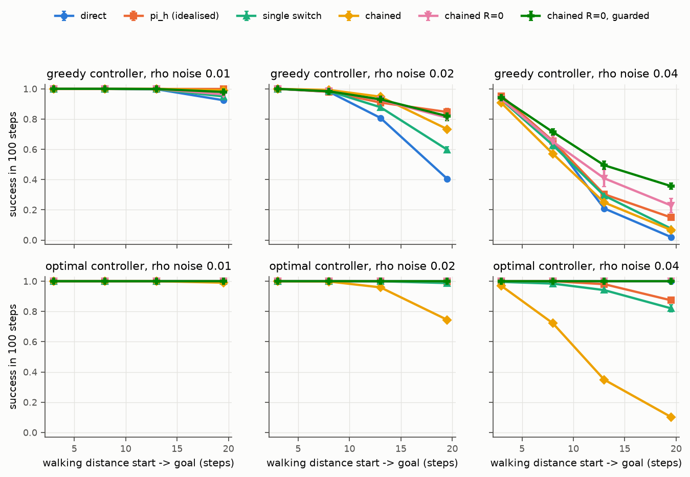
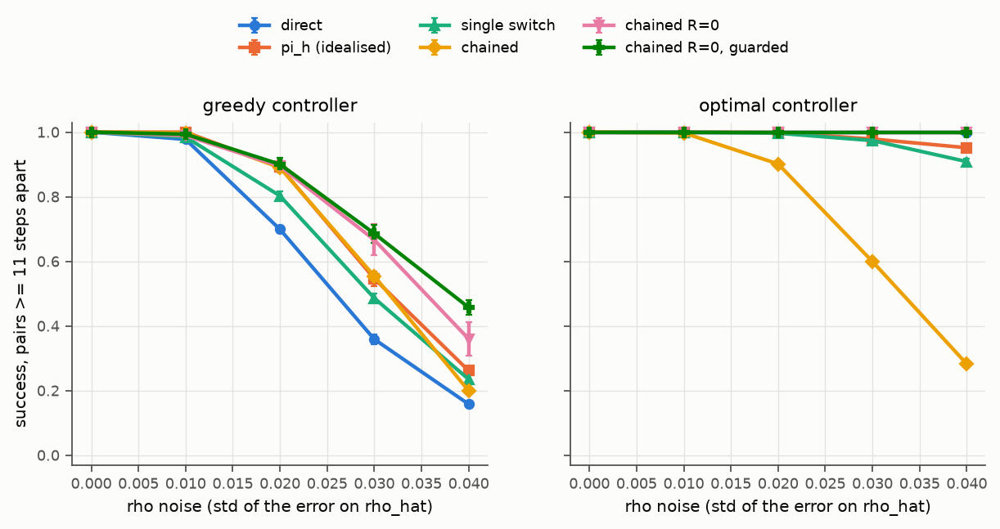
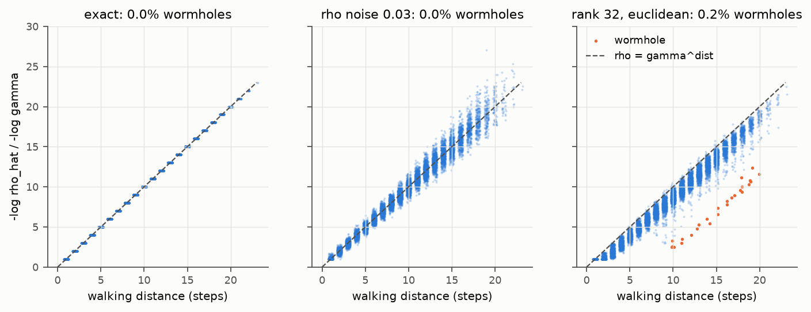
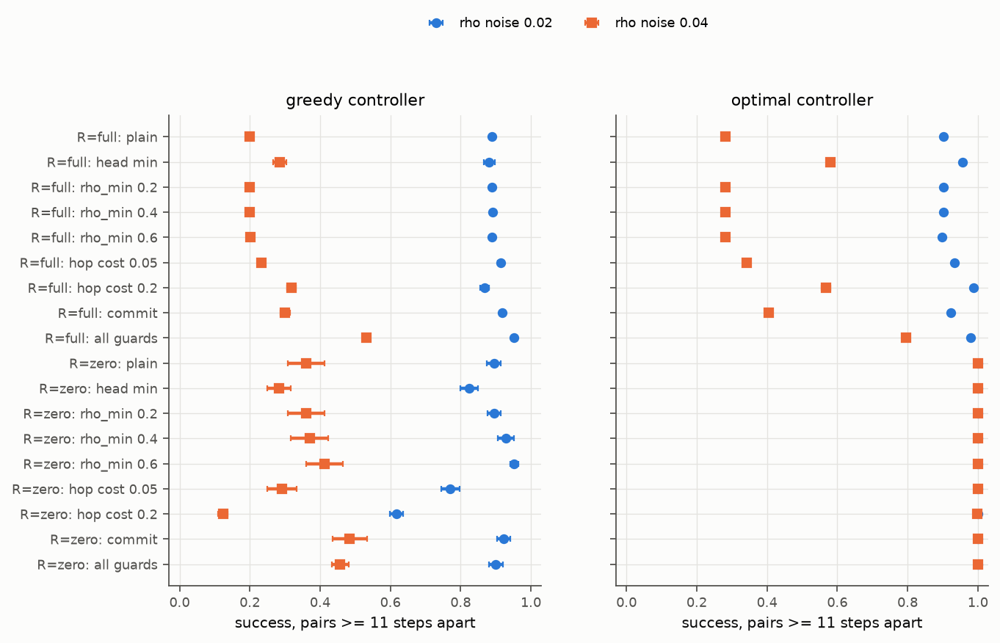
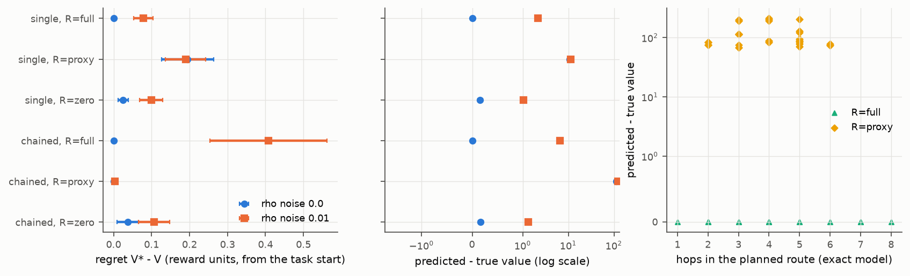
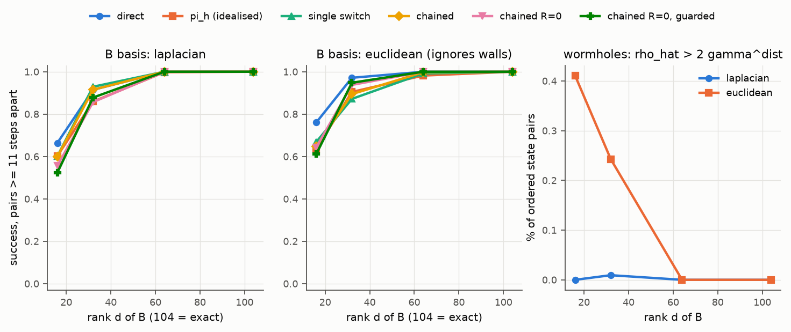
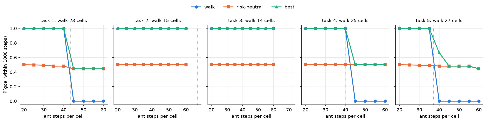
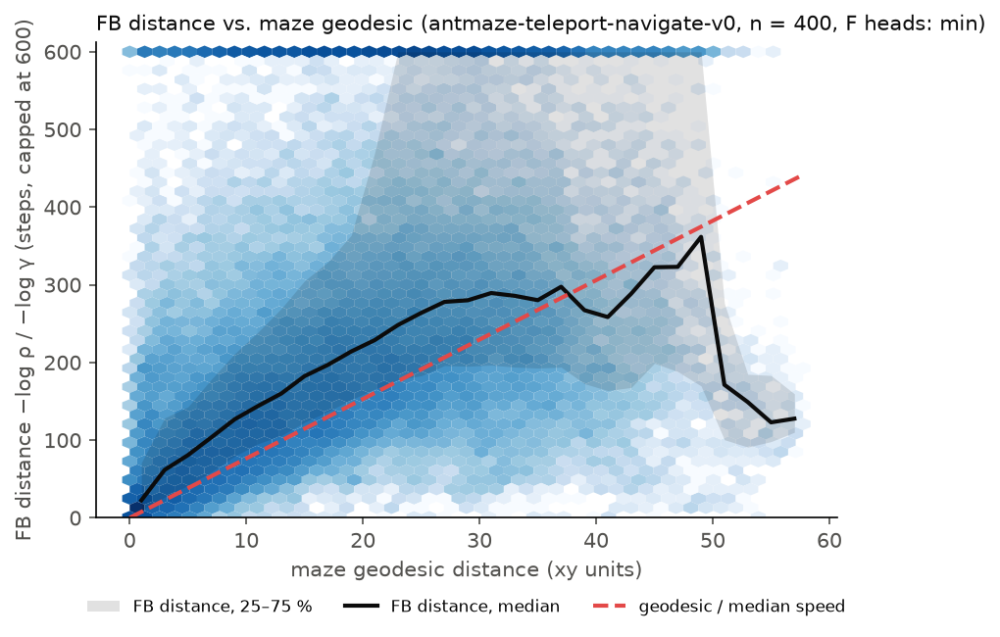
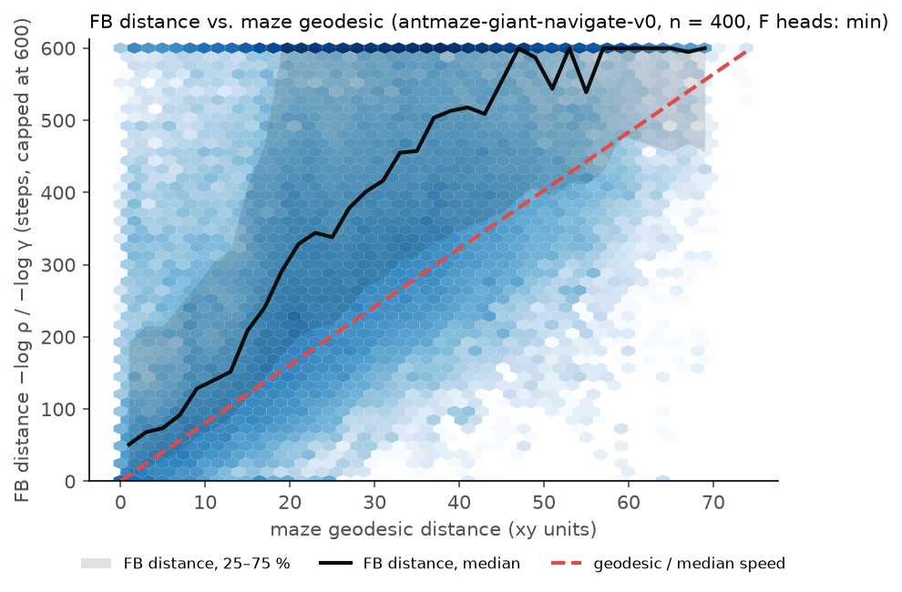
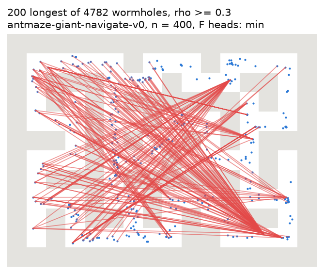

# Theory: chaining switches with successor measures

Status: report appendix. Notation follows `docs/design.md` §3 and the paper
(arXiv 2605.13207, §3–5, App. B.1). Every claim marked ✓ has a numeric check in
`tests/test_tabular_theory.py` (exact to 1e-8, on the deterministic medium maze and on the
stochastic teleport maze).

## 1. Setting

- MDP with discount γ < 1 and a state reward r, collected from t = 0:
  `V^π(s; r) = E[Σ_t γ^t r(s_t)]`.
- Successor measure with the t = 0 term: `M^π_s(s') = Σ_t γ^t P(s_t = s' | s_0 = s)`, so
  `V^π(s; r) = ⟨M^π_s, r⟩` and `M^π_w(w) ≥ 1`.
- Hitting time `H = min{t ≥ 0 : s_t = w}` (H = 0 if s = w, H = ∞ if w is never reached).
- An **option** `o_w` = "follow the Markov policy π_w until w is hit". In FB π-Switch,
  `π_w = π_l(·|s, z_w)` with `z_w = B(w)` fixed, which is Markov.

## 2. Option model

```
ρ(s,w) = E[γ^H]                       R(s,w) = E[Σ_{t<H} γ^t r(s_t)]
```

**Lemma 1** (Myers et al., Lemma B.1). `M^{π_w}_s(w) = ρ(s,w) · M^{π_w}_w(w)`. ✓
*Proof.* No visit to w happens before H. At H the state is w, and by the strong Markov property
the process after H is the chain started at w under π_w. So the visits from H on contribute
`E[γ^H] · M^{π_w}_w(w)`. □

**Lemma 2.** `R(s,w) = V^{π_w}(s; r) − ρ(s,w) · V^{π_w}(w; r)`. ✓
*Proof.* Split `V^{π_w}(s)` at H. The part after H is `E[γ^H] V^{π_w}(w)` by the same argument. □

With `M ≈ Fᵀ B` this gives design.md's formulas:
`ρ(s,w) = F(s,z_w)ᵀB(w) / F(w,z_w)ᵀB(w)` and `R(s,w) = F(s,z_w)ᵀz_r − ρ(s,w) F(w,z_w)ᵀz_r`.
Both are invariant to a positive scale of `B(w)` (F depends only on the direction of z).
A data-density factor at w cancels in the ratio.

**Bounds.** `ρ(w,w) = 1` and `R(w,w) = 0`. For s ≠ w, H ≥ 1, so `ρ(s,w) ≤ γ`; more precisely
`ρ(s,w) ≤ γ^{d(s,w)}` with d the least number of steps from s to w. ✓
In a deterministic maze with a shortest-path π_w, `ρ = γ^d` exactly.

## 3. One switch (Theorem 1 of the paper)

For any policy π, possibly history-dependent, that starts fresh at the hitting time:

```
V(s; w → π) = R(s,w) + ρ(s,w) · V^π(w; r)
```

Equivalently, at the measure level, `M^{π_w→π}_s = M^{π_w}_s + ρ(s,w)(M^π_w − M^{π_w}_w)`. ✓
*Proof.* Split at H. Before H: Lemma 2. After H: the state is w, and the strong Markov property of
the environment makes the future the process started at w under π. The policy π can have memory,
because it only sees the history after H. Only π_w must be Markov (Lemmas 1–2 use it). □

## 4. Chains

**Proposition 1.** For subgoals w_1, …, w_k and a last policy π (w_0 = s):

```
V(s; w_1,…,w_k → π) = R(s,w_1) + ρ(s,w_1) · V(w_1; w_2,…,w_k → π)
                    = Σ_{i=1..k} (Π_{j<i} ρ(w_{j−1},w_j)) R(w_{i−1},w_i) + (Π_{j≤k} ρ(w_{j−1},w_j)) V^π(w_k)
```
✓ (4 hops, random rewards, detour option policies, both mazes).
*Proof.* Apply Theorem 1 with the last policy "w_2,…,w_k → π". This policy has memory, but it
starts fresh at the first hit of w_1, which Theorem 1 allows. Induct on k. □
If some w_i is never hit, `ρ = 0` and the rest of the chain drops out, which is also correct.

The test also shows that the check is not trivial: a random policy hits w only from w itself
(ρ = 0 everywhere else), so the option policies in the test are optimal policies for
"indicator of w plus small noise". The upstream proxy (no subtraction in R) misses the true
chain value by up to 0.56 (medium) and 0.36 (teleport) in the same test. ✓

## 5. Graph Bellman equation

Options: `o_w` for each landmark `w ∈ L`, and `o_∞` = "follow π_{z_r} forever" with value
`V_d(u) = F(u,z_r)ᵀz_r`.

**Proposition 2.**
```
V_H(u) = max( V_d(u),  max_{w ∈ L, w ≠ u} R(u,w) + ρ(u,w) · V_H(w) )
```
(a) **Self-loops must be excluded.** `o_u` at u is empty (H = 0, ρ = 1, R = 0). With it, any
`V(u)` above the other terms solves the equation, so the fixed point is not unique. ✓ (with
self-loops, `V_H + 1000` is a fixed point too.)
(b) **Contraction.** Without self-loops, `ρ(u,w) ≤ γ`, so the operator is a γ-contraction in
the sup norm: one fixed point, value iteration converges from any start. ✓ (20 random pairs of
value vectors.)
(c) **k sweeps = best chain of ≤ k switches.** `T^k V_d (u) = max over chains of length ≤ k` of
Proposition 1. ✓ (brute force over all chains of 5 landmarks, k ≤ 3.)
(d) **Open-loop chains are optimal among option policies.** Each option ends exactly at its
subgoal, so the state after an option is known in advance. Choosing the next option after
seeing the outcome gives no extra information. V_H is the optimal value over these options.
(e) **Exact planning cannot beat an exact direct policy.** If π_{z_r} is optimal, `V_H = V*`. ✓
Chaining can only help when FB values or the policy π_l(·|s, z_r) are inaccurate.
(f) **Goal reaching.** If π_w's path avoids the goal, `R(u,w) = 0`, and `log V_H` solves a
shortest-path problem with edge cost `−log ρ(u,w) ≥ −log γ > 0` (no zero-cost cycles).

**With FB estimates.** `ρ̂` can exceed γ (or 1) for u ≠ w. Then (b) fails, and a cycle with
`ρ̂ = 1` and `R̂ ≥ 0` has no unique value. Clip `ρ̂` to `[0, γ]` for u ≠ w; the planner also
distrusts every edge with a raw `ρ̂ ≥ 1` (`fbplan.graph.trusted_edges`).

## 6. Executing a plan: commit or re-plan

Let `Q_H(s,w) = R(s,w) + ρ(s,w) V_H(w)`, with the option at its own subgoal excluded.

**Proposition 3** (option interruption, Sutton, Precup & Singh 1999, Thm. 2). The Markov policy
that picks `argmax(V_d(s), max_w Q_H(s,w))` at every step has value `≥ max(V_d(s), max_w Q_H(s,w))`
at every state. ✓ It is strictly better at 7 of 26 states (medium) and 20 of 45 (teleport) in
the test: mid-route states can offer a better landmark than the planned one.

So with exact values, "keep w* until it is reached" is never better than re-planning. Commitment
is a defence against noisy values (see §9). The upstream π_h, which picks a new z every step,
approximates the interrupting version of the best single switch (with the proxy advantage).

## 7. Assumptions and what changes

**Markov option policies.** Lemmas 1–2 need π_w Markov. `π_l(·|s, z_w)` with a fixed `z_w` is.
A policy with memory (for example a recurrent π_l) breaks Lemma 1.

**Continuous states.** A single point is hit with probability 0, and `M_s(·)` is a density, so
`ρ̂ = m_s(w)/m_w(w)` is a density ratio. Two approximations replace exact hitting:

1. *Ball option.* Let the option end at the first entry `x_H` into a ball `B(w)`. By the strong
   Markov property, `M_s(B) = E[γ^{H_B} M_{x_H}(B)]`, so
   `M_s(B)/M_w(B) = E[γ^{H_B} κ(x_H)]` with `κ(x) = M_x(B)/M_w(B)`. This equals the ball hitting
   discount `ρ_B = E[γ^{H_B}]` only if `κ ≈ 1` on the entry points (π_w enters the ball and stays).
2. *Entry point ≠ w.* The next option starts at `x_H`, not at w. Let
   `ε_i = sup_{x ∈ B(w_i)} |V(x; rest) − V(w_i; rest)|` for the true chain values. Then
   ```
   |V_true(s; chain) − formula(s; chain)| ≤ Σ_i (Π_{j≤i} ρ_B(w_{j−1}, w_j)) ε_i ≤ ε ρ_max / (1 − ρ_max)
   ```
   *Proof.* `V_true(s) = R_B(s,w_1) + E[γ^{H_1} V_true(x_1; rest)]`. Replacing `x_1` by `w_1`
   costs at most `ρ_B ε_1`; the rest of the chain is handled by induction. □
   The error grows with the number of hops, and it is small when option values are smooth in the
   start state at the scale of the ball (ε ≈ Lipschitz constant × radius).

The bound `ρ ≤ γ` becomes `ρ_B(s,w) ≤ γ^{t_min(s, B(w))}` for s outside the ball.

**Stochastic environments (teleport).** All proofs use only the Markov property, and every ✓ test
also passes on the teleport maze. Two things change in practice:
- `ρ = E[γ^H]` averages over random hitting times. The planner is risk-neutral in `γ^H`, but
  the success metric is `P(H ≤ T)`: a route through a teleport with a 1/3 chance of a good exit
  can have a good `ρ` and a poor success rate.
- Re-planning gains more (20/45 states vs. 7/26), because the outcome of a teleport is new
  information that a committed option ignores.

**The dropped term (upstream proxy).** The proxy uses `R̃(s,w) = F(s,z_w)ᵀz_r = R(s,w) + ρ(s,w)
V^{π_w}(w; r)`. In a chain the bias is `Σ_i (Π_{j≤i} ρ_j) V^{π_{w_i}}(w_i; r)`: one term per
hop. For goal reaching through landmarks outside the goal, `V^{π_w}(w) = 0` and the proxy is
exact. Inside a rewarding region, two neighbouring landmarks u, w form a 2-cycle that the proxy
values at `ρ V/(1 − ρ)` (for example 45/(1 − 0.9) = 450 instead of 50 in the +5 goal cell).
Value iteration on a proxy graph therefore produces values that cannot be interpreted (§9.4).

## 8. Exact tabular testbed

`fbplan/tabular/` (tests: `tests/test_tabular_*.py`):

- `maze.py`: discrete copies of the OGBench medium, large, giant and teleport mazes (maps, tasks
  and teleporters checked against OGBench by a test). Each maze cell is split into `resolution²` states; medium at
  resolution 2 has 104 states, as in the paper's discrete maze. Observations are AntMaze (x, y);
  5 actions (stay, ±x, ±y). The teleport maze is stochastic, as in OGBench.
- `mdp.py`, `options.py`: exact `M^π = (I − γP_π)^{-1}`, optimal policies, option models from the
  true model, the augmented-chain ground truth, the re-planning policy. Graph value iteration
  and Q-values are the planner's own (`fbplan/graph.py`).
- `study.py`: the planners of §9. They get `ρ̂`, `R̂` and `V_d` from the planner's
  `fbplan/option_model.py` applied to the fake, and use its trust rule, value iteration and tie
  rules (`fbplan/graph.py`, `best_options`). The plan is the planner's; the execution is not:
  the study has no reach radius or look-ahead, and its commit rule keeps w* until it is reached
  or for twice its predicted duration plus 2 steps (the AntMaze planner: 100 steps). Code names:
  `v_direct` = V_d, `v_graph` = V_H, `r_before` = R.
- `fake_fb.py`: `TabularFB` implements `FBModel`. B has orthonormal columns times √n (upstream
  convention). A latent z means the reward `r_z = B ẑ / n`; `π*_z` is its exact optimal policy and
  `F(s,z) = M^{π*_z} B / n + noise`, so `F(s,z)ᵀB(s') = M^{π*_z}(s,s')` in full rank.
  Modes: exact (d = n); low rank (Laplacian basis respects walls, cosine "euclidean" basis ignores
  them); independent additive noise per head with std ≈ `rho_noise` on `ρ̂`. The controller
  π_l is greedy on the noisy value `F(s',z)ᵀz` (default) or the exact `π*_z`. π_h is idealised:
  the argmax of the proxy advantage over states `0 < d(s,w) ≤ high_radius`.
- `env.py`: an OGBench-like env and `rollout()` for any `Controller`.
- `time_limit.py`: success within a time limit vs. the discounted value on the cell mazes (§11).

Noise model note: the error on `F(s,z)ᵀz` is about `rho_noise/(1 − γ)`, while the value gap
between neighbours is about `γ^{d−1}`. So the greedy controller fails beyond
`d ≈ log(rho_noise/(1−γ)) / log γ` steps (about 9 steps at 0.04), earlier than `ρ̂` itself becomes
unreliable. This mirrors a controller that is reliable only at short range.

## 9. Study: single switch vs. chained switches under FB errors

Setup: medium, 104 states, γ = 0.9 (ρ from 0.9 for neighbours to 0.09 for the farthest pair),
landmarks = all states, every (start, goal) pair with a one-state goal, success = goal reached in
100 steps, 5 noise seeds, mean ± s.e. over seeds. "Far" = 11 steps or more (ρ ≤ 0.31).
Planners (`fbplan/tabular/study.py`) see only F, B, π_l, π_h; evaluation is exact. They use the
planner's own code (§8): `OptionModel` for `ρ̂`, `R̂`, `V_d`; `fbplan.graph` for trust (raw
`ρ̂` in `[ρ_min, 1)`), value iteration and Q-values. R̂ variants use the planner's names:
exact (`R` of §2), paper (the upstream proxy `F(s,z_w)ᵀz_r`, §7) and zero.

- **direct**: π_l(z_r). **π_h**: the idealised baseline (subgoals within 10 = 1/(1−γ) steps).
- **single switch**: best `R̂ + ρ̂ V_d(w)` over all landmarks, re-planned every step.
- **chained**: graph value iteration (§5), exact `R̂`. **chained R=0**: `R̂ = 0` (§5 f).
- **guarded**: R = 0, head min, `ρ_min = 0.4`, commit until reached (timeout: twice the
  predicted duration `log ρ̂ / log γ`, plus 2 steps).

Reproduce: `uv run python -m fbplan.tabular.run_study && uv run python -m fbplan.tabular.study_plots`
(14 min with 4 workers on the shared 12-core Mac; 10 CPU minutes). Tables:
`docs/figures/theory/study_*.csv`.

### 9.1 Chaining helps when the controller fails at long range




Far-pair success:

| controller | planner | ρ noise 0.02 | 0.03 | 0.04 |
|---|---|---|---|---|
| greedy | direct | 0.70 | 0.36 | 0.16 |
| greedy | π_h (idealised) | 0.89 | 0.55 | 0.26 |
| greedy | single switch | 0.80 | 0.49 | 0.24 |
| greedy | chained | 0.89 | 0.55 | 0.20 |
| greedy | chained R=0 | 0.90 | 0.67 | 0.37 |
| greedy | chained R=0, guarded | **0.90** | **0.69** | **0.46** |
| exact | direct | 1.00 | 1.00 | 1.00 |
| exact | chained | 0.90 | 0.60 | 0.28 |
| exact | chained R=0 (± guards) | 1.00 | 1.00 | 1.00 |

- With the greedy controller, chained R=0 with guards almost triples direct at noise 0.04 and
  beats the idealised π_h (0.46 vs. 0.26). At noise 0.02 the gain over π_h is small.
- With an exact controller the direct policy is already optimal (§5 e). Planning on noisy values
  can only lose, and the planner with exact-mode `R̂` loses a lot.

### 9.2 The main failure is noisy R̂, not wormholes

`R̂ = F(s,z_w)ᵀz_r − ρ̂ F(w,z_w)ᵀz_r` is a difference of two noisy values. For goal reaching
the true R is 0 almost everywhere, so `R̂` is pure noise of size about `rho_noise/(1 − γ)`. The max
over about 100 landmarks per hop picks the largest noise, and cycles with positive `R̂` look
profitable. Setting `R̂ = 0` restores 1.00 with the exact controller.

Independent noise creates no gross wormholes: no pair has `ρ̂ > 2γ^d` at any noise level up to
0.04 (`study_wormholes.csv`). The harm comes from many small overestimates compounded by the max.
"Wormhole" here means `ρ̂ > 2γ^d` (`study.rho_bound_wormholes`, the true ρ is at most `γ^d`).
The AntMaze calibration (`analysis/calibration.py`) uses another definition: a trusted pair whose FB distance is
shorter than the time to walk the geodesic at the ant's top speed (§11.2).



### 9.3 Guards (one change at a time from a plain chained planner)



Far-pair success at noise 0.04:

| change | R exact, greedy | R exact, exact | R=0, greedy | R=0, exact |
|---|---|---|---|---|
| plain | 0.20 | 0.28 | 0.37 | 1.00 |
| head min | 0.29 | 0.58 | 0.29 | 1.00 |
| ρ_min 0.6 | 0.21 | 0.28 | 0.42 | 1.00 |
| hop discount 0.95 | 0.27 | 0.50 | 0.11 | 1.00 |
| hop discount 0.8 | 0.16 | 0.83 | 0.13 | 1.00 |
| commit | 0.31 | 0.40 | 0.50 | 1.00 |
| all (min, ρ_min 0.4, commit) | 0.53 | 0.80 | 0.46 | 1.00 |

- **Head min** counters independent errors in `R̂` (0.28 → 0.58), not shared errors (§9.5).
- **ρ_min** matters only when hops must stay inside the controller's reliable range (R=0, greedy:
  0.37 → 0.42; at noise 0.02, 0.90 → 0.95). With exact-mode `R̂` the chosen edges are already
  short.
- **Hop discount** (a factor on ρ̂ per hop, as in the planner) helps against fake `R̂` when the
  controller is exact (0.28 → 0.83), but hurts with R = 0: it pushes the plan to fewer, longer
  hops that the greedy controller cannot complete (0.37 → 0.11–0.13).
- **Commitment** helps in every noisy case: it stops dithering between near-equal noisy plans.
  With exact values it can only lose (§6).

### 9.4 The dropped term over hops (general rewards)

Region rewards: +5 on the task's goal cell, +1 and −1 on two random cells; 5 tasks × 10 rewards;
exact controller; value from the task start (V* ≈ 11).



| planner | regret, exact FB | predicted − true, exact | regret, noise 0.01 | predicted − true, 0.01 |
|---|---|---|---|---|
| single, R exact | 0.00 | 0.0 | 0.08 | 2.1 |
| single, R paper (proxy) | 0.19 | 10.7 | 0.19 | 11.3 |
| chained, R exact | 0.00 | 0.0 | 0.41 | 6.6 |
| chained, R paper (proxy) | 0.00 | 111.8 | 0.00 | 121.3 |
| chained, R = 0 | 0.03 | 0.2 | 0.11 | 1.3 |

- The proxy bias repeats per hop: the predicted value is 10× more wrong for chains than for one
  switch, mostly through the 2-cycles of §7. Actions suffer little here, because the inflation sits
  in the goal region, where the agent should go anyway.
- With noise, exact-mode `R̂` makes chained plans long (9.8 hops; with exact values 0, because the
  direct policy is optimal and wins ties, `graph.best_options`) and costly (regret 0.41):
  the same noisy-`R̂` effect as §9.2. R = 0 ignores the ±1 regions on the way and costs little.

### 9.5 Low rank: wall-blind features make wormholes



- The wall-blind basis puts 0.24 % (rank 32) and 0.41 % (rank 16) of pairs above `2γ^d`; the
  wall-aware basis almost none. The wormholes cross thin walls (calibration figure, right).
- At rank ≤ 32 all methods lose together (far success 0.57–0.76 at rank 16, 0.86–0.97 at rank 32),
  and chaining gives no gain (direct is best at rank 16): the
  reward `P_B e_w` is blurred, so π_l(·|B(w)) goes near w, not to w. Errors shared by both heads
  are not removed by head min.

## 10. Consequences for the planner (approach A)

1. Exclude self-loops; clip `ρ̂` to `[0, γ]` for distinct landmarks.
2. For goal-reaching tasks use `R̂ = 0` (shortest path on `−log ρ̂`). Use exact-mode `R̂` only
   for general rewards, with head min and a hop discount. Never use the proxy ("paper") in a
   graph.
3. Choose `ρ_min` so that every hop stays in the range where π_l reliably reaches its subgoal;
   commit to w* until it is reached, with a timeout.
4. Expect gains where π_l fails at long range, not where the direct policy already works. The
   oracle-waypoint controller (`fbplan/controllers/oracle.py`) measures exactly this headroom on AntMaze.
5. In continuous states the chain value is approximate (§7): keep hops few and the reach radius
   small compared with the scale on which option values change.

## 11. Bonus mazes: teleport and giant

Runs: the protocol of design.md §5 (5 eval seeds × 5 tasks × 50 episodes, paired start states),
method defaults, on the Linux evaluation instance (CSVs in `results/teleport/` and
`results/giant/`, commands in `scripts/reproduce.sh`). Two replays of preliminary Mac runs
(the giant oracle's progress in §11.2, the check of the trap rule in §11.3) say so; no table
mixes the two platforms.

### 11.1 Teleport: the value is risk-neutral, the success metric is not

**The env** (OGBench source and the train split):

- An agent within 1.5 xy units of an entry centre, (4,6) or (5,1), jumps to one of the exits
  (1,7), (6,1), (6,10), chosen uniformly. Exit (1,7) has walls on all four sides: a trap.
- Every task goal can be reached on foot, without a teleporter. The shortest such walks are
  23, 15, 14, 25 and 27 cells long (tasks 1–5). The plain BFS path goes through an entry on
  tasks 1, 3, 4 and 5, so the BFS oracle of `fbplan/controllers/oracle.py` is not valid here.
- The data route through the entries: trajectories that leave the start cell (5,6) of tasks 3
  and 5 go up into the entry 91 times and down 2 times; from (6,1), up into the entry 323 times
  and down 54 times. OGBench's `get_oracle_subgoal` runs BFS on the map without the teleporters.
  18 % of the train states lie in the trap, and 27 % of the 1,000 train trajectories end there.

**Proposition 4.** Each jump ends in the trap with probability 1/3, and the trap is absorbing.
So a policy that jumps at least once succeeds with probability ≤ 2/3. A policy that jumps again
after each bad exit succeeds with probability `Σ_k (1/3)^{k+1} = 1/2` at most. A walk that fits
in the time limit succeeds with probability 1. ✓ (`tests/test_tabular_time_limit.py`)

**Why a discounted value prefers the jump.** FB values estimate `E[γ^H]`, and π_l, π_h and the
graph planner all maximise it. Let one cell move take c ant steps, so `g = γ^c` per move. From
(5,6) to the goal (7,10) (task 3), the jump is worth `g²/(3 − g)` (exit (6,10) is next to the
goal, and exit (6,1) is next to the other entry, so a new jump costs one move), and the walk is
worth `g^14`. At γ = 0.99 and c = 40: 0.19 against 0.0036. The trap removes a third of the
value per jump; the walk loses a factor `γ^560`.

Exact cell-level computation (`fbplan/tabular/time_limit.py`; resolution 1, T = 1000 ant
steps, c = 40, the median pace of successful medium episodes):

| task | walk (cells) | P(success): walk | risk-neutral (max `E[γ^H]`, γ = 0.99) | best for the metric | γ at which the risk-neutral policy walks |
|---|---|---|---|---|---|
| 1 | 23 | 1.00 | 0.48 | 1.00 | 0.99856 |
| 2 | 15 | 1.00 | 0.50 | 1.00 | 0.99770 |
| 3 | 14 | 1.00 | 0.50 | 1.00 | 0.99850 |
| 4 | 25 | 1.00 | 0.50 | 1.00 | 0.99919 |
| 5 | 27 | 0.00 | 0.48 | 0.67 | 0.99933 |



- The risk-neutral policy takes the teleporter on all 5 tasks at every pace from 20 to 60 ant
  steps per cell, and its success stays at 0.44–0.50. An exact FB agent with this γ would score
  below 50 % on teleport.
- It walks only for γ ≥ 0.9977–0.9993: an effective horizon `1/(1 − γ)` of 435–1,500 steps,
  4–15 times the checkpoint's 100 steps.
- The best policy for the metric walks whenever the walk fits. On task 5 the walk does not fit
  at 40 steps per cell; the best policy then jumps once and walks from the far exit (2/3).

**The FB checkpoint has learned the jump.** FB calibration on 400 val states (as in §11.2,
`--env antmaze-teleport-navigate-v0`; γ = 0.99):



- The median FB distance grows with the walking distance up to about 30 xy units, stays at
  about 290 steps from 30 to 50 units, and falls beyond. For pairs 60–75 units apart on foot
  (480–555 steps at the median speed; `0.99^walk` = 0.004–0.008), it is 150–190 steps:
  `ρ̂` = 0.15–0.22. These pairs join the left and the right side of the maze, which the
  teleporters connect. (Distances from the independent raster check
  `uv run python analysis/raster_geodesic.py --env antmaze-teleport-navigate-v0`; the figure's
  geodesic is too short for some pairs, see the caveat in §11.2.)
- A jump that is repeated after each bad exit is worth `(1/3) / (1 − γ^40/3) = 0.43` at γ = 0.99
  and 40 steps per re-jump, times the discount of the walks to the entry and from the exit. So
  `ρ̂` has the size of the risk-neutral jump value, not of the walk: FB estimates `E[γ^H]` of the
  data policy, and the data policy jumps.
- 5,135 pairs that pass the planner's ρ test (0.3 ≤ raw `ρ̂` < 1, before the xy cap) cannot be
  walked: 4,671 lead into the trap (reachable only by a jump), 464 lead out of it (true ρ = 0).
  Of all pairs into the trap, 20.6 % have raw `ρ̂` ≥ 0.3; of all pairs out of it, 2.0 %.

**Consequences.** `E[γ^H]` at one γ is one point of the Laplace transform of H. It cannot tell
"slow" from "sometimes never", so no planner on FB values alone can be optimal for `P(H ≤ T)`
here. The graph planner with `R̂ = 0` maximises `Π ρ̂ = E[γ^H]` of the chain: risk-neutral too. Its
xy cap (6 units) removes every jump edge, because the exits are far from the entries in xy, so it
plans walks; this guard works against risk by accident. Remedies within the frozen setting: a
larger γ (it costs accuracy, see giant), FB at several γ to bound `P(H ≤ T)`, or an explicit
penalty on edges whose successor measure has mass on an absorbing region (the trap). §11.4
tests such a penalty in the intention (T3).

### 11.2 Giant: the time limit and ρ at long range

**The time budget.** The giant walks are 30, 26, 30, 26 and 17 cells (medium: 6–10). They fit in
1,000 steps only at ≤ 33, 38, 33, 38 and 59 ant steps per cell. Successful medium episodes take a
median of 41 (baseline) and 43 (oracle) steps per cell, and only 29–45 % of them are fast enough
for tasks 1–4 (70 % for task 5). So with this π_l even a perfect high level fails most episodes
of tasks 1–4.

The privileged oracle (true shortest path, waypoints 2 cells ahead) measures the pace on giant
itself. It succeeds in 2.5 % of the episodes (§11.3; 0 % on tasks 1 and 3). Of its 1,219
failures, 21.7 % are flips, 0.7 % are stuck, and 77.6 % are still moving at the time limit
(`results/giant/failures/oracle.csv`, `analysis/failures.py`). A replay of eval seed 0
of the preliminary Mac run (249 of 250 failures) measures the progress: in 1,000 steps the
oracle covers a median of 14, 15.5, 6, 15 and 5 cells of the 30-, 26-, 30-, 26- and 17-cell
walks (`cells_left`), so 65–200 steps per cell against about 40 on medium. On giant, π_l follows
even perfect waypoints too slowly for the time limit; the route is not the bottleneck.

**ρ at long range.** The checkpoint uses γ = 0.995 (horizon 200 steps). A 1,000-step route has
`ρ = 0.995^1000 = 0.0067`. FB calibration on 400 val states
(`uv run python analysis/calibration.py --env antmaze-giant-navigate-v0 --out-dir docs/figures/theory
--table-dir docs/figures/theory`):



- The median FB distance `−log ρ̂ / −log γ` grows with the walking distance over the whole
  range, at 1.2–1.7 times the walk at the median speed of the data (5–65 xy units), and passes
  the 600-step cap (`ρ̂` < 0.05) at about 65 units. The spread is wide: from 20 units (5 cells)
  on, the upper quartile is at the cap, and 26–60 % of the pairs have `ρ̂` < 0.05. The task
  walks are 52–92 units on foot (420–740 steps at the median speed, `0.995^walk` = 0.02–0.12).
  (Bins of the independent raster check
  `uv run python analysis/raster_geodesic.py --env antmaze-giant-navigate-v0`; see the caveat.)
- Caveat: the figure's point geodesic (`MazeGeometry.geodesic_distances`) is too short for some
  pairs. Two wall cells that share an edge leave a thin slit after the shrink of the wall boxes,
  and a straight segment along that grid line passes between them. The giant task 5 measures
  21.2 xy units, but its walk is 17 cells (raster check: 51.9). Against an octile Dijkstra on a
  0.5-unit raster (at most 8 % too long; `analysis/raster_geodesic.py --env <env>`), 31 % of the
  giant pairs are more than 15 % too short (large 13 %, teleport 16 %, medium 0.2 %). The bins in
  this section use the raster distance.
- `ρ̂ ≤ 0` (clipped to 0) for 23.9 % of the pairs (medium 10.2 %). At ρ_min 0.3, 11.1 % of the
  trusted pairs are wormholes in the sense of `analysis/calibration.py` (FB distance shorter
  than the walk at the ant's top speed; medium 5.5 %), some across the whole maze. With the slit issue this count is a
  lower bound. The planner's 6-unit xy cap removes all but 801 of the 4,782 (table:
  `docs/figures/theory/wormholes_antmaze-giant-navigate-v0_min.csv`):



So at the start of a task, `F(s,z_r)ᵀz_r` and the subgoal values `F(w,z_r)ᵀz_r` that drive π_h
carry no reliable direction. This is the regime of §9.1: the controller fails at long range, and
a graph of short trusted edges can supply the direction (the planner's edges are ≤ 6 xy units,
well inside the calibrated range). Chaining cannot fix the time budget or the flips.

### 11.3 Measured results

Success (%), 95 % stratified bootstrap CI, paired difference against the baseline on the same
episodes: `uv run python analysis/tables.py results/<maze>/*.csv results/<maze>/planner*/*.csv
--label-root results/<maze> --cluster config_hash`. Planner rows pool landmark sets 0–2 (3,750
episodes, cluster bootstrap over the sets). The oracles are privileged: they read the maze map.

| teleport | task 1 | task 2 | task 3 | task 4 | task 5 | all | vs. baseline (pp) |
|---|---|---|---|---|---|---|---|
| baseline | 22.8 | 43.6 | 29.2 | 24.4 | 18.4 | 27.7 [25.3, 30.2] | |
| baseline_raw (upstream z_r) | 18.8 | 39.6 | 26.4 | 21.2 | 14.8 | 24.2 [21.8, 26.6] | −3.5 [−6.2, −1.0] |
| nonhier | 17.6 | 21.6 | 23.6 | 18.4 | 14.0 | 19.0 [16.9, 21.2] | −8.6 [−11.2, −6.2] |
| planner | 17.5 | 24.8 | 20.3 | 15.6 | 14.7 | 18.6 [16.5, 21.0] | −9.1 [−12.2, −6.0] |
| planner_high | 17.1 | 33.6 | 28.1 | 21.7 | 19.9 | 24.1 [21.5, 26.4] | −3.6 [−6.7, −0.5] |
| teleport-aware oracle, π_l follows | 2.8 | 8.4 | 8.0 | 3.2 | 5.6 | 5.6 [4.3, 6.9] | −22.1 [−24.7, −19.5] |
| teleport-aware oracle, π_h follows | 7.2 | 60.4 | 27.2 | 3.2 | 8.8 | 21.4 [19.4, 23.3] | −6.3 [−9.2, −3.4] |

| giant | task 1 | task 2 | task 3 | task 4 | task 5 | all | vs. baseline (pp) |
|---|---|---|---|---|---|---|---|
| baseline | 0.0 | 0.0 | 0.0 | 1.2 | 1.2 | 0.5 [0.2, 0.9] | |
| nonhier | 0.0 | 0.8 | 0.0 | 0.8 | 0.8 | 0.5 [0.2, 0.9] | +0.0 [−0.6, +0.6] |
| planner | 0.0 | 0.5 | 0.0 | 0.0 | 1.5 | 0.4 [0.2, 0.7] | −0.1 [−0.6, +0.4] |
| planner_high | 0.0 | 0.4 | 0.0 | 0.1 | 3.5 | 0.8 [0.5, 1.1] | +0.3 [−0.2, +0.9] |
| oracle | 0.0 | 5.2 | 0.0 | 2.0 | 5.2 | 2.5 [1.7, 3.4] | +2.0 [+1.1, +3.0] |

**Teleport: most failures end in the trap.** A trapped ant ends its episode inside cell (1,7), so
its final distance to the goal is within 2 xy units of the trap centre's (26.8 for goal (7,10),
33.9 for goal (7,1)). On eval seed 0 of the Mac baseline this rule finds all 129 trapped
episodes of an exact replay (`replay_failures` in `analysis/failures.py`, trap = `cells_left = −1`) and adds 3 of
the 48 other failures. (`analysis/failures.py` now has the exact `trapped` class; the rule here
needs only the CSV.) Over all episodes:

| teleport | success | trap | other failures |
|---|---|---|---|
| baseline | 27.7 % | 54.7 % | 17.6 % |
| baseline_raw | 24.2 % | 57.4 % | 18.4 % |
| nonhier | 19.0 % | 65.4 % | 15.6 % |
| planner | 18.6 % | 64.2 % | 17.3 % |
| planner_high | 24.1 % | 53.9 % | 22.1 % |
| teleport-aware oracle, π_l follows | 5.6 % | 19.9 % | 74.5 % |
| teleport-aware oracle, π_h follows | 21.4 % | 18.2 % | 60.5 % |

- A policy that jumps until it lands on a good exit ends in the trap half the time (Proposition
  4). All learned agents end there more often: they also jump when the walk is short, and they
  jump again after a good exit when π_l does not finish.
- The planner plans walks (its xy cap removes the jump edges), yet 64 % of its episodes end in
  the trap. π_h after the waypoint (planner_high) is as trapped as the baseline (54 %) and
  recovers most of the gap (−3.6 pp against −9.1 pp).
- The risk-free route of the teleport-aware oracle cuts the trap share by about two thirds
  (18–20 % against 55 %), but not to 0. On tasks 1 and 2, at most 4 % of its episodes end in the
  trap; on task 4, 13–17 %; on tasks 3 and 5, 37–39 %. Tasks 3 and 5 start at (5,6), one cell
  below entry (4,6). The plan walks down, but π_l and π_h walk up: trajectories in the data that
  leave (5,6) go up 91 times and down 2 times (§11.1). The executor learned the expert's route
  through the entries.
- The oracle's other failures are timeouts near the goal: a median final distance of 13–17 xy
  units (3–4 cells) on tasks 1, 2, 3 and 5, and 36 on task 4. The safe walks of tasks 1, 4 and 5
  (23, 25 and 27 cells) fit in 1,000 steps only at ≤ 43, 40 and 37 steps per cell, and waypoint
  following is slower than that (it stalls at corners; on giant 65–200 steps per cell, §11.2).
  π_l follows the oracle's region latents worse than π_h does (5.6 % against 21.4 %).
- Where the route and the executor agree, the route helps. The shortest path of task 2 (15
  cells) passes no entry, so the oracle's route is the data's route. With π_h following, the
  oracle reaches 60.4 % against 43.6 % for the baseline on that task (+16.8 pp [+8.0, +25.6],
  paired, episode bootstrap). Over all tasks it loses 6.3 pp.

So on teleport the frozen executor, not the plan, sets the ceiling: the risk-free route removes
most jumps, but π_l and π_h still take the entry next to their start, and the long safe walks do
not fit in the time limit at their pace. Proposition 4 adds a second ceiling for any agent that
maximises a discounted value.

**Giant: the executor is the bottleneck.** The baseline and nonhier are equal (0.5 %). The
privileged oracle reaches 2.5 % (+2.0 pp); its failures are mostly slow progress (§11.2). Neither
planner differs from the baseline (−0.1 and +0.3 pp, both CIs contain 0). Most planner
successes are on task 5, the shortest walk (17 cells; it fits at ≤ 59 steps per cell):
planner_high reaches 3.5 % there against 1.2 % for the baseline (+2.3 pp [−0.1, +4.8], paired,
episode bootstrap over the pooled sets), and the oracle 5.2 %. A planner can at most supply the
route, and the oracle shows that the route alone is worth about +2 points here.

### 11.4 Time-aware trap avoidance (T3)

T3 of design.md §8 (`docs/hypotheses/h-exec.md` H1) tests the last remedy of §11.1 in the
intention: a penalty on the absorbing trap, applied only while a walk still fits in the steps
left. Controller: `fbplan/controllers/trap_aware.py`; tests on the exact tabular maze:
`tests/test_tabular_trap_aware.py`.

- `z_t = normalize(π_h(s,z_r) − λ·g(s,t)·ẑ_trap)`. `ẑ_trap` is the centred mean of B over a
  seeded pool of 200,000 train states, with the trap states marked: the states that follow a
  trajectory's last jump (xy step > 2) and stay within a radius of their mean.
- Data checks of the trap rule on the train split (the map checks the rule; the rule does not
  read the map). Jumps are ≥ 2.27 xy units and walking steps ≤ 0.37, so the threshold 2
  separates them. At radius 2.5–4.0 the rule marks all 247 train trajectories that end in the
  trap cell, with 10–14 false alarms; the trap states are 16.4 % of the train states.
  `B(s)ᵀẑ_trap` separates the trap cell with AUC 0.991. The radius hardly matters: `ẑ_trap` at
  radius 1.5, 2.5 and 4.0 have cosines ≥ 0.997.
- The gate g is open while `log ρ̂_walk / log γ ≤ 1000 − t`, with
  `ρ̂_walk = min_h F_h(s,z_c)ᵀẑ_r / F_goal` and `z_c = normalize(ẑ_r − λẑ_trap)`.
- `F_goal` deviates from `docs/hypotheses/h-exec.md` H1, which takes it over the train states in
  the goal ball: the controller cannot know these without `goal_xy`. It takes the median of the
  same value over the 64 pool states with the highest `B(s)ᵀẑ_r`. On the 5 start–goal pairs of
  `docs/hypotheses/h-exec.md` M11, these states lie at a median 2.4–3.3 xy units from the goal,
  and `F_goal` is within 20 % of the goal ball's value.
- On the tabular maze (exact F and B) the controller walks where the walk fits (success 1.0,
  trap 0, against a trap share of 0.42–0.72 for the baseline) and hands back to the baseline
  where it does not. ✓

**Selection on the 10 teleport held-out goals** (Linux, eval seeds 0–2, 20 episodes per goal and
eval seed, 600 episodes per row). The rule was fixed on 2026-10-30, before any held-out result:

- Candidates: the 6 gated rows, λ ∈ {0.5, 1, 2} × radius ∈ {1.5, 2.5}. The rule takes the
  candidate with the highest held-out success; ties go to the smaller λ, then to radius 2.5.
  Nothing else is tuned.
- Control, not a candidate: the ungated rows (gate `none`, radius 2.5, λ ∈ {0.5, 1, 2}), the
  setting of `docs/hypotheses/h-exec.md` M11. References: baseline and baseline_raw.

Success (%) and the paired difference against the baseline (pp):

| teleport held-out | λ = 0.5 | λ = 1 | λ = 2 |
|---|---|---|---|
| gated, radius 1.5 | 46.5 (−1.7 [−6.2, +2.8]) | 40.2 (−8.0 [−12.2, −3.8]) | 27.2 (−21.0) |
| gated, radius 2.5 | 44.7 (−3.5 [−7.8, +1.0]) | 39.8 (−8.3 [−12.7, −4.0]) | 29.7 (−18.5) |
| ungated (control) | 44.2 (−4.0 [−8.3, +0.5]) | 37.8 (−10.3 [−14.8, −5.7]) | 29.8 (−18.3) |

The baseline has 48.2 % and baseline_raw 46.5 %. The rule selects λ = 0.5, radius 1.5. No row
beats the baseline.

**Final run** (5 eval tasks, eval seeds 0–9, 2,500 episodes per row, paired):

| teleport, 10 seeds | task 1 | task 2 | task 3 | task 4 | task 5 | all | vs. baseline (pp) | vs. baseline_raw (pp) |
|---|---|---|---|---|---|---|---|---|
| baseline | 24.6 | 43.4 | 27.4 | 23.4 | 19.2 | 27.6 [25.9, 29.3] | – | +2.5 [+0.6, +4.4] |
| baseline_raw | 20.2 | 42.0 | 25.8 | 20.6 | 17.0 | 25.1 [23.5, 26.8] | −2.5 [−4.4, −0.6] | – |
| trap_aware (λ 0.5, r 1.5) | 13.8 | 30.0 | 17.2 | 17.2 | 11.4 | 17.9 [16.4, 19.4] | −9.7 [−11.6, −7.7] | −7.2 [−9.2, −5.2] |

| teleport, 10 seeds | success | trap | other failures | median steps of successes |
|---|---|---|---|---|
| baseline | 27.6 % | 54.8 % | 17.6 % | 502 |
| baseline_raw | 25.1 % | 56.5 % | 18.4 % | 471 |
| trap_aware | 17.9 % | 51.8 % | 30.2 % | 574 |

T3 fails the rule of design.md §8 (a significant gain over both baseline rows). The reasons:

- **The penalty moves 3 points from the trap to the time limit.** The trap share falls from
  54.8 to 51.8 %. The other failures rise from 17.6 to 30.2 %; all of them run to the 1,000-step
  limit (flips and slow walks; the CSV cannot separate them), with a median final distance of
  17.7 xy units (baseline 21.7). Successes are slower (median 502 → 574 steps). This is the
  trade-off of §11.1 and `docs/hypotheses/h-exec.md` M11: an episode that does not jump must
  walk, and the safe walks do not fit at π_l's pace.
- **The penalty also costs where there is nothing to avoid.** On the 4 held-out goals where at
  most 10 % of the baseline episodes end in the trap (104, 105, 106, 108), λ = 0.5 loses 7.1 pp
  (63.7 → 56.7 %) and λ = 1 loses 17.1 pp; the trap share does not fall there (3.3 → 5.8 %). On
  the other 6 goals λ = 0.5 gains 1.9 pp (trap 38.3 → 31.1 %). The penalised intention is a
  different instruction for π_l on every route, and π_l follows it less well.
- **The time gate has no measurable effect.** Gated against ungated on the held-out goals:
  +2.3 pp [−2.0, +6.7] at λ = 0.5 (p 0.33) and +2.3 pp at λ = 1 (p 0.34). At the start states
  of the eval tasks (controller reset only, 5 reset seeds), the gate's walk estimate is 58–77
  steps on tasks 3, 4 and 5, whose safe walks are 14, 25 and 27 cells (about 560–1,100 steps at
  40 steps per cell). On tasks 1 and 2 the median estimate is inf (`ρ̂_walk ≤ 0`), so the gate
  is closed at the start.
  58–77 steps is the jump route: tasks 3–5 start 1–2 cells from an entry, and a good exit is
  next to the goal.
- **F does not model the trap-averse route.** For λ from 0 to 4 in `z_c`, the walk estimate at
  the start of tasks 3–5 stays at 58–77 steps, and F's trap occupancy `F(s,z_c)ᵀẑ_trap / d`
  falls only from 0.15 to 0.11. But π_l does change its route under the penalty (the trap share
  falls by 3 points here, by half at λ = 1 in `docs/hypotheses/h-exec.md` M11). So the gate
  stays open on the long walks of tasks 4 and 5, where it should close.
- **The gate is closed at the start of tasks 1 and 2, but it opens later.** With a closed gate
  the controller makes the baseline's calls, so an episode whose gate never opens repeats the
  baseline's episode exactly. Only 1.0 % (task 1) and 0 % (task 2) of the episodes do. These two
  tasks lose the most:

  | teleport, 10 seeds | task 1 | task 2 | task 3 | task 4 | task 5 |
  |---|---|---|---|---|---|
  | success (pp) | −10.8 | −13.4 | −10.2 | −6.2 | −7.8 |
  | other failures (%) | 29.6 → 46.2 | 22.2 → 40.8 | 8.2 → 21.4 | 9.2 → 21.8 | 18.6 → 21.0 |

- **The held-out grid under-predicted the cost** (−1.7 pp against −9.7 pp on the eval tasks).
  The held-out goals are easier (baseline 48 % against 28 %), and only 3 of the 10 have an entry
  on the plain route. The selection could find the smallest λ, but not its cost on long walks.

**Consequence.** Three ways to walk instead of jump are now measured on teleport: the planner
(−9.1 pp, 5 seeds), the teleport-aware oracle with π_h (−6.3 pp, 5 seeds) and T3 (−9.7 pp,
10 seeds). None beats the baseline. The frozen π_l walks too slowly for the long safe walks,
and FB cannot tell where a walk fits: at long range its F holds the value of the jump (§11.1),
also for a trap-averse `z_c`. I see no other high-level remedy for teleport in the frozen
setting that the measurements support. A faster π_l (`docs/hypotheses/h-exec.md` H2, out of
scope for now) comes first.

Numbers:

- Success and paired differences: `uv run python analysis/tables.py
  results/teleport/heldout/*.csv results/teleport/heldout/trap_aware/*.csv --label-root
  results/teleport/heldout --reference baseline trap_aware/w0.5_ungated
  trap_aware/w1.0_ungated` and `uv run python analysis/tables.py results/teleport_10seeds/*.csv
  --label-root results/teleport_10seeds --reference baseline baseline_raw`.
- Trap and other failures, per task, the low-trap groups and the identical episodes (the CSV
  rule of §11.3; for the held-out goals the trap distance is from each goal's xy, and the rule
  is less exact there): `uv run python analysis/trap_split.py
  results/teleport_10seeds/baseline.csv results/teleport_10seeds/baseline_raw.csv
  results/teleport_10seeds/trap_aware.csv` and `uv run python analysis/trap_split.py
  results/teleport/heldout/baseline.csv results/teleport/heldout/trap_aware/*.csv`.
- The gate check at the start states (Mac, controller reset only, no episodes):
  `uv run python analysis/trap_gate.py`.
